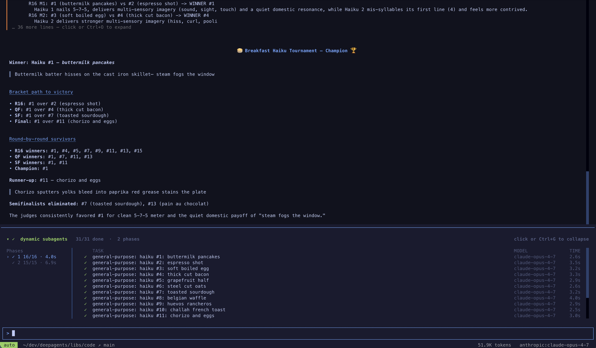

把自定义的同步 [subagents](/oss/deepagents/subagents) 定义成 markdown 文件，这样 Deep Agents Code 就能把专门任务委派给它们。

<Note>
    目前 Deep Agents Code 还不向终端最终用户开放异步 subagents。
</Note>

每个 subagent 都放在自己独立的文件夹里，并包含一个 `AGENTS.md` 文件：

```text
.deepagents/agents/{subagent-name}/AGENTS.md   # Project-level
~/.deepagents/{agent}/agents/{subagent-name}/AGENTS.md  # User-level
```

项目 subagent 会覆盖同名的用户 subagent（见 [precedence rules](/oss/deepagents/code/configuration#subagents)）。

## 继续父对话

内置的 `general-purpose` subagent 会继承父 agent 的对话和 system prompt。有了这些上下文，被委派的工作可以直接接着往下做，不需要重复父对话中已经确定的调查、决策或其他细节。

如果想让内置的 `general-purpose` subagent 改为在隔离模式下运行，请在你的 shell 或全局 `~/.deepagents/.env` 中设置以下变量：

```bash
export DEEPAGENTS_CODE_FORKED_SUBAGENTS=false
```

frontmatter 里必须包含 `name` 和 `description`（与 [`SubAgent` dictionary spec](/oss/deepagents/subagents#subagent-dictionary-based) 一致）。markdown 正文会成为 subagent 的 `system_prompt`。除了基础规范外，`AGENTS.md` 还支持一个可选的 `model` frontmatter 字段，用来覆盖主 agent 在这个 subagent 上使用的模型。请使用 `provider:model-name` 格式，例如 `anthropic:claude-opus-4-8`、`openai:gpt-6.1-sol`。如果省略，就继承主 agent 的模型。

<Note>
    其他 `SubAgent` 字段（`tools`、`middleware`、`interrupt_on`、`skills`）目前不能通过 `AGENTS.md` frontmatter 配置。用这种方式定义的自定义 subagent 会继承主 agent 的 tools。若需要完整控制，请直接使用 SDK。
</Note>

## 文件格式

subagent 的 `AGENTS.md` 文件使用 YAML frontmatter，后接 markdown 正文：

```markdown
---
name: researcher
description: Research topics on the web before writing content
model: anthropic:claude-haiku-5-5
---

You are a research assistant with access to web search.

## Your Process
1. Search for relevant information
2. Summarize findings clearly
```

## 动态 subagent

`dcode` 自带已启用的 code interpreter，因此[动态 subagent](/oss/deepagents/dynamic-subagents)开箱即用。

要触发动态 subagent，可以要求执行一个 "workflow"。agent 不会自己完成工作，也不会通过其原生 `task` 工具管理 fan-out，而是编写一个编排脚本，调用内置的 `task()` global，并在 code interpreter 中运行它。例如："Run a workflow to review every file in src/ for SQL injection."

随着 subagent 被创建，`dcode` 会在动态 subagent 面板中实时显示它们，并按派发过程分组到不同阶段。

<Frame>
  
</Frame>

你也可以通过 [ACP](/oss/deepagents/acp) 在你选择的编码 agent 中使用动态 subagent（例如 Zed）。

## 示例：成本更低的 subagent

对于简单的委派任务，可以使用更便宜、更快的模型，同时让主 agent 继续运行在更强的模型上：

```markdown
---
name: general-purpose
description: General-purpose agent for research and multi-step tasks
model: anthropic:claude-haiku-5-5
---

You are a general-purpose assistant. Complete the task efficiently and return a concise summary.
```

这会覆盖内置的 general-purpose subagent，把所有委派任务路由到更便宜的模型。更多信息见 [Override the general-purpose subagent](/oss/deepagents/subagents#override-the-general-purpose-subagent)。
