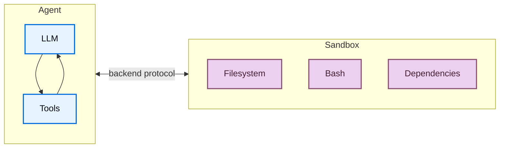
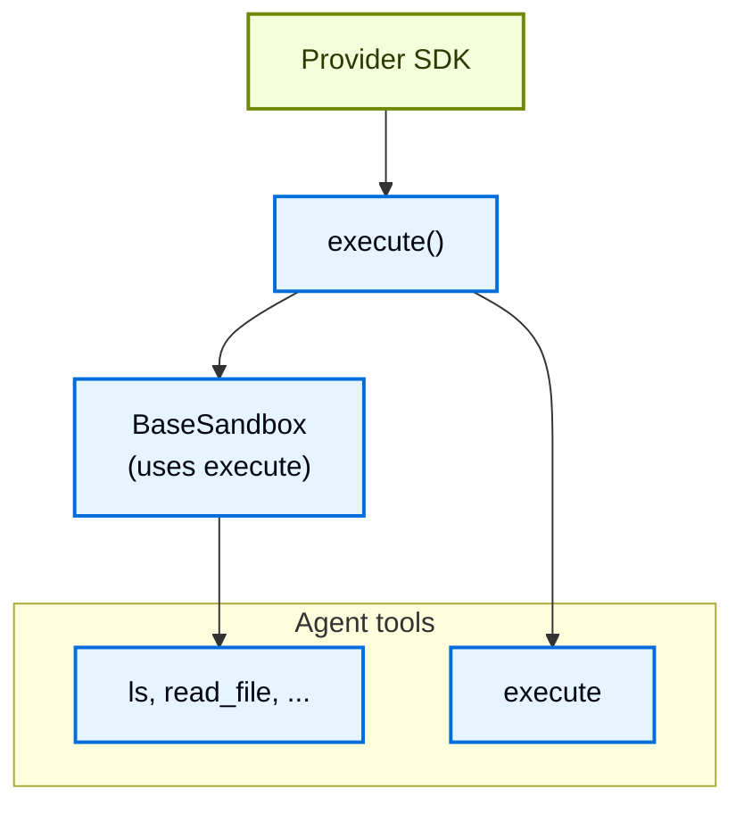
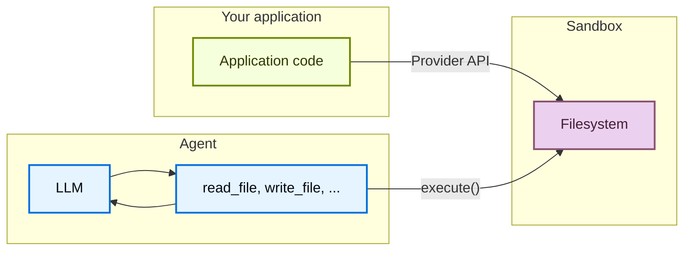

import SandboxesBasicTabsPy from '/snippets/sandboxes-basic-tabs-py.mdx';
import DeepagentsSandboxBasicJs from '/snippets/code-samples/deepagents-sandbox-basic-js.mdx';
import DeepagentsSandboxLifecycleFactoryThreadTs from '/snippets/code-samples/deepagents-sandbox-lifecycle-factory-thread-js.mdx';
import DeepagentsSandboxLifecycleFactoryAssistantTs from '/snippets/code-samples/deepagents-sandbox-lifecycle-factory-assistant-js.mdx';
import DeepagentsSandboxLifecycleFactoryThreadPy from '/snippets/code-samples/deepagents-sandbox-lifecycle-factory-thread-py.mdx';
import DeepagentsSandboxLifecycleFactoryAssistantPy from '/snippets/code-samples/deepagents-sandbox-lifecycle-factory-assistant-py.mdx';
import DeepagentsSandboxAsToolPy from '/snippets/code-samples/deepagents-sandbox-as-tool-py.mdx';
import DeepagentsSandboxAsToolJs from '/snippets/code-samples/deepagents-sandbox-as-tool-js.mdx';
import DeepagentsSandboxExecuteLangsmithPy from '/snippets/code-samples/deepagents-sandbox-execute-langsmith-py.mdx';
import DeepagentsSandboxUploadJs from '/snippets/code-samples/deepagents-sandbox-upload-js.mdx';
import DeepagentsSandboxDownloadJs from '/snippets/code-samples/deepagents-sandbox-download-js.mdx';
import DeepagentsSandboxUploadLangsmithPy from '/snippets/code-samples/deepagents-sandbox-upload-langsmith-py.mdx';
import DeepagentsSandboxDownloadLangsmithPy from '/snippets/code-samples/deepagents-sandbox-download-langsmith-py.mdx';

Agent 会生成代码、与文件系统交互并运行 shell 命令。由于无法预测 agent 可能会做什么，隔离其环境非常重要，这样它就无法访问凭据、文件或网络。沙箱通过在 agent 的执行环境与主机系统之间创建边界来提供这种隔离。

在 Deep Agents 中，**沙箱是定义 agent 运行环境的[后端](/oss/deepagents/backends)**。其他后端（State、Filesystem、Store）只提供文件操作，而沙箱后端还为 agent 提供用于运行 shell 命令的 `execute` 工具。配置沙箱后端后，agent 会获得：

:::python
- 所有标准文件系统工具（`ls`、`read_file`、`write_file`、`edit_file`、`delete`、`glob`、`grep`）
:::
:::js
- 所有标准文件系统工具（`ls`、`read_file`、`write_file`、`edit_file`、`glob`、`grep`）
:::
- 用于在沙箱中运行任意 shell 命令的 `execute` 工具
- 保护主机系统的安全边界



## 为什么要使用沙箱？

沙箱用于保障安全。
它们让 agent 可以执行任意代码、访问文件并使用网络，而不会危及你的凭据、本地文件或主机系统。
当 agent 自主运行时，这种隔离至关重要。

沙箱特别适用于：

- 编码 agent：自主运行的 agent 可以使用 shell、git、克隆仓库（许多提供商提供原生 git API，例如 [Daytona 的 git 操作](https://www.daytona.io/docs/en/git-operations/)），并运行 Docker-in-Docker 来构建和测试流水线
- 数据分析 agent：在安全、隔离的环境中加载文件、安装数据分析库（pandas、numpy 等）、运行统计计算，并创建 PowerPoint 演示文稿等输出

<Tip>
    **使用 Deep Agents Code？** Deep Agents Code 通过 `--sandbox` 标志内置沙箱支持。有关 Deep Agents Code 特定的设置、标志（`--sandbox-id`、`--sandbox-setup`）和示例，请参阅[使用远程沙箱](/oss/deepagents/code/remote-sandboxes)。
</Tip>

<Note>
**如果你在寻找 LangSmith 沙箱：** LangSmith 提供第一方托管沙箱，你可以直接从 LangSmith UI 或 SDK 使用，无需第三方账户。有关托管沙箱资源、快照、服务 URL 和身份验证代理，请参阅 [LangSmith Sandboxes](/langsmith/sandboxes)。
</Note>

## 基本用法

这些示例假设你已经使用提供商的 SDK 创建了沙箱或 devbox，并配置好了凭据。有关注册、身份验证和提供商特定的生命周期详情，请参阅[可用提供商](#available-providers)。

:::js
<DeepagentsSandboxBasicJs />
:::

:::python
<SandboxesBasicTabsPy />
:::

<Tip>
[LangSmith](https://smith.langchain.com) trace 会显示沙箱内运行了哪些 shell 命令，以及 agent 如何使用文件系统工具。按照[可观测性快速入门](/langsmith/observability-quickstart)完成设置。有关托管沙箱服务，请参阅 [LangSmith Sandboxes](/langsmith/sandboxes)。

建议同时配置 [LangSmith Engine](/langsmith/engine)，它会监控 trace、发现问题并提出修复建议。
</Tip>

## 可用的提供商

有关提供商特定的设置、身份验证和生命周期详情，请参阅[沙箱集成](/oss/integrations/sandboxes)。

## 生命周期和范围

大多数应用选择为每个 [thread](/langsmith/use-threads) 使用一个沙箱（thread 作用域），或为同一 [assistant](/langsmith/assistants) 上的所有 thread 共用一个沙箱（assistant 作用域）。

沙箱在关闭前会持续消耗资源并产生费用。确保在不再使用后关闭沙箱。

有关完整的生命周期表、异步[图工厂](/langsmith/graph-rebuild)说明、TTL 行为、LangGraph Deployment 接入方式和客户端示例，请参阅 Going to production 中的[沙箱生命周期](/oss/deepagents/going-to-production#lifecycle)。

### Thread 作用域（默认）

每个对话都有自己的沙箱。首次运行会创建它，同一 thread 上的后续轮次会复用它。当 thread 结束或沙箱 TTL 到期时，环境会被销毁。按下例使用沙箱名称或元数据存储映射，使每次运行都解析到同一个沙箱。

<Tip>
当用户可能在空闲一段时间后返回时，请为沙箱配置 TTL，让提供商自动删除或归档空闲环境。
</Tip>

:::js
<DeepagentsSandboxLifecycleFactoryThreadTs />
:::

:::python
<DeepagentsSandboxLifecycleFactoryThreadPy />
:::

### Assistant 作用域

同一 assistant 上的每个 thread 都复用同一个沙箱。文件、已安装的软件包和克隆的仓库会在对话之间保留。

<Warning>
Assistant 作用域的沙箱会随时间累积沙箱内状态。请向沙箱提供商配置 TTL、使用快照定期重置，或实现清理逻辑，以免磁盘和内存无限制增长。
</Warning>

:::js
<DeepagentsSandboxLifecycleFactoryAssistantTs />
:::

:::python
<DeepagentsSandboxLifecycleFactoryAssistantPy />
:::

有关在图工厂之外手动创建、执行和销毁沙箱的示例，请参阅[基本用法](#basic-usage)；有关提供商特定的 API，请参阅[沙箱集成](/oss/integrations/sandboxes)。

## 集成模式

根据 agent 的运行位置，将 agent 与沙箱集成有两种架构模式。

### Agent 在沙箱中运行模式

Agent 在沙箱内运行，你通过网络与它通信。你构建一个预装 agent 框架的 Docker 或 VM 镜像，在沙箱内运行它，然后从外部连接并发送消息。

优势：

- ✅ 与本地开发环境高度一致。
- ✅ Agent 与环境紧密耦合。

权衡：

- 🔴 API 密钥必须存放在沙箱内（安全风险）。
- 🔴 更新需要重新构建镜像。
- 🔴 需要通信基础设施（WebSocket 或 HTTP 层）。

要在沙箱中运行 agent，请构建镜像并在其上安装 deepagents。

```dockerfile
FROM python:3.11
RUN pip install deepagents-code
```

然后在沙箱内运行 agent。
要在沙箱内使用 agent，你必须添加额外基础设施，以处理应用与沙箱内 agent 之间的通信。

### 沙箱作为工具模式

Agent 在你的机器或服务器上运行。当它需要执行代码时，会调用沙箱工具（例如 `execute`、`read_file` 或 `write_file`），这些工具调用提供商的 API 在远程沙箱中执行操作。

优势：

- ✅ 无需重新构建镜像即可即时更新 agent 代码。
- ✅ Agent 状态与执行之间更清晰的分离。
    - API 密钥保留在沙箱之外。
    - 沙箱故障不会丢失 agent 状态。
    - 可以选择在多个沙箱中并行运行任务。
- ✅ 只需为执行时间付费。

权衡：

- 🔴 每次执行调用都有网络延迟。

:::python

<DeepagentsSandboxAsToolPy />

:::

:::js

<DeepagentsSandboxAsToolJs />

:::

本文档中的示例使用沙箱作为工具模式。
如果提供商的 SDK 负责通信层，并且你希望生产环境与本地开发保持一致，请选择 agent 在沙箱中运行模式。
如果你需要快速迭代 agent 逻辑、将 API 密钥保留在沙箱之外，或更倾向于清晰的关注点分离，请选择沙箱作为工具模式。

## 沙箱如何工作

### 隔离边界

所有沙箱提供商都会保护你的主机系统免受 agent 的文件系统和 shell 操作影响。Agent 无法读取你的本地文件、访问你机器上的环境变量或干扰其他进程。然而，仅靠沙箱**不能**防范：

- **上下文注入**：控制 agent 部分输入的攻击者可以指示它在沙箱内运行任意命令。沙箱是隔离的，但 agent 在其中拥有完全控制权。
- **网络外泄**：除非网络访问被阻止，否则被上下文注入的 agent 可以通过 HTTP 或 DNS 将数据发送出沙箱。一些提供商支持阻止网络访问（例如 Modal 上的 `blockNetwork: true`）。

有关如何处理机密并缓解这些风险，请参阅[安全注意事项](#security-considerations)。

### `execute` 方法

沙箱后端架构简单：提供商唯一必须实现的方法是 `execute()`，它运行 shell 命令并返回其输出。

:::python
其他所有文件系统操作（`read`、`write`、`edit`、`delete`、`ls`、`glob`、`grep`）都由 @[`BaseSandbox`] 基类构建在 `execute()` 之上，该基类构造脚本并通过 `execute()` 在沙箱内运行它们。
:::
:::js
其他所有文件系统操作（`read`、`write`、`edit`、`ls`、`glob`、`grep`）都由 @[`BaseSandbox`] 基类构建在 `execute()` 之上，该基类构造脚本并通过 `execute()` 在沙箱内运行它们。
:::



这种设计意味着：
- **添加新的提供商很简单。** 实现 `execute()` 即可，基类会处理其他所有事情。
- **`execute` 工具是有条件提供的。** 在每次模型调用时，harness 都会检查后端是否实现 @[`SandboxBackendProtocol`]。如果没有实现，该工具会被过滤掉，agent 永远不会看到它。

当 agent 调用 `execute` 工具时，它提供 `command` 字符串，并收到合并的 stdout/stderr、退出码，以及输出过大时的截断提示。

你也可以直接在应用代码中调用后端的 `execute()` 方法。

:::python
<Tabs>
    <Tab title="LangSmith">
        <DeepagentsSandboxExecuteLangsmithPy />
    </Tab>
    <Tab title="AgentCore">
        <CodeGroup>
            ```bash pip
            pip install langchain-agentcore-codeinterpreter
            ```

            ```bash uv
            uv add langchain-agentcore-codeinterpreter
            ```
        </CodeGroup>

        ```python
        from bedrock_agentcore.tools.code_interpreter_client import CodeInterpreter

        from langchain_agentcore_codeinterpreter import AgentCoreSandbox

        interpreter = CodeInterpreter(region="us-west-2")
        interpreter.start()

        backend = AgentCoreSandbox(interpreter=interpreter)

        try:
            result = backend.execute("python3 --version")
            print(result.output)
        finally:
            interpreter.stop()
        ```
    </Tab>
    <Tab title="Databricks">
        <CodeGroup>
            ```bash pip
            pip install 'databricks-langchain[deepagents]>=0.22.0'
            ```

            ```bash uv
            uv add 'databricks-langchain[deepagents]>=0.22.0'
            ```
        </CodeGroup>

        ```python
        from databricks.sdk import WorkspaceClient

        from databricks_langchain import DatabricksSandbox

        client = WorkspaceClient()
        backend = DatabricksSandbox(client, "sandboxes/my-sandbox")

        result = backend.execute("python --version")
        print(result.output)
        ```
    </Tab>
    <Tab title="Daytona">
        <CodeGroup>
            ```bash pip
            pip install langchain-daytona
            ```

            ```bash uv
            uv add langchain-daytona
            ```
        </CodeGroup>

        ```python
        from daytona import Daytona

        from langchain_daytona import DaytonaSandbox

        sandbox = Daytona().create()
        backend = DaytonaSandbox(sandbox=sandbox)

        result = backend.execute("python --version")
        print(result.output)
        ```
    </Tab>
    <Tab title="E2B">
        <CodeGroup>
            ```bash pip
            pip install langchain-e2b
            ```

            ```bash uv
            uv add langchain-e2b
            ```
        </CodeGroup>

        ```python
        from e2b import Sandbox
        from langchain_e2b import E2BSandbox

        e2b_sandbox = Sandbox.create()
        sandbox = E2BSandbox(sandbox=e2b_sandbox)

        try:
            result = sandbox.execute("python --version")
            print(result.output)
        finally:
            e2b_sandbox.kill()
        ```
    </Tab>
    <Tab title="Modal">
        ```python
        import modal

        from langchain_modal import ModalSandbox

        app = modal.App.lookup("your-app")
        modal_sandbox = modal.Sandbox.create(app=app)
        backend = ModalSandbox(sandbox=modal_sandbox)

        result = backend.execute("python --version")
        print(result.output)
        ```
    </Tab>
    <Tab title="NVIDIA OpenShell">
        <CodeGroup>
            ```bash pip
            pip install langchain-nvidia-openshell
            ```

            ```bash uv
            uv add langchain-nvidia-openshell
            ```
        </CodeGroup>

        ```python
        import openshell

        from langchain_nvidia_openshell import OpenShellSandbox

        with openshell.Sandbox(delete_on_exit=True) as sandbox:
            backend = OpenShellSandbox(sandbox=sandbox)

            result = backend.execute("python3 --version")
            print(result.output)
        ```
    </Tab>
    <Tab title="Runloop">
        <CodeGroup>
            ```bash pip
            pip install langchain-runloop
            ```

            ```bash uv
            uv add langchain-runloop
            ```
        </CodeGroup>

        ```python
        from runloop_api_client import RunloopSDK

        from langchain_runloop import RunloopSandbox

        api_key = "..."
        client = RunloopSDK(bearer_token=api_key)

        devbox = client.devbox.create()
        backend = RunloopSandbox(devbox=devbox)

        try:
            result = backend.execute("python --version")
            print(result.output)
        finally:
            devbox.shutdown()
        ```
    </Tab>
    <Tab title="Vercel">
        <CodeGroup>
            ```bash pip
            pip install langchain-vercel-sandbox
            ```

            ```bash uv
            uv add langchain-vercel-sandbox
            ```
        </CodeGroup>

        ```python
        from vercel.sandbox import Sandbox

        from langchain_vercel_sandbox import VercelSandbox

        sandbox = Sandbox.create(runtime="python3.13")
        backend = VercelSandbox(sandbox=sandbox)

        try:
            result = backend.execute("python --version")
            print(result.output)
        finally:
            sandbox.stop()
        ```
    </Tab>
</Tabs>
:::

例如：

```
4
[Command succeeded with exit code 0]
```

```
bash: foobar: command not found
[Command failed with exit code 127]
```

如果命令产生非常大的输出，结果会自动保存到文件中，并指示 agent 使用 `read_file` 逐步读取。这样可以防止上下文窗口溢出。

### 文件访问的两个层面

文件进出沙箱有两种不同的方式，了解何时使用哪种方式很重要：

:::python
**Agent 文件系统工具**：`read_file`、`write_file`、`edit_file`、`delete`、`ls`、`glob`、`grep`、`execute` 是 LLM 在执行过程中调用的工具。这些工具通过沙箱内的 `execute()` 执行。Agent 使用它们读取代码、写入文件并运行命令，以完成任务。
:::
:::js
**Agent 文件系统工具**：`read_file`、`write_file`、`edit_file`、`ls`、`glob`、`grep`、`execute` 是 LLM 在执行过程中调用的工具。这些工具通过沙箱内的 `execute()` 执行。Agent 使用它们读取代码、写入文件并运行命令，以完成任务。
:::

**文件传输 API**：应用代码调用的 `uploadFiles()` 和 `downloadFiles()` 方法。它们使用提供商的原生文件传输 API（而不是 shell 命令），用于在你宿主环境与沙箱之间移动文件。使用它们可以：
- 在 agent 运行前用源代码、配置或数据**预置沙箱**
- 在 agent 完成后**获取产物**（生成的代码、构建输出、报告）
- **预先填充** agent 所需的依赖项



:::js
## 处理文件

### 预置沙箱

在 agent 运行前使用 `uploadFiles()` 填充沙箱。文件内容以 `Uint8Array` 形式提供：

<DeepagentsSandboxUploadJs />

### 获取产物

在 agent 完成后使用 `downloadFiles()` 从沙箱中获取文件：

<DeepagentsSandboxDownloadJs />

<Note>
在沙箱内，agent 使用自己的文件系统工具（`read_file`、`write_file`），而不是 `uploadFiles` 或 `downloadFiles`。这些方法供应用代码在你的主机与沙箱之间的边界上移动文件。
</Note>
:::

:::python
## 处理文件

deepagents 沙箱后端支持文件传输 API，用于在应用与沙箱之间移动文件。

### 预置沙箱

在 agent 运行前使用 `upload_files()` 填充沙箱。路径必须是绝对路径，内容为 `bytes`：

<Tabs>
    <Tab title="LangSmith">

        <DeepagentsSandboxUploadLangsmithPy />
    </Tab>
    <Tab title="AgentCore">
        <CodeGroup>
            ```bash pip
            pip install langchain-agentcore-codeinterpreter
            ```

            ```bash uv
            uv add langchain-agentcore-codeinterpreter
            ```
        </CodeGroup>

        ```python
        from bedrock_agentcore.tools.code_interpreter_client import CodeInterpreter

        from langchain_agentcore_codeinterpreter import AgentCoreSandbox

        interpreter = CodeInterpreter(region="us-west-2")
        interpreter.start()

        backend = AgentCoreSandbox(interpreter=interpreter)

        backend.upload_files(
            [
                ("hello.py", b"print('Hello')\n"),
                ("data.csv", b"name,value\na,1\nb,2\n"),
            ]
        )
        ```
    </Tab>
    <Tab title="Databricks">
        <CodeGroup>
            ```bash pip
            pip install 'databricks-langchain[deepagents]>=0.22.0'
            ```

            ```bash uv
            uv add 'databricks-langchain[deepagents]>=0.22.0'
            ```
        </CodeGroup>

        ```python
        from databricks.sdk import WorkspaceClient

        from databricks_langchain import DatabricksSandbox

        client = WorkspaceClient()
        backend = DatabricksSandbox(client, "sandboxes/my-sandbox")

        backend.upload_files(
            [
                ("/src/index.py", b"print('Hello')\n"),
                ("/pyproject.toml", b"[project]\nname = 'my-app'\n"),
            ]
        )
        ```
    </Tab>
    <Tab title="Daytona">
        <CodeGroup>
            ```bash pip
            pip install langchain-daytona
            ```

            ```bash uv
            uv add langchain-daytona
            ```
        </CodeGroup>

        ```python
        from daytona import Daytona

        from langchain_daytona import DaytonaSandbox

        sandbox = Daytona().create()
        backend = DaytonaSandbox(sandbox=sandbox)

        backend.upload_files(
            [
                ("/src/index.py", b"print('Hello')\n"),
                ("/pyproject.toml", b"[project]\nname = 'my-app'\n"),
            ]
        )
        ```
    </Tab>
    <Tab title="E2B">
        <CodeGroup>
            ```bash pip
            pip install langchain-e2b
            ```

            ```bash uv
            uv add langchain-e2b
            ```
        </CodeGroup>

        ```python
        from e2b import Sandbox
        from langchain_e2b import E2BSandbox

        e2b_sandbox = Sandbox.create()
        sandbox = E2BSandbox(sandbox=e2b_sandbox)

        try:
            sandbox.upload_files(
                [
                    ("/src/index.py", b"print('Hello')\n"),
                    ("/pyproject.toml", b"[project]\nname = 'my-app'\n"),
                ]
            )
        finally:
            e2b_sandbox.kill()
        ```
    </Tab>
    <Tab title="Modal">
        ```python
        import modal

        from langchain_modal import ModalSandbox

        app = modal.App.lookup("your-app")
        modal_sandbox = modal.Sandbox.create(app=app)
        backend = ModalSandbox(sandbox=modal_sandbox)

        backend.upload_files(
            [
                ("/src/index.py", b"print('Hello')\n"),
                ("/pyproject.toml", b"[project]\nname = 'my-app'\n"),
            ]
        )
        ```
    </Tab>
    <Tab title="Runloop">
        <CodeGroup>
            ```bash pip
            pip install langchain-runloop
            ```

            ```bash uv
            uv add langchain-runloop
            ```
        </CodeGroup>

        ```python
        from runloop_api_client import RunloopSDK

        from langchain_runloop import RunloopSandbox

        api_key = "..."
        client = RunloopSDK(bearer_token=api_key)

        devbox = client.devbox.create()
        backend = RunloopSandbox(devbox=devbox)

        backend.upload_files(
            [
                ("/src/index.py", b"print('Hello')\n"),
                ("/pyproject.toml", b"[project]\nname = 'my-app'\n"),
            ]
        )
        ```
    </Tab>
    <Tab title="Vercel">
        <CodeGroup>
            ```bash pip
            pip install langchain-vercel-sandbox
            ```

            ```bash uv
            uv add langchain-vercel-sandbox
            ```
        </CodeGroup>

        ```python
        from vercel.sandbox import Sandbox

        from langchain_vercel_sandbox import VercelSandbox

        sandbox = Sandbox.create(runtime="python3.13")
        backend = VercelSandbox(sandbox=sandbox)

        backend.upload_files(
            [
                ("/src/index.py", b"print('Hello')\n"),
                ("/pyproject.toml", b"[project]\nname = 'my-app'\n"),
            ]
        )
        ```
    </Tab>
</Tabs>

### 获取产物

在 agent 完成后使用 `download_files()` 从沙箱中获取文件：

<Tabs>
    <Tab title="LangSmith">
        <DeepagentsSandboxDownloadLangsmithPy />
    </Tab>
    <Tab title="AgentCore">
        <CodeGroup>
            ```bash pip
            pip install langchain-agentcore-codeinterpreter
            ```

            ```bash uv
            uv add langchain-agentcore-codeinterpreter
            ```
        </CodeGroup>

        ```python
        from bedrock_agentcore.tools.code_interpreter_client import CodeInterpreter

        from langchain_agentcore_codeinterpreter import AgentCoreSandbox

        interpreter = CodeInterpreter(region="us-west-2")
        interpreter.start()

        backend = AgentCoreSandbox(interpreter=interpreter)

        results = backend.download_files(["hello.py"])
        for result in results:
            if result.content is not None:
                print(f"{result.path}: {result.content.decode()}")
            else:
                print(f"Failed to download {result.path}: {result.error}")

        interpreter.stop()
        ```
    </Tab>
    <Tab title="Databricks">
        <CodeGroup>
            ```bash pip
            pip install 'databricks-langchain[deepagents]>=0.22.0'
            ```

            ```bash uv
            uv add 'databricks-langchain[deepagents]>=0.22.0'
            ```
        </CodeGroup>

        ```python
        from databricks.sdk import WorkspaceClient

        from databricks_langchain import DatabricksSandbox

        client = WorkspaceClient()
        backend = DatabricksSandbox(client, "sandboxes/my-sandbox")

        results = backend.download_files(["/src/index.py", "/output.txt"])
        for result in results:
            if result.content is not None:
                print(f"{result.path}: {result.content.decode()}")
            else:
                print(f"Failed to download {result.path}: {result.error}")
        ```
    </Tab>
    <Tab title="Daytona">
        <CodeGroup>
            ```bash pip
            pip install langchain-daytona
            ```

            ```bash uv
            uv add langchain-daytona
            ```
        </CodeGroup>

        ```python
        from daytona import Daytona

        from langchain_daytona import DaytonaSandbox

        sandbox = Daytona().create()
        backend = DaytonaSandbox(sandbox=sandbox)

        results = backend.download_files(["/src/index.py", "/output.txt"])
        for result in results:
            if result.content is not None:
                print(f"{result.path}: {result.content.decode()}")
            else:
                print(f"Failed to download {result.path}: {result.error}")
        ```
    </Tab>
    <Tab title="E2B">
        <CodeGroup>
            ```bash pip
            pip install langchain-e2b
            ```

            ```bash uv
            uv add langchain-e2b
            ```
        </CodeGroup>

        ```python
        from e2b import Sandbox
        from langchain_e2b import E2BSandbox

        e2b_sandbox = Sandbox.create()
        sandbox = E2BSandbox(sandbox=e2b_sandbox)

        try:
            results = sandbox.download_files(["/src/index.py", "/output.txt"])
            for result in results:
                if result.content is not None:
                    print(f"{result.path}: {result.content.decode()}")
                else:
                    print(f"Failed to download {result.path}: {result.error}")
        finally:
            e2b_sandbox.kill()
        ```
    </Tab>
    <Tab title="Modal">
        ```python
        import modal

        from langchain_modal import ModalSandbox

        app = modal.App.lookup("your-app")
        modal_sandbox = modal.Sandbox.create(app=app)
        backend = ModalSandbox(sandbox=modal_sandbox)

        results = backend.download_files(["/src/index.py", "/output.txt"])
        for result in results:
            if result.content is not None:
                print(f"{result.path}: {result.content.decode()}")
            else:
                print(f"Failed to download {result.path}: {result.error}")
        ```
    </Tab>
    <Tab title="Runloop">
        <CodeGroup>
            ```bash pip
            pip install langchain-runloop
            ```

            ```bash uv
            uv add langchain-runloop
            ```
        </CodeGroup>

        ```python
        from runloop_api_client import RunloopSDK

        from langchain_runloop import RunloopSandbox

        api_key = "..."
        client = RunloopSDK(bearer_token=api_key)

        devbox = client.devbox.create()
        backend = RunloopSandbox(devbox=devbox)

        results = backend.download_files(["/src/index.py", "/output.txt"])
        for result in results:
            if result.content is not None:
                print(f"{result.path}: {result.content.decode()}")
            else:
                print(f"Failed to download {result.path}: {result.error}")
        ```
    </Tab>
    <Tab title="Vercel">
        <CodeGroup>
            ```bash pip
            pip install langchain-vercel-sandbox
            ```

            ```bash uv
            uv add langchain-vercel-sandbox
            ```
        </CodeGroup>

        ```python
        from vercel.sandbox import Sandbox

        from langchain_vercel_sandbox import VercelSandbox

        sandbox = Sandbox.create(runtime="python3.13")
        backend = VercelSandbox(sandbox=sandbox)

        results = backend.download_files(["/src/index.py", "/output.txt"])
        for result in results:
            if result.content is not None:
                print(f"{result.path}: {result.content.decode()}")
            else:
                print(f"Failed to download {result.path}: {result.error}")
        ```
    </Tab>
</Tabs>

<Note>
在沙箱内，agent 使用文件系统工具（`read_file`、`write_file`）。`upload_files` 和 `download_files` 方法供应用代码在你的主机与沙箱之间的边界上移动文件。
</Note>
:::

## 安全注意事项

沙箱将代码执行与主机系统隔离，但不能防范**上下文注入**。控制 agent 部分输入的攻击者可以指示它读取文件、运行命令或从沙箱内窃取数据。这使得沙箱内的凭据尤其危险。

<Warning>
**绝不要将机密放入沙箱。** 注入沙箱的 API 密钥、令牌、数据库凭据和其他机密（通过环境变量、挂载文件或 `secrets` 选项）都可能被上下文注入的 agent 读取并窃取。即使是短期或限定范围的凭据也是如此：如果 agent 能访问它们，攻击者也能访问。
</Warning>

### 安全处理机密

如果 agent 需要调用经过身份验证的 API 或访问受保护的资源，有两种选择：

1. **将机密保留在沙箱外的工具中。** 定义在你的宿主环境（而不是沙箱内）中运行的工具，并在那里处理身份验证。Agent 按名称调用这些工具，但永远不会看到凭据。这是推荐的做法。

2. **使用注入凭据的网络代理。** 一些沙箱提供商支持代理拦截沙箱发出的 HTTP 请求，并在转发前附加凭据（例如 `Authorization` 头）。Agent 永远不会看到机密，只是向 URL 发出普通请求。这种方法尚未在所有提供商中广泛可用。

<Warning>
如果必须将机密注入沙箱（不推荐），请采取以下预防措施：

- 为**所有**工具调用启用[人在回路中](/oss/deepagents/human-in-the-loop)批准，而不仅仅是敏感调用
- 阻止或限制沙箱的网络访问，以缩小外泄途径
- 使用尽可能窄的凭据范围和尽可能短的有效期
- 监控沙箱网络流量，发现意外的出站请求

即使采取了这些防护措施，这仍然是不安全的变通方法。足够巧妙的上下文注入攻击可以绕过输出过滤和人在回路审查。
</Warning>

### 通用最佳实践

- 在应用中根据沙箱输出采取行动前先审查它们
- 不需要时阻止沙箱的网络访问
- 使用 [middleware](/oss/langchain/middleware) 过滤或遮盖工具输出中的敏感模式
- 将沙箱内产生的所有内容视为不受信任的输入
