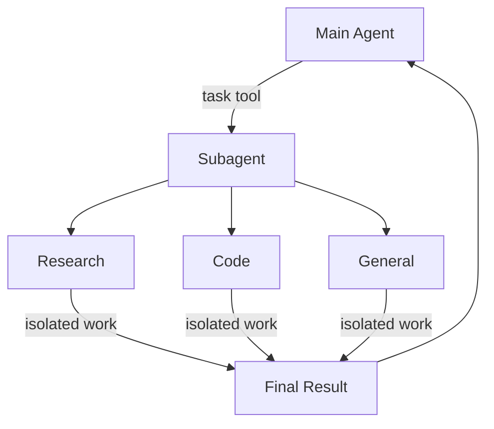
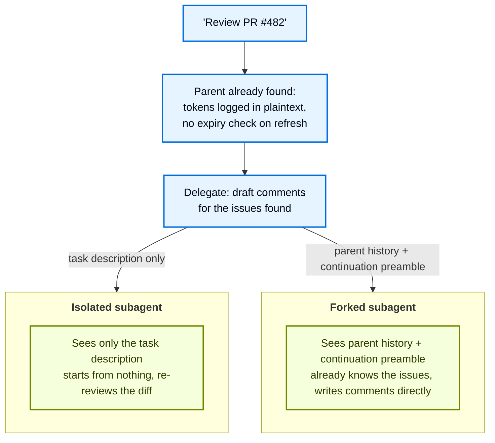
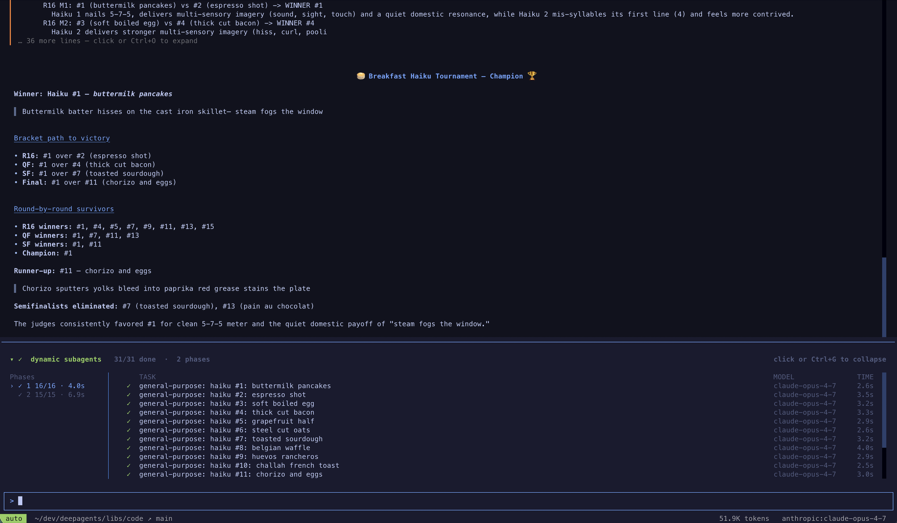
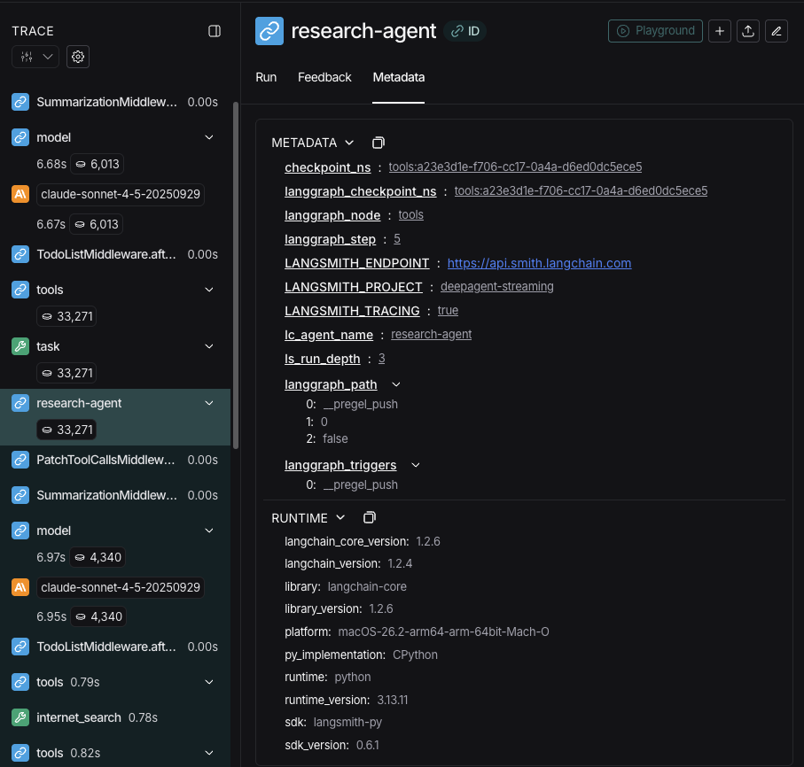
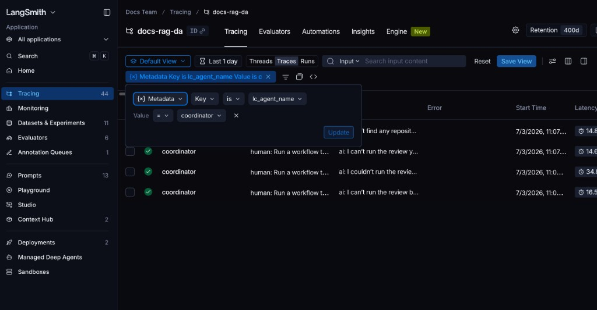

import SubagentBasicPy from '/snippets/code-samples/subagent-basic-py.mdx';
import SubagentBasicJs from '/snippets/code-samples/subagent-basic-js.mdx';
import SubagentStreamProgressPy from '/snippets/code-samples/subagent-stream-progress-py.mdx';
import SubagentStreamProgressJs from '/snippets/code-samples/subagent-stream-progress-js.mdx';
import SubagentsCompiledSubagentPy from '/snippets/code-samples/subagents-compiled-subagent-py.mdx';
import SubagentsCompiledSubagentJs from '/snippets/code-samples/subagents-compiled-subagent-js.mdx';
import ForkedSubagentsBasicPy from '/snippets/code-samples/forked-subagents-basic-py.mdx';
import ForkedSubagentsBasicJs from '/snippets/code-samples/forked-subagents-basic-js.mdx';
import DynamicSubagentsQuickstartPy from '/snippets/code-samples/dynamic-subagents-quickstart-py.mdx';
import DynamicSubagentsQuickstartJs from '/snippets/code-samples/dynamic-subagents-quickstart-js.mdx';
import DynamicSubagentsInvokePy from '/snippets/code-samples/dynamic-subagents-invoke-py.mdx';
import DynamicSubagentsInvokeJs from '/snippets/code-samples/dynamic-subagents-invoke-js.mdx';
import SubagentsStructuredOutputPy from '/snippets/code-samples/subagents-structured-output-py.mdx';
import SubagentsStructuredOutputJs from '/snippets/code-samples/subagents-structured-output-js.mdx';
import SubagentsGeneralPurposeOverridePy from '/snippets/code-samples/subagents-general-purpose-override-py.mdx';
import SubagentsGeneralPurposeOverrideJs from '/snippets/code-samples/subagents-general-purpose-override-js.mdx';
import SkillsSubagentsPy from '/snippets/code-samples/skills-subagents-py.mdx';
import SkillsSubagentsJs from '/snippets/code-samples/skills-subagents-js.mdx';
import SubagentsResearchPromptPy from '/snippets/code-samples/subagents-research-prompt-py.mdx';
import SubagentsResearchPromptJs from '/snippets/code-samples/subagents-research-prompt-js.mdx';
import SubagentsEmailToolsGoodPy from '/snippets/code-samples/subagents-email-tools-good-py.mdx';
import SubagentsEmailToolsGoodJs from '/snippets/code-samples/subagents-email-tools-good-js.mdx';
import SubagentsEmailToolsBadPy from '/snippets/code-samples/subagents-email-tools-bad-py.mdx';
import SubagentsEmailToolsBadJs from '/snippets/code-samples/subagents-email-tools-bad-js.mdx';
import SubagentsChooseModelsPy from '/snippets/code-samples/subagents-choose-models-py.mdx';
import SubagentsChooseModelsJs from '/snippets/code-samples/subagents-choose-models-js.mdx';
import SubagentsConciseResultsPy from '/snippets/code-samples/subagents-concise-results-py.mdx';
import SubagentsConciseResultsJs from '/snippets/code-samples/subagents-concise-results-js.mdx';
import SubagentsMultipleSpecializedPy from '/snippets/code-samples/subagents-multiple-specialized-py.mdx';
import SubagentsMultipleSpecializedJs from '/snippets/code-samples/subagents-multiple-specialized-js.mdx';
import SubagentsContextPropagationPy from '/snippets/code-samples/subagents-context-propagation-py.mdx';
import SubagentsContextPropagationJs from '/snippets/code-samples/subagents-context-propagation-js.mdx';
import SubagentsPerSubagentContextPy from '/snippets/code-samples/subagents-per-subagent-context-py.mdx';
import SubagentsPerSubagentContextJs from '/snippets/code-samples/subagents-per-subagent-context-js.mdx';
import SubagentsSharedLookupPy from '/snippets/code-samples/subagents-shared-lookup-py.mdx';
import SubagentsSharedLookupJs from '/snippets/code-samples/subagents-shared-lookup-js.mdx';
import SubagentsFlexibleSearchPy from '/snippets/code-samples/subagents-flexible-search-py.mdx';
import SubagentsFlexibleSearchJs from '/snippets/code-samples/subagents-flexible-search-js.mdx';
import SubagentsTroubleshootingDescriptionGoodPy from '/snippets/code-samples/subagents-troubleshooting-description-good-py.mdx';
import SubagentsTroubleshootingDescriptionGoodJs from '/snippets/code-samples/subagents-troubleshooting-description-good-js.mdx';
import SubagentsTroubleshootingDescriptionBadPy from '/snippets/code-samples/subagents-troubleshooting-description-bad-py.mdx';
import SubagentsTroubleshootingDescriptionBadJs from '/snippets/code-samples/subagents-troubleshooting-description-bad-js.mdx';
import SubagentsTroubleshootingDelegatePy from '/snippets/code-samples/subagents-troubleshooting-delegate-py.mdx';
import SubagentsTroubleshootingDelegateJs from '/snippets/code-samples/subagents-troubleshooting-delegate-js.mdx';
import SubagentsTroubleshootingConcisePromptPy from '/snippets/code-samples/subagents-troubleshooting-concise-prompt-py.mdx';
import SubagentsTroubleshootingConcisePromptJs from '/snippets/code-samples/subagents-troubleshooting-concise-prompt-js.mdx';
import SubagentsTroubleshootingFilesystemPromptPy from '/snippets/code-samples/subagents-troubleshooting-filesystem-prompt-py.mdx';
import SubagentsTroubleshootingFilesystemPromptJs from '/snippets/code-samples/subagents-troubleshooting-filesystem-prompt-js.mdx';
import SubagentsTroubleshootingDifferentiatePy from '/snippets/code-samples/subagents-troubleshooting-differentiate-py.mdx';
import SubagentsTroubleshootingDifferentiateJs from '/snippets/code-samples/subagents-troubleshooting-differentiate-js.mdx';

深度代理可以创建子代理来委派工作。你可以在 `subagents` 参数中指定自定义子代理。子代理对于[上下文隔离](https://www.dbreunig.com/2025/06/26/how-to-fix-your-context.html#context-quarantine)（保持主代理的上下文干净）以及提供专门指令很有用。

本页介绍**同步**子代理，即 supervisor 会阻塞，直到子代理完成。对于长时间运行的任务、并行工作流，或需要在中途进行引导和取消的场景，请参阅[异步子代理](/oss/deepagents/async-subagents)。



## 为什么要使用子代理？

子代理解决了**上下文膨胀问题**。当代理使用具有大量输出的工具（网络搜索、文件读取、数据库查询）时，上下文窗口很快就会被中间结果填满。子代理隔离了这些详细的工作——主代理只会收到最终结果，而不是产生该结果的数十次工具调用。

**何时使用子代理：**
- ✅ 会让主代理上下文变得杂乱的多步骤任务
- ✅ 需要自定义指令或工具的专业领域
- ✅ 需要不同模型能力的任务
- ✅ 希望主代理专注于高层协调时

**何时不使用子代理：**
- ❌ 简单的单步任务
- ❌ 需要保留中间上下文时
- ❌ 开销超过收益时

## 配置

`subagents` 应该是字典或 @[`CompiledSubAgent`] 对象的列表。有两种类型：

### 默认子代理

Deep Agents 会自动添加一个同步的 `general-purpose` 子代理，除非你已经提供了同名的同步子代理。

`general-purpose` 子代理默认带有文件系统工具，并可以通过额外的工具或中间件进行自定义。

- 要替换它，请传入你自己的名为 `general-purpose` 的子代理。
- 要重命名或重新设定自动添加版本的提示词，请在活动的 [harness profile](/oss/deepagents/profiles#harness-profiles) 上设置 `general_purpose_subagent=GeneralPurposeSubagentProfile(...)`。
- 要禁用它，请参阅下面的[不使用子代理运行](#running-without-subagents)。

### 不使用子代理运行

要在没有 `task` 工具的情况下运行代理，请做两件事：

1. 在活动的 [harness profile](/oss/deepagents/profiles#harness-profiles) 上设置 `general_purpose_subagent=GeneralPurposeSubagentProfile(enabled=False)`。
2. 在 `create_deep_agent` 上通过 `subagents=` 不传入任何同步子代理。

Deep Agents 只有在至少存在一个同步子代理时才会附加 @[`SubAgentMiddleware`]（以及 `task` 工具）。如果既没有默认子代理，也没有调用方提供的子代理，代理就会在没有委派的情况下运行。

异步子代理不受影响——它们走自己的中间件和工具，详见[异步子代理](/oss/deepagents/async-subagents)。

<Tip>
    不要在这里使用 `excluded_middleware`——`SubAgentMiddleware` 是必需的脚手架，列出它会引发 `ValueError`。受支持的路径是 `general_purpose_subagent.enabled = False` 开关。
</Tip>

## 自定义子代理

你可以使用 `subagents` 参数定义带有特定工具的专门子代理。例如担任代码审查员、网络研究员或测试运行器。

对于大多数用例，请使用 [SubAgent 字典](#subagent-dictionary-based)将子代理定义为字典。对于复杂的工作流，请使用 [`CompiledSubAgent`](#compiledsubagent)：

### SubAgent（基于字典）

将子代理定义为与 @[`SubAgent`] 规范匹配的字典，其中包含以下字段：

:::python

| 字段 | 类型 | 描述 |
|-------|------|-------------|
| `name` | `str` | 必需。子代理的唯一标识符。主代理在调用 `task()` 工具时使用此名称。子代理名称会成为 `AIMessage` 的元数据以及流式传输中的元数据，有助于区分不同的代理。 |
| `description` | `str` | 必需。描述该子代理做什么。要具体且以行动为导向。主代理用它来决定何时委派。 |
| `system_prompt` | `str` | 在 `mode: "isolated"`（默认值）下必需。子代理的指令。自定义隔离子代理必须自行定义。请包含工具使用指导和输出格式要求。<br></br>不会从主代理继承。对于 `mode: "fork"`，除非需要仅 fork 生效的附加说明，否则请省略该字段。参见 [Forked 子代理](#forked-subagents)。 |
| `mode` | `"isolated"` \| `"fork"` | 可选。上下文模式。默认为 `"isolated"`，此时子代理只能看到被委派的任务。设为 `"fork"` 则改为继承父代理的对话和系统提示。参见 [Forked 子代理](#forked-subagents)。 |
| `tools` | `list[Callable]` | 可选。子代理可以使用的工具。请保持最小化，只包含需要的内容。<br></br>默认从主代理继承。指定后会完全覆盖继承的工具。 |
| `model` | `str` \| `BaseChatModel` | 可选。覆盖主代理的模型。省略则使用主代理的模型。<br></br>默认从主代理继承。你可以传入模型标识符字符串，例如 `'openai:gpt-6.1-sol'`（使用 `'provider:model'` 格式），也可以传入 LangChain 聊天模型对象（`init_chat_model("gpt-6.1-sol")` 或 `ChatOpenAI(model="gpt-6.1-sol")`）。 |
| `middleware` | `list[Middleware]` | 可选。用于自定义行为、日志记录或速率限制的附加中间件。<br></br>隔离子代理不会继承主代理的自定义中间件。关于 fork 模式下的继承与覆盖，请参见[配置 forked 子代理](#configure-a-forked-subagent)。它会合并进[同步子代理栈](/oss/deepagents/customization#synchronous-subagent-stack)：`.name` 与某个默认项匹配的实例会原位替换该默认项，其余实例会落在最后一个核心中间件条目之后、profile、prompt caching 和 memory 之前。参见[覆盖默认中间件实例](/oss/deepagents/customization#override-a-default-middleware-instance)。例如，可以在这里加入一个带有 `tools` allowlist 的 @[`FilesystemMiddleware`] 实例，以独立于主代理限制该子代理的文件系统工具。更多信息请参见[虚拟文件系统访问](/oss/deepagents/overview#virtual-filesystem-access)下的“限制文件系统工具”一节。 |
| `interrupt_on` | `dict[str, bool \| InterruptOnConfig]` | 可选。为特定工具配置[人在回路](/oss/deepagents/human-in-the-loop)。选项：`True`、`False`，或带有 `allowed_decisions` 的 `InterruptOnConfig`。需要 checkpointer。<br></br>默认从主代理继承。子代理的值会覆盖默认值。 |
| `skills` | `list[str]` | 可选。[Skills](/oss/deepagents/skills) 源路径。指定后，子代理会从这些目录加载技能（例如 `["/skills/researcher/"]`，这是一个容器，其子目录就是各个技能）。这允许子代理拥有与主代理不同的技能集。<br></br>不会从主代理继承。只有 general-purpose 子代理会继承主代理的技能。当子代理拥有技能时，它会运行自己独立的 @[`SkillsMiddleware`] 实例。技能状态完全隔离——子代理加载的技能对父代理不可见，反之亦然。 |
| `response_format` | `ResponseFormat` | 可选。子代理的[结构化输出](/oss/langchain/structured-output) schema。设置后，父代理会以 JSON 形式收到子代理的结果，而不是自由格式文本。接受 Pydantic 模型、`ToolStrategy(...)`、`ProviderStrategy(...)` 或原始 schema 类型。参见[结构化输出](#structured-output)。 |
| `permissions` | `list[FilesystemPermission]` | 可选。子代理的[文件系统权限规则](/oss/deepagents/permissions)。设置后会**完全替换**父代理的权限。<br></br>默认从主代理继承。 |

:::

:::js

| 字段 | 类型 | 描述 |
|-------|------|-------------|
| `name` | `string` | 必需。子代理的唯一标识符。主代理在调用 `task()` 工具时使用此名称。子代理名称会成为 `AIMessage` 的元数据以及流式传输中的元数据，有助于区分不同的代理。 |
| `description` | `string` | 必需。描述该子代理做什么。要具体且以行动为导向。主代理用它来决定何时委派。 |
| `systemPrompt` | `string` | 在 `mode: "isolated"`（默认值）下必需。子代理的指令。自定义隔离子代理必须自行定义。请包含工具使用指导和输出格式要求。<br></br>不会从主代理继承。对于 `mode: "fork"`，除非需要仅 fork 生效的附加说明，否则请省略该字段。参见 [Forked 子代理](#forked-subagents)。 |
| `mode` | `"isolated"` \| `"fork"` | 可选。上下文模式。默认为 `"isolated"`，此时子代理只能看到被委派的任务。设为 `"fork"` 则改为继承父代理的对话和系统提示。参见 [Forked 子代理](#forked-subagents)。 |
| `tools` | `StructuredTool[]` | 可选。子代理可以使用的工具。请保持最小化，只包含需要的内容。<br></br>默认从主代理继承。指定后会完全覆盖继承的工具。 |
| `model` | `LanguageModelLike \| string` | 可选。覆盖主代理的模型。省略则使用主代理的模型。<br></br>默认从主代理继承。你可以传入模型标识符字符串，例如 `'openai:gpt-6.1-sol'`（使用 `'provider:model'` 格式），也可以传入 LangChain 聊天模型对象（`await initChatModel("gpt-6.1-sol")` 或 `new ChatOpenAI({ model: "gpt-6.1-sol" })`）。 |
| `middleware` | `AgentMiddleware[]` | 可选。用于自定义行为、日志记录或速率限制的附加中间件。<br></br>不会从主代理继承。会追加到[同步子代理栈](/oss/deepagents/customization#synchronous-subagent-stack)。 |
| `interruptOn` | `Record<string, boolean \| InterruptOnConfig>` | 可选。为特定工具配置[人在回路](/oss/deepagents/human-in-the-loop)。选项：`True`、`False`，或带有 `allowed_decisions` 的 `InterruptOnConfig`。需要 checkpointer。<br></br>默认从主代理继承。子代理的值会覆盖默认值。 |
| `skills` | `string[]` | 可选。[Skills](/oss/deepagents/skills) 源路径。指定后，子代理会从这些目录加载技能（例如 `["/skills/research/", "/skills/web-search/"]`）。这允许子代理拥有与主代理不同的技能集。<br></br>不会从主代理继承。只有 general-purpose 子代理会继承主代理的技能。当子代理拥有技能时，它会运行自己独立的 @[`SkillsMiddleware`] 实例。技能状态完全隔离——子代理加载的技能对父代理不可见，反之亦然。 |
| `responseFormat` | `ResponseFormat` | 可选。子代理的[结构化输出](/oss/langchain/structured-output) schema。设置后，父代理会以 JSON 形式收到子代理的结果，而不是自由格式文本。接受 Zod schema、JSON schema 对象、`toolStrategy(...)` 或 `providerStrategy(...)`。参见[结构化输出](#structured-output)。 |
| `permissions` | `FilesystemPermission[]` | 可选。子代理的[文件系统权限规则](/oss/deepagents/permissions)。设置后会**完全替换**父代理的权限。<br></br>默认从主代理继承。 |

:::

### CompiledSubAgent

对于复杂的工作流，请使用预构建的 LangGraph 图作为 @[`CompiledSubAgent`]：

| 字段 | 类型 | 描述 |
|-------|------|-------------|
| `name` | `str` | 必需。子代理的唯一标识符。子代理名称会成为 `AIMessage` 的元数据以及流式传输中的元数据，有助于区分不同的代理。 |
| `description` | `str` | 必需。该子代理做什么。 |
| `runnable` | `Runnable` | 必需。一个已编译的 LangGraph 图（必须先调用 `.compile()`）。 |
| `mode` | `"isolated"` \| `"fork"` | 可选。默认为 `"isolated"`。设为 `"fork"` 可继承父代理的消息历史。无论哪种方式，编译后的图都会保留自己的系统提示。参见 [Forked 子代理](#forked-subagents)。 |

## 使用 SubAgent

:::python
<SubagentBasicPy />
:::

:::js
<SubagentBasicJs />
:::

## 使用 CompiledSubAgent

对于更复杂的用例，你可以使用 @[`CompiledSubAgent`] 提供自定义子代理。
你可以使用 LangChain 的 @[`create_agent`] 创建自定义子代理，也可以使用 [graph API](/oss/langgraph/graph-api) 创建自定义 LangGraph 图。

如果要创建自定义 LangGraph 图，请确保该图有一个[名为 `"messages"` 的状态键](/oss/langgraph/quickstart#2-define-state)：

:::python
<SubagentsCompiledSubagentPy />
:::

:::js
<SubagentsCompiledSubagentJs />
:::

## Forked 子代理

默认情况下，子代理以 `mode: "isolated"` 运行：它只看到你给出的任务描述，对导致此次委派的对话毫无记忆。**Forked 子代理**（`mode: "fork"`）则继承父代理的对话历史和状态。

当子代理的任务是继续父代理已经开始的工作时，适合使用 forked 子代理，例如接手父代理已诊断出的问题并完成修复的 worker agent，或者在事件调查中为父代理起草事后复盘的子代理。由于 fork 是在子代理自身上设置的模式，这是你在定义它时做出的决定。



:::python
<Note>
    子代理 fork 需要 `deepagents>=0.7.13`。该功能处于 [**beta**](/oss/versioning) 阶段；API 和行为可能在版本之间变化。
</Note>
:::

:::js
<Note>
    子代理 fork 需要 `deepagents>=1.13.3`。该功能处于 [**beta**](/oss/versioning) 阶段；API 和行为可能在版本之间变化。
</Note>
:::

### 配置 forked 子代理

:::python
在 @[`SubAgent`] 上设置 `mode: "fork"`（默认为 `mode: "isolated"`）。你可以配置以下 @[`SubAgent`] 字段：
`name`、`description`、`tools`、`model`、`middleware`、`interrupt_on`、`permissions` 和 `response_format`。

fork 会继承传给父代理 `create_deep_agent` 的自定义中间件。子代理 `middleware` 列表中与继承实例 `.name` 相同的中间件会替换该继承实例，其余实例会添加到子代理的默认中间件栈中。

默认情况下，fork 会继承传给父代理的所有工具。设置 `tools` 会替换这些工具，而不是在它们基础上追加。例如，只包含一个工具的列表会用该工具替换继承的列表。文件系统和其他由中间件提供的工具会单独添加。

如果提供 `skills` 会被拒绝。`system_prompt` 会作为附注追加到父代理继承的提示之后。除非需要仅 fork 生效的指令，否则请保持不设置。

`wrap_model_call` 钩子通过 `request.system_message` 接收 fork 继承的提示。它可以用 `request.override(system_message=...)` 改写 fork 的传出请求，而不会更改父代理的提示。这与追加指令的 `system_prompt` 不同。

除非你接受缓存复用减少以及模型成本可能升高，否则请避免改写共享的继承前缀或更改工具定义。例如，下面这个钩子片段在继承前缀之前插入文本，会使该前缀无法复用：

```python
from langchain.messages import SystemMessage

rewritten = SystemMessage(content=[
    {"type": "text", "text": "You are a security auditor.\n"},
    *request.system_message.content_blocks,
])
return handler(request.override(system_message=rewritten))
```

额外的中间件或追加的指令并不一定会阻止未更改前缀的复用。

<ForkedSubagentsBasicPy />
:::

:::js
在 @[`SubAgent`] 上设置 `mode: "fork"`（默认为 `mode: "isolated"`）。你可以配置以下 @[`SubAgent`] 字段：
`name`、`description`、`tools`、`model`、`middleware`、`interruptOn`、`permissions` 和 `responseFormat`。

fork 会继承父代理的 skills；不支持设置 `skills`。

保持 `systemPrompt` 不设置即可使用父代理的提示。如果设置，其指令会追加到父代理的提示之后，缩短可用于跨 provider 提示缓存的共享前缀。因此，除非 fork 需要附加指令，否则不建议设置仅 fork 生效的系统提示。

默认情况下，fork 会继承传给父代理的所有工具。设置 `tools` 会替换这些工具，而不是在它们基础上追加。例如，只包含一个工具的列表会用该工具替换继承的列表。文件系统和其他由中间件提供的工具会单独添加。

<ForkedSubagentsBasicJs />
:::

### 工作原理

fork 会收到父代理的有效对话历史，外加被委派的任务描述。Deep Agents 会去掉末尾的委派调用，并在任务描述前附加一段延续性前置说明。如果父代理已压缩其历史，fork 收到的是压缩后的上下文，而不是每条原始消息。

这里所说的 fork，是指为委派的工作继承上下文，而不是复制持久化线程的 checkpoint 历史。子代理收到的是为其本次调用准备好的状态，父代理专有的字段会被排除。当它完成时，其答案会作为普通的工具结果返回，父代理随即继续。

:::python
```python
# What the parent has, right before delegating
[
    HumanMessage("Review the changes in PR #482"),
    AIMessage("", tool_calls=[{"name": "read_diff", "args": {"path": "src/auth/session.py"}}]),
    ToolMessage("- session tokens are logged in plaintext\n- no expiry check on refresh", tool_call_id="1"),
    AIMessage("Found two issues: session tokens are logged in plaintext, and there's no expiry check on refresh."),
    HumanMessage("Good catch. Draft review comments for those."),
    AIMessage("", tool_calls=[{"name": "task", "args": {"subagent_type": "comment-writer", "description": "Draft review comments for the two issues found above."}}]),
]

# What the fork actually sees
[
    HumanMessage("Review the changes in PR #482"),
    AIMessage("", tool_calls=[{"name": "read_diff", "args": {"path": "src/auth/session.py"}}]),
    ToolMessage("- session tokens are logged in plaintext\n- no expiry check on refresh", tool_call_id="1"),
    AIMessage("Found two issues: session tokens are logged in plaintext, and there's no expiry check on refresh."),
    HumanMessage("Good catch. Draft review comments for those."),
    HumanMessage("Continuing as the subagent that was just invoked. Draft review comments for the two issues found above."),
]
```
:::

:::js
```javascript
// What the parent has, right before delegating
[
  new HumanMessage("Review the changes in PR #482"),
  new AIMessage({ content: "", tool_calls: [{ name: "read_diff", args: { path: "src/auth/session.py" } }] }),
  new ToolMessage({ content: "- session tokens are logged in plaintext\n- no expiry check on refresh", tool_call_id: "1" }),
  new AIMessage("Found two issues: session tokens are logged in plaintext, and there's no expiry check on refresh."),
  new HumanMessage("Good catch. Draft review comments for those."),
  new AIMessage({ content: "", tool_calls: [{ name: "task", args: { subagentType: "comment-writer", description: "Draft review comments for the two issues found above." } }] }),
]

// What the fork actually sees
[
  new HumanMessage("Review the changes in PR #482"),
  new AIMessage({ content: "", tool_calls: [{ name: "read_diff", args: { path: "src/auth/session.py" } }] }),
  new ToolMessage({ content: "- session tokens are logged in plaintext\n- no expiry check on refresh", tool_call_id: "1" }),
  new AIMessage("Found two issues: session tokens are logged in plaintext, and there's no expiry check on refresh."),
  new HumanMessage("Good catch. Draft review comments for those."),
  new HumanMessage("Continuing as the subagent that was just invoked. Draft review comments for the two issues found above."),
]
```
:::

fork 可以在其请求与父代理匹配的前缀上复用父代理的 prompt cache。更改系统提示、工具或较早的消息会缩短跨 provider 的共享前缀。保持 fork 的配置不变可以最大化复用，但不保证缓存命中。

@[`CompiledSubAgent`] 也支持 `mode: "fork"`，但由于图已经构建完成，它会保留自己的系统提示。

### 何时使用 fork

从以下维度比较 isolated 和 forked 模式：

| 维度 | isolated（默认） | forked |
|-----------|---------------------|--------|
| **上下文** | 只有你传入的任务描述 | 父代理的有效对话历史和继承的状态，外加任务描述 |
| **系统提示与技能** | 由你在子代理上设置 | 继承技能和父代理的基础提示。可选的系统提示会追加指令，并可能降低缓存复用。 |
| **调用其他子代理** | 可以使用 `task` 工具 | 不能使用 `task`；必须自己完成工作 |
| **最适合** | 需要较少前置上下文的聚焦工作 | 延续父代理已经开始的调查 |

## 动态子代理

默认情况下，主代理通过 `task` 工具调用委派给子代理（它可以在单轮中发出多个调用以并行运行它们）。附加[解释器](/oss/deepagents/interpreters)后，代理可以改为**从代码中**分派子代理——使用循环、分支和并行批次，将工作分散到许多条目上，并以编程方式汇总结果。这称为[动态子代理](/oss/deepagents/dynamic-subagents)。

当工作跨越许多独立单元（审查目录中的每个文件、批量分诊工单）、需要多个视角，或能从递归分析中获益时，适合使用动态子代理。

<Warning>
    动态子代理使用解释器运行时，该运行时处于 [**beta**](/oss/versioning) 阶段。API 和生命周期行为可能随版本变化。
</Warning>

### 启用动态子代理

一旦代理同时拥有子代理和解释器中间件，动态子代理就可用。安装 QuickJS 解释器包，然后向代理添加 `CodeInterpreterMiddleware`。

:::python
<CodeGroup>
```bash pip
pip install -U "deepagents[quickjs]"
```

```bash uv
uv add "deepagents[quickjs]"
```
</CodeGroup>

<DynamicSubagentsQuickstartPy />

<Note>
    只要代理同时拥有子代理和解释器中间件，动态子代理调度就会默认开启。传入 `CodeInterpreterMiddleware(subagents=False)` 可要求通过正常的 `task` 工具路径进行调度。解释器需要 `langchain-quickjs>=0.2.0` 以及 Python 3.11 或更高版本。
</Note>
:::

:::js
<CodeGroup>
```bash npm
npm install deepagents @langchain/quickjs
```

```bash pnpm
pnpm add deepagents @langchain/quickjs
```

```bash yarn
yarn add deepagents @langchain/quickjs
```
</CodeGroup>

<DynamicSubagentsQuickstartJs />

<Note>
    只要代理同时拥有子代理和解释器中间件，动态子代理调度就会默认开启。传入 `createCodeInterpreterMiddleware({ subagents: false })` 可要求通过正常的 `task` 工具路径进行调度。
</Note>
:::

### 触发动态编排

动态调度是隐式的：代理会根据任务的形态决定是否从代码中分散工作，而不是依靠每次调用的标志。

<Tip>
    **“workflow”一词是一个有用的触发器。** 内置解释器系统提示会将“workflow”视为通过解释器组织工作的信号——从代码中用 `task()` 分派子代理。将请求表述为“workflow”是一个有意的杠杆，你可以用它来选择动态编排：当你希望代理从代码中分散工作时就包含它。对于单次直接委派，请改为平实地表述请求。
</Tip>

例如，将请求表述为“workflow”即可选择从代码中扇出：

:::python
<DynamicSubagentsInvokePy />
:::

:::js
<DynamicSubagentsInvokeJs />
:::

关于配置、高级编排模式和安全注意事项，请参阅[动态子代理](/oss/deepagents/dynamic-subagents)。

### 与编码代理一起使用

尝试动态子代理最快的方式是使用 `dcode`，这是基于 Deep Agent 构建的 LangChain 终端编码代理。它自带已启用的代码解释器，因此动态子代理开箱即用，无需任何配置。

安装 `dcode`：

```bash
curl -LsSf https://langch.in/dcode | bash
```

运行它：

```bash
dcode
```

要触发动态子代理，请要求一个“workflow”。代理不会自己硬啃这些工作，也不会通过其原生 `task` 工具管理扇出，而是编写一个编排脚本，调用内置的 `task()` 全局函数并在代码解释器中运行它。例如：“Run a workflow to review every file in src/ for SQL injection.”

随着子代理生成，`dcode` 会在动态子代理面板中实时显示它们，并按调度分组为多个阶段。

<Frame>
  
</Frame>

`dcode` 是尝试此功能最快的方式，但你也可以在任意你选择的编码代理中通过 [ACP](/oss/deepagents/acp) 使用动态子代理（例如 Zed）。

## 流式传输

Deep Agents 支持来自协调器和每个被委派子代理的流式更新。

:::python
使用 [`stream_events`](/oss/deepagents/event-streaming) 获取类型化投影——为子代理、消息、工具调用和值提供独立的迭代器——以便分别消费它们。
:::

:::js
使用 [`streamEvents`](/oss/deepagents/event-streaming) 获取类型化投影——为子代理、消息、工具调用和值提供独立的迭代器——以便分别消费它们。
:::

### 流式传输子代理进度

最简单的模式是迭代 `stream.subagents`，以跟踪每个被委派任务的启动、运行和完成。每个子代理句柄都暴露 `.name`、`.messages`、`.tool_calls` 和 `.output`。

:::python

<SubagentStreamProgressPy />

:::

:::js

<SubagentStreamProgressJs />

:::

### LangSmith 追踪

深度代理运行时，由子代理或协调器执行的所有运行都会在元数据中以 `lc_agent_name` 键携带代理名称——例如 `{'lc_agent_name': 'research-agent'}`。这让你可以在 LangSmith 中按子代理识别和过滤运行。



<Tip>
在 [LangSmith](https://smith.langchain.com) 中打开该运行，将协调器 trace 与每个子代理运行进行比较。按照[可观测性快速入门](/langsmith/observability-quickstart)完成设置。我们还建议你配置 [LangSmith Engine](/langsmith/engine)，它会监控你的 trace、检测问题并提出修复建议。
</Tip>

## 在 LangSmith 中按子代理过滤

由于每个子代理的 `name` 都会写入其产生的每次运行的 `lc_agent_name` 元数据键，你可以使用 LangSmith 的元数据过滤来隔离特定子代理的所有运行——这对于调试、监控或比较子代理随时间的行为很有用。

### 在 LangSmith UI 中过滤

1. 在 [LangSmith](https://smith.langchain.com) 中打开你的追踪项目。
2. 在 Tracing 项目页面上将视图切换为 **Runs**，以查看单个 span。
3. 点击 **Add filter** 并选择 **Metadata**。
4. 将 **Key** 设为 `lc_agent_name`，将 **Value** 设为子代理名称，例如 `coordinator`。



这只显示该子代理产生的运行。你可以将该过滤器保存为命名视图以便复用。关于过滤选项的完整参考，请参阅[过滤 trace](/langsmith/filter-traces)。

### 使用 SDK 以编程方式过滤

在 LangSmith 过滤查询语言中使用 `has` 比较器，按元数据键值对匹配运行：

```python
from langsmith import Client

client = Client()

runs = client.list_runs(
    project_name="<your-project>",
    filter='has(metadata, \'{"lc_agent_name": "research-agent"}\')',
)

for run in runs:
    print(run.name, run.start_time, run.status)
```

要获取来自_任意_命名子代理（不包括主代理）的运行，请过滤出所有具有 `lc_agent_name` 键的运行：

```python
runs = client.list_runs(
    project_name="<your-project>",
    filter="has(metadata, 'lc_agent_name')",
)
```

关于完整的过滤查询语言参考，请参阅 [trace 查询语法](/langsmith/trace-query-syntax)。

## 结构化输出

子代理支持[结构化输出](/oss/langchain/structured-output)，因此父代理会收到可预测、可解析的 JSON，而不是自由格式文本。

:::python
<Note>
    子代理的结构化输出需要 `deepagents>=0.5.3`。
</Note>

在子代理配置上传入 `response_format`。当子代理完成时，其结构化响应会被 JSON 序列化，并作为 `ToolMessage` 内容返回给父代理。该 schema 接受 @[`create_agent`] 支持的任何内容：Pydantic 模型、`ToolStrategy(...)`、`ProviderStrategy(...)` 或原始 schema 类型。

<SubagentsStructuredOutputPy />

:::

:::js
<Note>
    子代理的结构化输出需要 `deepagents>=1.8.4`。
</Note>

在子代理配置上传入 `responseFormat`。当子代理完成时，其结构化响应会被 JSON 序列化，并作为 `ToolMessage` 内容返回给父代理。该 schema 接受 `createAgent` 支持的任何内容：Zod schema、JSON schema 对象、`toolStrategy(...)` 或 `providerStrategy(...)`。

<SubagentsStructuredOutputJs />
:::

如果不传 `response_format`，父代理会原样收到子代理最后一条消息的文本。传入后，父代理始终会获得符合 schema 的有效 JSON，这在父代理需要以编程方式处理结果或将其传给下游工具时很有用。

关于 schema 类型和策略（工具调用与 provider 原生）的完整细节，请参阅[结构化输出](/oss/langchain/structured-output)。

:::python
## 模型拒绝

当子代理的模型拒绝请求时，父代理会收到一条说明该情况的简短任务结果，而不是空结果或失败的运行。父代理随后可以改写任务，或跳过该任务继续执行：

```txt
The subagent stopped because a model refused the request. Retrying the same request is unlikely to succeed; rephrase it or continue without it.
```

对于 Anthropic 模型，结果还会包含拒绝类别，例如 `Category: cyber.`。

这涵盖以下情形：子代理的最后一条消息是 [`refusal` 内容块](/oss/langchain/messages#content-block-reference)；子代理抛出 @[`ModelRefusalError`]（例如使用了 [`ModelRefusalMiddleware`](/oss/langchain/middleware/built-in#model-refusal) 的子代理）；以及结构化输出子代理的拒绝内容无法解析。异步子代理会报告相同的结果。当子代理抛出错误时，父代理不会收到该子代理在拒绝之前更改的任何状态。

主代理自身的模型拒绝时会抛出 @[`ModelRefusalError`]，因为 @[`ModelRefusalMiddleware`] 位于 [Deep Agents 栈](/oss/deepagents/customization#full-stack)中。你传入的 @[`ModelFallbackMiddleware`] 会先捕获拒绝，并在下一个模型上重试请求。应对方式请参阅[处理拒绝](/oss/langchain/middleware/built-in#handle-a-refusal)。

<Note>
子代理拒绝结果需要 `deepagents>=0.7.33`。
</Note>
:::

:::js
## 模型拒绝

当子代理的模型拒绝请求时，父代理会收到一条包含该拒绝的简短任务结果，而不是空结果或失败的运行。父代理随后可以改写任务，或跳过该任务继续执行：

```txt
The subagent stopped because a model refused the request. Retrying the same request is unlikely to succeed; rephrase it or continue without it.
```

对于 Anthropic 模型，结果还会包含拒绝类别，例如 `Category: cyber.`。

这涵盖以下情形：子代理的最后一条消息是 [`refusal` 内容块](/oss/langchain/messages#content-block-reference)；子代理抛出 @[`ModelRefusalError`]（例如使用了 [`modelRefusalMiddleware`](/oss/langchain/middleware/built-in#model-refusal) 的子代理）；以及结构化输出子代理的拒绝内容无法解析。异步子代理会以相同方式在其最后一条消息中报告拒绝。当子代理抛出错误时，父代理不会收到该子代理在拒绝之前更改的任何状态。

主代理自身的模型拒绝时会抛出 @[`ModelRefusalError`]，因为 @[`modelRefusalMiddleware`] 位于 [Deep Agents 栈](/oss/deepagents/customization#full-stack)中。你传入的 @[`modelFallbackMiddleware`] 会先捕获拒绝，并在下一个模型上重试请求。应对方式请参阅[处理拒绝](/oss/langchain/middleware/built-in#handle-a-refusal)。

<Note>
子代理拒绝结果需要 `deepagents>=1.16.4`。
</Note>
:::

## general-purpose 子代理

除了用户定义的任何子代理之外，每个深度代理始终可以访问一个 `general-purpose` 子代理。该子代理：

- 使用自己的[应用了 profile 覆盖的默认系统提示](/oss/deepagents/customization#system-prompt)
- 可以访问所有相同的工具
- 使用相同的模型（除非被覆盖）
- 继承主代理的技能（在配置了技能时）

### 覆盖 general-purpose 子代理

:::python
在 `subagents` 列表中包含一个 `name="general-purpose"` 的子代理即可替换默认值。用它来为 general-purpose 子代理配置不同的模型、工具或系统提示：

<SubagentsGeneralPurposeOverridePy />
:::

:::js
在 `subagents` 列表中包含一个具有 `name: "general-purpose"` 的子代理即可替换默认值。用它来为 general-purpose 子代理配置不同的模型、工具或系统提示：

<SubagentsGeneralPurposeOverrideJs />
:::

当你提供名为 general-purpose 的子代理时，不会再添加默认的 general-purpose 子代理。你的定义会完全替换它。

要完全移除内置的 general-purpose 子代理而不是替换它，请将活动 harness profile 中 general-purpose 子代理的 `enabled` 标志设为 `False`。

### 何时使用它

general-purpose 子代理非常适合在不引入专门行为的情况下实现上下文隔离。主代理可以将复杂的多步骤任务委派给该子代理，并拿回简洁的结果，而不会被中间工具调用撑大上下文。

<Card title="Example">
    与其让主代理执行 10 次网络搜索并用结果填满上下文，不如委派给 general-purpose 子代理：`task(name="general-purpose", task="Research quantum computing trends")`。子代理在内部执行所有搜索，只返回一份摘要。
</Card>

### 技能继承

使用 `create_deep_agent` 配置[技能](/oss/deepagents/skills)时：

- **general-purpose 子代理**：自动继承主代理的技能
- **自定义子代理**：默认不继承技能——使用 `skills` 参数为它们提供自己的技能

<Note>
    只有配置了技能的子代理才会获得 `SkillsMiddleware` 实例——没有 `skills` 参数的自定义子代理不会。存在技能时，技能状态在两个方向上完全隔离：父代理的技能对子代理不可见，子代理的技能也不会回传到父代理。
</Note>

:::python
<SkillsSubagentsPy />
:::

:::js
<SkillsSubagentsJs />
:::

## 最佳实践

### 编写清晰的描述

主代理使用描述来决定调用哪个子代理。要具体：

✅ **好：** `"分析财务数据，并生成带置信度评分的投资洞察"`

❌ **坏：** `"处理财务相关的东西"`

### 保持系统提示详细

包含关于如何使用工具以及如何格式化输出的具体指导：

:::python
<SubagentsResearchPromptPy />
:::

:::js
<SubagentsResearchPromptJs />
:::

### 最小化工具集

只给子代理它们需要的工具。这有助于提高专注度和安全性：

:::python
<SubagentsEmailToolsGoodPy />
:::

:::js
<SubagentsEmailToolsGoodJs />
:::

:::python
<SubagentsEmailToolsBadPy />
:::

:::js
<SubagentsEmailToolsBadJs />
:::

### 按任务选择模型

不同的模型擅长不同的任务：

:::python
<SubagentsChooseModelsPy />
:::

:::js
<SubagentsChooseModelsJs />
:::

### 返回简洁的结果

指示子代理返回摘要，而不是原始数据：

:::python
<SubagentsConciseResultsPy />
:::

:::js
<SubagentsConciseResultsJs />
:::

## 常见模式

### 多个专门子代理

为不同领域创建专门的子代理：

:::python
<SubagentsMultipleSpecializedPy />
:::

:::js
<SubagentsMultipleSpecializedJs />
:::

**工作流程：**
1. 主代理制定高层计划
2. 将数据收集委派给 data-collector
3. 将结果传给 data-analyzer
4. 将洞察发送给 report-writer
5. 汇总最终输出

每个子代理都在干净的上下文中工作，只专注于自己的任务。

## 上下文管理

当你使用[运行时上下文](/oss/langchain/runtime)调用父代理时，该上下文会自动传播到所有子代理。每次子代理运行都会收到你在父代理 `invoke` / `ainvoke` 调用中传入的同一份运行时上下文。

这意味着在任何子代理内运行的工具都能访问你提供给父代理的相同上下文值：

:::python
<SubagentsContextPropagationPy />
:::

:::js
<SubagentsContextPropagationJs />
:::

### 每个子代理的上下文

所有子代理都接收相同的父上下文。要传递特定于某个子代理的配置，可以在扁平的 `context` 映射中使用**命名空间键**（用子代理名称给键加前缀，例如 `researcher:max_depth`），**或者**将这些设置建模为上下文类型上的独立字段：

:::python
<SubagentsPerSubagentContextPy />
:::

:::js
<SubagentsPerSubagentContextJs />
:::

### 识别是哪个子代理调用了工具

当同一个工具在父代理和多个子代理之间共享时，你可以使用 `lc_agent_name` 元数据（与[流式传输](#streaming)中使用的值相同）来判断是哪个代理发起了调用：

:::python
<SubagentsSharedLookupPy />
:::

:::js
<SubagentsSharedLookupJs />
:::

你可以组合这两种模式——在分支工具行为时，从 `runtime.context` 读取代理特定的设置，并从 `runtime.config` 元数据读取 `lc_agent_name`。

:::python
<SubagentsFlexibleSearchPy />
:::

:::js
<SubagentsFlexibleSearchJs />
:::

## 故障排除

### 子代理未被调用

**问题**：主代理试图自己完成工作，而不是进行委派。

**解决方案**：

1. **让描述更具体：**

   :::python
   <SubagentsTroubleshootingDescriptionGoodPy />
   :::

   :::js
   <SubagentsTroubleshootingDescriptionGoodJs />
   :::

   :::python
   <SubagentsTroubleshootingDescriptionBadPy />
   :::

   :::js
   <SubagentsTroubleshootingDescriptionBadJs />
   :::

2. **指示主代理进行委派：**

   :::python
   <SubagentsTroubleshootingDelegatePy />
   :::

   :::js
   <SubagentsTroubleshootingDelegateJs />
   :::

### 上下文仍然变得臃肿

**问题**：尽管使用了子代理，上下文仍然被填满。

**解决方案**：

1. **指示子代理返回简洁的结果：**

   :::python
   <SubagentsTroubleshootingConcisePromptPy />
   :::

   :::js
   <SubagentsTroubleshootingConcisePromptJs />
   :::

2. **对大数据使用文件系统：**

   :::python
   <SubagentsTroubleshootingFilesystemPromptPy />
   :::

   :::js
   <SubagentsTroubleshootingFilesystemPromptJs />
   :::

### 选择了错误的子代理

**问题**：主代理为任务调用了不合适的子代理。

**解决方案**：在描述中清晰地区分子代理：

:::python
<SubagentsTroubleshootingDifferentiatePy />
:::

:::js
<SubagentsTroubleshootingDifferentiateJs />
:::
