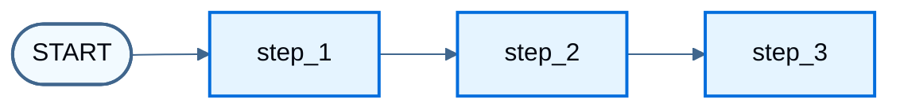
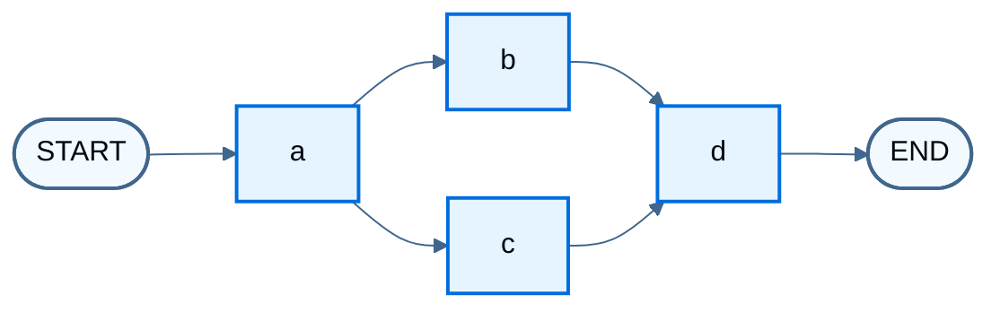
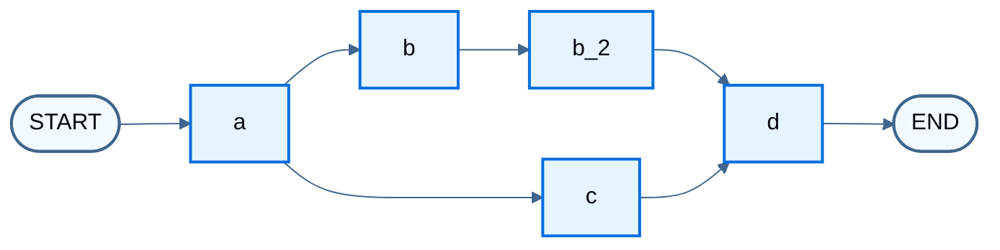
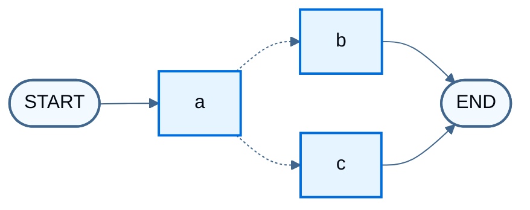
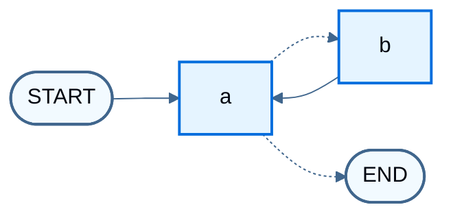
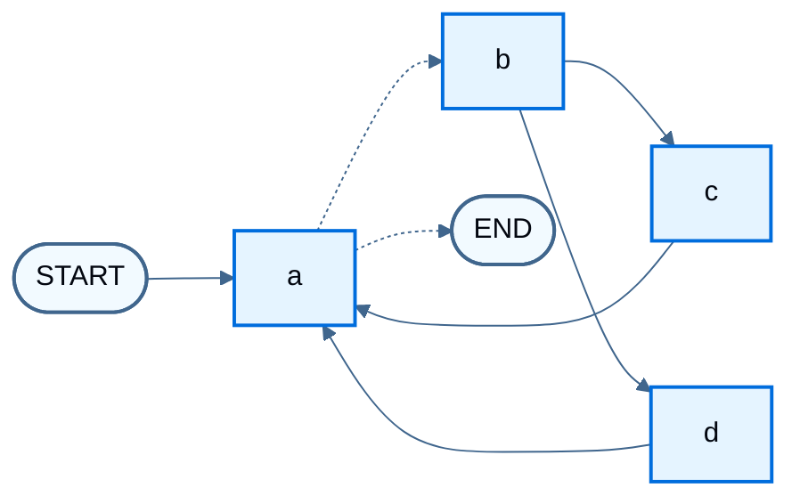

import LanggraphGraphApiControlFlowBranchesConditionalInvokeJs from '/snippets/code-samples/langgraph-graph-api-control-flow-branches-conditional-invoke-js.mdx';
import LanggraphGraphApiControlFlowBranchesConditionalInvokePy from '/snippets/code-samples/langgraph-graph-api-control-flow-branches-conditional-invoke-py.mdx';
import LanggraphGraphApiControlFlowBranchesConditionalJs from '/snippets/code-samples/langgraph-graph-api-control-flow-branches-conditional-js.mdx';
import LanggraphGraphApiControlFlowBranchesConditionalPy from '/snippets/code-samples/langgraph-graph-api-control-flow-branches-conditional-py.mdx';
import LanggraphGraphApiControlFlowBranchesDeferInvokeJs from '/snippets/code-samples/langgraph-graph-api-control-flow-branches-defer-invoke-js.mdx';
import LanggraphGraphApiControlFlowBranchesDeferInvokePy from '/snippets/code-samples/langgraph-graph-api-control-flow-branches-defer-invoke-py.mdx';
import LanggraphGraphApiControlFlowBranchesDeferJs from '/snippets/code-samples/langgraph-graph-api-control-flow-branches-defer-js.mdx';
import LanggraphGraphApiControlFlowBranchesDeferListEdgeJs from '/snippets/code-samples/langgraph-graph-api-control-flow-branches-defer-list-edge-js.mdx';
import LanggraphGraphApiControlFlowBranchesDeferListEdgePy from '/snippets/code-samples/langgraph-graph-api-control-flow-branches-defer-list-edge-py.mdx';
import LanggraphGraphApiControlFlowBranchesDeferPy from '/snippets/code-samples/langgraph-graph-api-control-flow-branches-defer-py.mdx';
import LanggraphGraphApiControlFlowBranchesMultiRouteJs from '/snippets/code-samples/langgraph-graph-api-control-flow-branches-multi-route-js.mdx';
import LanggraphGraphApiControlFlowBranchesMultiRoutePy from '/snippets/code-samples/langgraph-graph-api-control-flow-branches-multi-route-py.mdx';
import LanggraphGraphApiControlFlowBranchesParallelInvokeJs from '/snippets/code-samples/langgraph-graph-api-control-flow-branches-parallel-invoke-js.mdx';
import LanggraphGraphApiControlFlowBranchesParallelInvokePy from '/snippets/code-samples/langgraph-graph-api-control-flow-branches-parallel-invoke-py.mdx';
import LanggraphGraphApiControlFlowBranchesParallelJs from '/snippets/code-samples/langgraph-graph-api-control-flow-branches-parallel-js.mdx';
import LanggraphGraphApiControlFlowBranchesParallelPy from '/snippets/code-samples/langgraph-graph-api-control-flow-branches-parallel-py.mdx';
import LanggraphGraphApiControlFlowLoopsBranchesInvokeJs from '/snippets/code-samples/langgraph-graph-api-control-flow-loops-branches-invoke-js.mdx';
import LanggraphGraphApiControlFlowLoopsBranchesInvokePy from '/snippets/code-samples/langgraph-graph-api-control-flow-loops-branches-invoke-py.mdx';
import LanggraphGraphApiControlFlowLoopsBranchesJs from '/snippets/code-samples/langgraph-graph-api-control-flow-loops-branches-js.mdx';
import LanggraphGraphApiControlFlowLoopsBranchesLimitJs from '/snippets/code-samples/langgraph-graph-api-control-flow-loops-branches-limit-js.mdx';
import LanggraphGraphApiControlFlowLoopsBranchesLimitPy from '/snippets/code-samples/langgraph-graph-api-control-flow-loops-branches-limit-py.mdx';
import LanggraphGraphApiControlFlowLoopsBranchesPy from '/snippets/code-samples/langgraph-graph-api-control-flow-loops-branches-py.mdx';
import LanggraphGraphApiControlFlowLoopsDefineJs from '/snippets/code-samples/langgraph-graph-api-control-flow-loops-define-js.mdx';
import LanggraphGraphApiControlFlowLoopsDefinePy from '/snippets/code-samples/langgraph-graph-api-control-flow-loops-define-py.mdx';
import LanggraphGraphApiControlFlowLoopsImposeLimitJs from '/snippets/code-samples/langgraph-graph-api-control-flow-loops-impose-limit-js.mdx';
import LanggraphGraphApiControlFlowLoopsImposeLimitPy from '/snippets/code-samples/langgraph-graph-api-control-flow-loops-impose-limit-py.mdx';
import LanggraphGraphApiControlFlowLoopsInvokeJs from '/snippets/code-samples/langgraph-graph-api-control-flow-loops-invoke-js.mdx';
import LanggraphGraphApiControlFlowLoopsInvokePy from '/snippets/code-samples/langgraph-graph-api-control-flow-loops-invoke-py.mdx';
import LanggraphGraphApiControlFlowLoopsRecursionLimitJs from '/snippets/code-samples/langgraph-graph-api-control-flow-loops-recursion-limit-js.mdx';
import LanggraphGraphApiControlFlowLoopsRecursionLimitPy from '/snippets/code-samples/langgraph-graph-api-control-flow-loops-recursion-limit-py.mdx';
import LanggraphGraphApiControlFlowLoopsRemainingStepsPy from '/snippets/code-samples/langgraph-graph-api-control-flow-loops-remaining-steps-py.mdx';
import LanggraphGraphApiControlFlowLoopsStepCounterJs from '/snippets/code-samples/langgraph-graph-api-control-flow-loops-step-counter-js.mdx';
import LanggraphGraphApiControlFlowLoopsStepCounterPy from '/snippets/code-samples/langgraph-graph-api-control-flow-loops-step-counter-py.mdx';
import LanggraphGraphApiControlFlowLoopsTerminationJs from '/snippets/code-samples/langgraph-graph-api-control-flow-loops-termination-js.mdx';
import LanggraphGraphApiControlFlowLoopsTerminationPy from '/snippets/code-samples/langgraph-graph-api-control-flow-loops-termination-py.mdx';
import LanggraphGraphApiControlFlowMaxConcurrencyJs from '/snippets/code-samples/langgraph-graph-api-control-flow-max-concurrency-js.mdx';
import LanggraphGraphApiControlFlowSequenceAddSequenceCompilePy from '/snippets/code-samples/langgraph-graph-api-control-flow-sequence-add-sequence-compile-py.mdx';
import LanggraphGraphApiControlFlowSequenceAddSequencePy from '/snippets/code-samples/langgraph-graph-api-control-flow-sequence-add-sequence-py.mdx';
import LanggraphGraphApiControlFlowSequenceBuilderJs from '/snippets/code-samples/langgraph-graph-api-control-flow-sequence-builder-js.mdx';
import LanggraphGraphApiControlFlowSequenceBuilderPy from '/snippets/code-samples/langgraph-graph-api-control-flow-sequence-builder-py.mdx';
import LanggraphGraphApiControlFlowSequenceCompilePy from '/snippets/code-samples/langgraph-graph-api-control-flow-sequence-compile-py.mdx';
import LanggraphGraphApiControlFlowSequenceCustomNameJs from '/snippets/code-samples/langgraph-graph-api-control-flow-sequence-custom-name-js.mdx';
import LanggraphGraphApiControlFlowSequenceCustomNamePy from '/snippets/code-samples/langgraph-graph-api-control-flow-sequence-custom-name-py.mdx';
import LanggraphGraphApiControlFlowSequenceGraphJs from '/snippets/code-samples/langgraph-graph-api-control-flow-sequence-graph-js.mdx';
import LanggraphGraphApiControlFlowSequenceInvokeJs from '/snippets/code-samples/langgraph-graph-api-control-flow-sequence-invoke-js.mdx';
import LanggraphGraphApiControlFlowSequenceInvokePy from '/snippets/code-samples/langgraph-graph-api-control-flow-sequence-invoke-py.mdx';
import LanggraphGraphApiControlFlowSequenceMaxConcurrencyPy from '/snippets/code-samples/langgraph-graph-api-control-flow-sequence-max-concurrency-py.mdx';
import LanggraphGraphApiControlFlowSequenceNodesJs from '/snippets/code-samples/langgraph-graph-api-control-flow-sequence-nodes-js.mdx';
import LanggraphGraphApiControlFlowSequenceNodesPy from '/snippets/code-samples/langgraph-graph-api-control-flow-sequence-nodes-py.mdx';
import LanggraphGraphApiControlFlowSequenceStateJs from '/snippets/code-samples/langgraph-graph-api-control-flow-sequence-state-js.mdx';
import LanggraphGraphApiControlFlowSequenceStatePy from '/snippets/code-samples/langgraph-graph-api-control-flow-sequence-state-py.mdx';

使用 Graph API 组合[序列](#create-a-sequence-of-steps)、[并行分支](#create-branches)、[条件边](#conditional-branching)和[循环](#create-and-control-loops)。关于映射缩减扇出以及从节点返回边，请参阅[使用 Send 和 Command](/oss/langgraph/graph-api-send-command)。关于节点级重试、超时和缓存，请参阅[配置节点](/oss/langgraph/graph-api-nodes)。

## 创建一系列步骤

<Info>
**先决条件**
本指南假设你熟悉[定义和更新状态](/oss/langgraph/graph-api-state)。
</Info>

本节演示如何构建顺序图。Python 还提供了 `add_sequence` 简写来实现同一模式。



:::python
在 [StateGraph](/oss/langgraph/graph-api#stategraph) 上使用 @[`add_node`] 和 @[`add_edge`] 添加节点序列：

<LanggraphGraphApiControlFlowSequenceBuilderPy />

或使用内置的简写 `.add_sequence`：

<LanggraphGraphApiControlFlowSequenceAddSequencePy />
:::

:::js
在 [StateGraph](/oss/langgraph/graph-api#stategraph) 上使用 `.addNode` 和 `.addEdge` 添加节点序列：

<LanggraphGraphApiControlFlowSequenceBuilderJs />
:::

<Accordion title="Why split application steps into a sequence with LangGraph?">

LangGraph 可以在图之下添加持久层。状态在节点之间进行检查点，因此这些节点决定：

* 状态更新如何[创建检查点](/oss/langgraph/persistence)
* 中断如何在 [human-in-the-loop](/oss/langgraph/interrupts) 工作流中恢复
* 如何使用 [time travel](/oss/langgraph/use-time-travel) 回退和分支执行

它们还决定步骤如何被[流式传输](/oss/langgraph/streaming)，以及应用如何在 [Studio](/langsmith/studio) 中可视化和调试。

</Accordion>

下面的端到端示例构建一个包含三个步骤的序列：

1. 在状态的一个键中填充值
2. 更新同一个值
3. 填充另一个值

首先定义[状态](/oss/langgraph/graph-api#state)。关于更新如何合并，请参阅[使用 reducer 处理状态更新](/oss/langgraph/graph-api-state#process-state-updates-with-reducers)。

此示例跟踪两个值：

:::python
<LanggraphGraphApiControlFlowSequenceStatePy />
:::

:::js
<LanggraphGraphApiControlFlowSequenceStateJs />
:::

:::python
[节点](/oss/langgraph/graph-api#nodes)是读取图状态并返回更新的 Python 函数。第一个参数始终是状态：

<LanggraphGraphApiControlFlowSequenceNodesPy />
:::

:::js
[节点](/oss/langgraph/graph-api#nodes)是读取图状态并返回更新的 TypeScript 函数。第一个参数始终是状态：

<LanggraphGraphApiControlFlowSequenceNodesJs />
:::

<Note>
每个节点的更新只能指定它要更改的键。

默认情况下，这会**覆盖**这些键之前的值。如果更新应当追加或合并，请使用 [reducer](/oss/langgraph/graph-api#reducers)。请参阅[使用 reducer 处理状态更新](/oss/langgraph/graph-api-state#process-state-updates-with-reducers)。
</Note>

接下来，在该状态上定义 [StateGraph](/oss/langgraph/graph-api#stategraph) 并连接节点。

:::python
使用 [`add_node`](/oss/langgraph/graph-api#nodes) 和 [`add_edge`](/oss/langgraph/graph-api#edges) 填充图并定义其控制流。

<LanggraphGraphApiControlFlowSequenceBuilderPy />
:::

:::js
使用 [addNode](/oss/langgraph/graph-api#nodes) 和 [addEdge](/oss/langgraph/graph-api#edges) 填充图并定义其控制流。

<LanggraphGraphApiControlFlowSequenceGraphJs />
:::

:::python
<Tip>
**指定自定义名称**
将显式名称作为第一个参数传给 @[`add_node`]：

<LanggraphGraphApiControlFlowSequenceCustomNamePy />
</Tip>
:::

:::js
<Tip>
**指定自定义名称**
将节点名称作为第一个参数传给 `.addNode`：

<LanggraphGraphApiControlFlowSequenceCustomNameJs />
</Tip>
:::

注意：

:::python
* @[`add_edge`] 接收节点名称。对于裸函数，默认名称是 `node.__name__`。
* 图需要一个入口点：从 [START 节点](/oss/langgraph/graph-api#start-node)添加一条边。
* 当没有更多节点要执行时，图停止。

然后[编译](/oss/langgraph/graph-api#compiling-your-graph)图。编译会运行基本结构检查（例如孤立节点）。当应用需要持久化时，在此处传入 [checkpointer](/oss/langgraph/persistence)。

<LanggraphGraphApiControlFlowSequenceCompilePy />
:::

:::js
* `.addEdge` 接收传给 `.addNode` 的节点名称。
* 图需要一个入口点：从 [START 节点](/oss/langgraph/graph-api#start-node)添加一条边。
* 当没有更多节点要执行时，图停止。

然后[编译](/oss/langgraph/graph-api#compiling-your-graph)图。编译会运行基本结构检查（例如孤立节点）。当应用需要持久化时，在此处传入 [checkpointer](/oss/langgraph/persistence)。
:::

调用图：

:::python
<LanggraphGraphApiControlFlowSequenceInvokePy />

```
{'value_1': 'a b', 'value_2': 10}
```
:::

:::js
<LanggraphGraphApiControlFlowSequenceInvokeJs />

```
{ value1: 'a b', value2: 10 }
```
:::

注意：

* 这次调用为一个状态键传入了值。节点也可以写入输入中不存在的键。
* 第一个节点覆盖传入的值。
* 第二个节点更新该值。
* 第三个节点填充另一个键。

:::python
<Tip>
**内置简写**
`langgraph>=0.2.46` 包含用于添加节点序列的内置简写 `add_sequence`。可以按如下方式编译同一个图：

<LanggraphGraphApiControlFlowSequenceAddSequenceCompilePy />
</Tip>
:::

## 创建分支

并行节点执行可加速图运行。LangGraph 使用标准边和 @[conditional_edges][add_conditional_edges] 进行扇出和扇入。以下示例构建分支数据流。对于面向动态目标的映射缩减扇出，请参阅[使用 Send 和 Command](/oss/langgraph/graph-api-send-command)。

### 并行运行图节点

此示例从 `Node A` 扇出到 `B` 和 `C`，再扇入到 `D`。状态使用 [reducer](/oss/langgraph/graph-api#reducers)，使该键的值累积而不是被覆盖。对于列表，这意味着把新列表连接到现有列表。请参阅[使用 reducer 处理状态更新](/oss/langgraph/graph-api-state#process-state-updates-with-reducers)。



:::python
<LanggraphGraphApiControlFlowBranchesParallelPy />
:::

:::js
<LanggraphGraphApiControlFlowBranchesParallelJs />
:::

通过 reducer，可以看到每个节点添加的值都被累加了。

:::python
<LanggraphGraphApiControlFlowBranchesParallelInvokePy />

```
Adding "A" to []
Adding "B" to ['A']
Adding "C" to ['A']
Adding "D" to ['A', 'B', 'C']
```
:::

:::js
<LanggraphGraphApiControlFlowBranchesParallelInvokeJs />

```
Adding "A" to []
Adding "B" to ['A']
Adding "C" to ['A']
Adding "D" to ['A', 'B', 'C']
{ aggregate: ['A', 'B', 'C', 'D'] }
```
:::

<Note>
在上面的示例中，节点 `"b"` 和 `"c"` 在同一个[超级步](/oss/langgraph/graph-api#super-steps)中同时执行。因为它们处于同一步骤，节点 `"d"` 在 `"b"` 和 `"c"` 都完成后执行。

重要的是，来自并行超级步的更新的顺序可能不一致。如果需要对并行超级步的更新进行一致且预先确定的排序，应将输出连同用于排序的值一起写入状态中的单独字段。
</Note>

<Accordion title="Exception handling">
  LangGraph 在[超级步](/oss/langgraph/graph-api#super-steps)中运行节点。超级步中的并行分支并发执行，但该超级步是**事务性的**：只要任一分支抛出异常，该超级步的**所有**更新都不会应用到状态。

  使用 [checkpointer](/oss/langgraph/persistence) 时，已完成的超级步中成功节点的结果会被保存，运行恢复时不会重复。

  对于不可靠的 API 调用等易失败的工作，可以使用以下任一方式：

  :::python
  1. 在节点内部使用普通的 `try` / `except`（或等效写法）。
  2. 在节点上设置 **[`RetryPolicy`](https://reference.langchain.com/python/langgraph/types/#langgraph.types.RetryPolicy)**，让 LangGraph 重试选定的异常。只有失败的分支会重试，成功的同级分支不会重新运行。
  :::

  :::js
  1. 在节点内部使用普通的 `try` / `catch`（或等效写法）。
  2. 在节点上设置 **[`RetryPolicy`](https://reference.langchain.com/javascript/types/_langchain_langgraph.index.RetryPolicy.html)**，让 LangGraph 重试选定的异常。只有失败的分支会重试，成功的同级分支不会重新运行。
  :::

  二者结合，既保留并行执行，又能控制失败的处理方式。完整指南请参阅[容错](/oss/langgraph/fault-tolerance)。
</Accordion>

:::python
<Tip>
**设置最大并发数**
调用图时，将 `max_concurrency` 作为顶层配置键传入（不要放在 `configurable` 下）。请参阅 [RunnableConfig](https://reference.langchain.com/python/langchain-core/runnables/config/RunnableConfig)。

<LanggraphGraphApiControlFlowSequenceMaxConcurrencyPy />
</Tip>
:::

:::js
<Tip>
**设置最大并发数**
调用图时，将 `maxConcurrency` 作为顶层配置键传入（不要放在 `configurable` 下）。请参阅 [LangGraphRunnableConfig](https://reference.langchain.com/javascript/interfaces/_langchain_langgraph.index.LangGraphRunnableConfig.html)。

<LanggraphGraphApiControlFlowMaxConcurrencyJs />
</Tip>
:::

### 推迟节点执行

推迟节点执行会将节点延迟到所有其他待处理任务完成之后。当分支长度不同时这一点很重要，这在映射缩减工作流中很常见。

上面的并行示例在每条路径只有一步时进行扇出和扇入。在 `"b"` 分支上添加节点 `"b_2"`，使路径长度不等。节点 `d` 使用 `defer`，因此会等待较长的分支：



:::python
<LanggraphGraphApiControlFlowBranchesDeferPy />

<LanggraphGraphApiControlFlowBranchesDeferInvokePy />

```
Adding "A" to []
Adding "B" to ['A']
Adding "C" to ['A']
Adding "B_2" to ['A', 'B', 'C']
Adding "D" to ['A', 'B', 'C', 'B_2']
```

节点 `"b"` 和 `"c"` 在同一个超级步中并发运行。节点 `d` 上的 `defer=True` 使它等到所有待处理任务完成后才运行，因此 `"d"` 会等待完整的 `"b"` 分支。

当每个分支总是运行时，可以使用列表形式的边代替 `defer=True` 来等待。`add_edge` 也接受起始节点列表。这并不是多条独立 `add_edge` 调用的简写；两种形式的行为不同：

<LanggraphGraphApiControlFlowBranchesDeferListEdgePy />

- **一组起始节点**：`d` 只运行一次，在列出的所有节点都完成后执行。如果其中某个节点从未运行（例如条件边没有选择它的分支），`d` 就永远不运行，也不会抛出错误。已完成的分支留下的状态更新仍保留在图状态中，但 `d` 不会消费它们。
- **多条独立的边**：在任何一条入边分支完成的每个超级步中，`d` 都会运行一次。如果各分支长度相同，`d` 只运行一次；如果分支长度不同，`d` 会运行多次。
- **带 `defer=True` 的多条独立的边**（即上面示例中的模式）：`d` 只运行一次，在所有被选中的分支都完成之后执行，无论扇出是选中了全部分支还是只有其中一部分。

`defer=True` 会把节点推迟到图中任何位置都没有待处理任务为止，而不仅仅是为它提供输入的分支。发送给该节点的 [`Send`](/oss/langgraph/graph-api-send-command) 仍会单独调用它。
:::

:::js
<LanggraphGraphApiControlFlowBranchesDeferJs />

<LanggraphGraphApiControlFlowBranchesDeferInvokeJs />

```
Adding "A" to []
Adding "B" to []
Adding "C" to []
Adding "B_2" to [ 'A', 'B', 'C' ]
Adding "D" to [ 'A', 'B', 'C', 'B_2' ]
{ aggregate: [ 'A', 'B', 'C', 'B_2', 'D' ] }
```

节点 `"b"` 和 `"c"` 在同一个超级步中并发运行。节点 `"d"` 上的 `{ defer: true }` 使它等到所有待处理任务完成后才运行，因此 `"d"` 会等待完整的 `"b"` 分支。

当每个分支总是运行时，可以使用列表形式的边代替 `{ defer: true }` 来等待。`addEdge` 也接受起始节点列表。这并不是多条独立 `addEdge` 调用的简写；两种形式的行为不同：

<LanggraphGraphApiControlFlowBranchesDeferListEdgeJs />

- **一组起始节点**：`d` 只运行一次，在列出的所有节点都完成后执行。如果其中某个节点从未运行（例如条件边没有选择它的分支），`d` 就永远不运行，也不会抛出错误。已完成的分支留下的状态更新仍保留在图状态中，但 `d` 不会消费它们。
- **多条独立的边**：在任何一条入边分支完成的每个超级步中，`d` 都会运行一次。如果各分支长度相同，`d` 只运行一次；如果分支长度不同，`d` 会运行多次。
- **带 `{ defer: true }` 的多条独立的边**（即上面示例中的模式）：`d` 只运行一次，在所有被选中的分支都完成之后执行，无论扇出是选中了全部分支还是只有其中一部分。

`{ defer: true }` 会把节点推迟到图中任何位置都没有待处理任务为止，而不仅仅是为它提供输入的分支。发送给该节点的 [`Send`](/oss/langgraph/graph-api-send-command) 仍会单独调用它。
:::

### 条件分支

在运行时根据状态路由到不同节点。节点 `a` 更新状态，然后条件边选择 `b` 或 `c`：



虚线边表示条件路由。

:::python
如果扇出需要在运行时根据状态变化，可以使用 @[`add_conditional_edges`] 通过图状态选择一个或多个路径。请参阅下面的示例，其中节点 `a` 生成决定下一个节点的状态更新。

<LanggraphGraphApiControlFlowBranchesConditionalPy />

<LanggraphGraphApiControlFlowBranchesConditionalInvokePy />

```
Adding "A" to []
Adding "C" to ['A']
{'aggregate': ['A', 'C'], 'which': 'c'}
```
:::

:::js
如果扇出需要在运行时根据状态变化，可以使用 [`addConditionalEdges`](https://reference.langchain.com/javascript/classes/_langchain_langgraph.index.StateGraph.html#addconditionaledges) 通过图状态选择一个或多个路径。请参阅下面的示例，其中节点 `a` 生成决定下一个节点的状态更新。

<LanggraphGraphApiControlFlowBranchesConditionalJs />

<LanggraphGraphApiControlFlowBranchesConditionalInvokeJs />

```
Adding "A" to []
Adding "C" to ['A']
{ aggregate: ['A', 'C'], which: 'c' }
```
:::

<Tip>
条件边可以路由到多个目标节点。例如：

:::python
<LanggraphGraphApiControlFlowBranchesMultiRoutePy />
:::

:::js
<LanggraphGraphApiControlFlowBranchesMultiRouteJs />
:::
</Tip>

## 创建和控制循环

循环需要一种停止方式。通常的模式是使用[条件边](/oss/langgraph/graph-api#conditional-edges)，在满足终止条件时路由到 [END](/oss/langgraph/graph-api#end-node)。

也可以在调用或流式传输时设置递归限制。该限制是 LangGraph 抛出错误之前允许的[超级步](/oss/langgraph/graph-api#super-steps)数量。请参阅[递归限制概念](/oss/langgraph/graph-api#recursion-limit)。

以下示例使用一个简单的循环图。节点 `a` 要么继续到 `b`（再返回 `a`），要么退出：



虚线边表示条件路由。

:::python
<Tip>
要在达到限制后捕获 `GraphRecursionError`，请参阅[施加递归限制](#impose-a-recursion-limit)。要在达到限制前路由到完成路径，请参阅[使用 RemainingSteps 处理递归](#handle-recursion-with-remainingsteps)。
</Tip>
:::

:::js
<Tip>
要在达到限制后捕获 `GraphRecursionError`，请参阅[施加递归限制](#impose-a-recursion-limit)。
</Tip>
:::

添加编码终止条件的条件边：

:::python
<LanggraphGraphApiControlFlowLoopsTerminationPy />
:::

:::js
<LanggraphGraphApiControlFlowLoopsTerminationJs />
:::

:::python
要控制递归限制，请在配置中指定 `"recursion_limit"`。这会抛出 `GraphRecursionError`，你可以捕获并处理：
<LanggraphGraphApiControlFlowLoopsRecursionLimitPy />
:::

:::js
要控制递归限制，请在配置中指定 `"recursionLimit"`。这会抛出 `GraphRecursionError`，你可以捕获并处理：
<LanggraphGraphApiControlFlowLoopsRecursionLimitJs />
:::

定义一个带简单循环的图。条件边实现终止条件。

:::python
<LanggraphGraphApiControlFlowLoopsDefinePy />
:::

:::js
<LanggraphGraphApiControlFlowLoopsDefineJs />
:::

这种架构类似于 [ReAct agent](/oss/langgraph/workflows-agents)，其中节点 `"a"` 是工具调用模型，节点 `"b"` 代表工具。

`route` 条件边在 `"aggregate"` 列表超过阈值长度后结束运行。

调用图时，它会在节点 `"a"` 和 `"b"` 之间交替，直到满足该条件。

:::python
<LanggraphGraphApiControlFlowLoopsInvokePy />

```
Node A sees []
Node B sees ['A']
Node A sees ['A', 'B']
Node B sees ['A', 'B', 'A']
Node A sees ['A', 'B', 'A', 'B']
Node B sees ['A', 'B', 'A', 'B', 'A']
Node A sees ['A', 'B', 'A', 'B', 'A', 'B']
```
:::

:::js
<LanggraphGraphApiControlFlowLoopsInvokeJs />

```
Node A sees []
Node B sees ['A']
Node A sees ['A', 'B']
Node B sees ['A', 'B', 'A']
Node A sees ['A', 'B', 'A', 'B']
Node B sees ['A', 'B', 'A', 'B', 'A']
Node A sees ['A', 'B', 'A', 'B', 'A', 'B']
{ aggregate: ['A', 'B', 'A', 'B', 'A', 'B', 'A'] }
```
:::

### 施加递归限制

当无法保证达到终止条件时，设置图的[递归限制](/oss/langgraph/graph-api#recursion-limit)。LangGraph 在这些[超级步](/oss/langgraph/graph-api#super-steps)之后抛出 `GraphRecursionError`。捕获并处理该异常：

:::python
<LanggraphGraphApiControlFlowLoopsImposeLimitPy />

```
Node A sees []
Node B sees ['A']
Node A sees ['A', 'B']
Node B sees ['A', 'B', 'A']
Node A sees ['A', 'B', 'A', 'B']
Recursion Error
```
:::

:::js
<LanggraphGraphApiControlFlowLoopsImposeLimitJs />

```
Node A sees []
Node B sees ['A']
Node A sees ['A', 'B']
Node B sees ['A', 'B', 'A']
Node A sees ['A', 'B', 'A', 'B']
Recursion Error
```
:::

<Accordion title="Extended example: loops with branches">
更复杂的循环在某一步扇出到两个节点：



虚线边表示从 `a` 出发的条件路由。

:::python
<LanggraphGraphApiControlFlowLoopsBranchesPy />
:::

:::js
<LanggraphGraphApiControlFlowLoopsBranchesJs />
:::

此图是[超级步](/oss/langgraph/graph-api#super-steps)的循环：节点 A，然后 B，然后 C 和 D 并发，再回到 A。列表形式的边会等待 `"c"` 和 `"d"` 都完成后才返回 `"a"`。关于列表形式的边与指向同一节点的多条独立边有何不同，请参阅[推迟节点执行](#defer-node-execution)。

不设置递归限制调用时，在达到终止条件前会完成两整圈：

:::python
<LanggraphGraphApiControlFlowLoopsBranchesInvokePy />
:::

:::js
<LanggraphGraphApiControlFlowLoopsBranchesInvokeJs />
:::

```
Node A sees []
Node B sees ['A']
Node D sees ['A', 'B']
Node C sees ['A', 'B']
Node A sees ['A', 'B', 'C', 'D']
Node B sees ['A', 'B', 'C', 'D', 'A']
Node D sees ['A', 'B', 'C', 'D', 'A', 'B']
Node C sees ['A', 'B', 'C', 'D', 'A', 'B']
Node A sees ['A', 'B', 'C', 'D', 'A', 'B', 'C', 'D']
```

将递归限制设为四时，只完成一圈，因为每圈是四个超级步：

:::python
<LanggraphGraphApiControlFlowLoopsBranchesLimitPy />
:::

:::js
<LanggraphGraphApiControlFlowLoopsBranchesLimitJs />
:::

```
Node A sees []
Node B sees ['A']
Node C sees ['A', 'B']
Node D sees ['A', 'B']
Node A sees ['A', 'B', 'C', 'D']
Recursion Error
```
</Accordion>

### 访问和处理递归计数器

节点可以从运行元数据中读取当前步骤。利用这一点在达到限制前做出反应。

:::python
<LanggraphGraphApiControlFlowLoopsStepCounterPy />

#### 使用 RemainingSteps 处理递归

`RemainingSteps` 是仅 Python 提供的托管值，表示距离递归限制还剩多少步。用它可以在 LangGraph 抛出 `GraphRecursionError` 之前路由到完成路径：

<LanggraphGraphApiControlFlowLoopsRemainingStepsPy />

可以在图内部使用 `RemainingSteps` 处理限制，也可以在图外部捕获 `GraphRecursionError`：

| 方式 | 检测 | 处理 | 控制流 |
| --- | --- | --- | --- |
| 主动（`RemainingSteps`） | 达到限制之前 | 在图内部通过条件路由 | 图继续执行到完成路径 |
| 被动（`GraphRecursionError`） | 达到限制之后 | 在图外部通过 `try` / `except` | 图执行停止 |

相关的元数据键包括 `langgraph_node`、`langgraph_triggers`、`langgraph_path` 和 `langgraph_checkpoint_ns`。
:::

:::js
<LanggraphGraphApiControlFlowLoopsStepCounterJs />

相关的元数据键包括 `langgraph_node`、`langgraph_triggers`、`langgraph_path` 和 `langgraph_checkpoint_ns`。优先在图里定义显式的终止条件。在图外部捕获 `GraphRecursionError` 只是安全网。TypeScript 没有与 Python `RemainingSteps` 等价的功能。
:::

## 异步

:::python
当 [IO-bound](https://en.wikipedia.org/wiki/I/O_bound) 工作可以并发运行时，异步会有帮助。要将同步图转换为异步：

1. 使用 `async def` 而不是 `def` 定义节点。
2. 在这些节点内对异步调用使用 `await`。
3. 使用 `.ainvoke` 或 `.astream` 调用。

许多 LangChain 对象实现了 @[Runnable] 协议，该协议提供同步方法的异步变体。异步流式传输示例请参阅[流式传输指南](/oss/langgraph/streaming)。
:::

:::js
TypeScript 图节点以及 `graph.invoke` / `graph.stream` 已经是异步的。在调用处使用 `await`；没有单独的 `.ainvoke` API。
:::

## 另请参阅

- [Graph API 概览](/oss/langgraph/graph-api)
- [使用 Send 和 Command](/oss/langgraph/graph-api-send-command)
- [配置节点](/oss/langgraph/graph-api-nodes)
- [可视化你的图](/oss/langgraph/graph-api-visualize)
- [流式传输](/oss/langgraph/streaming)
