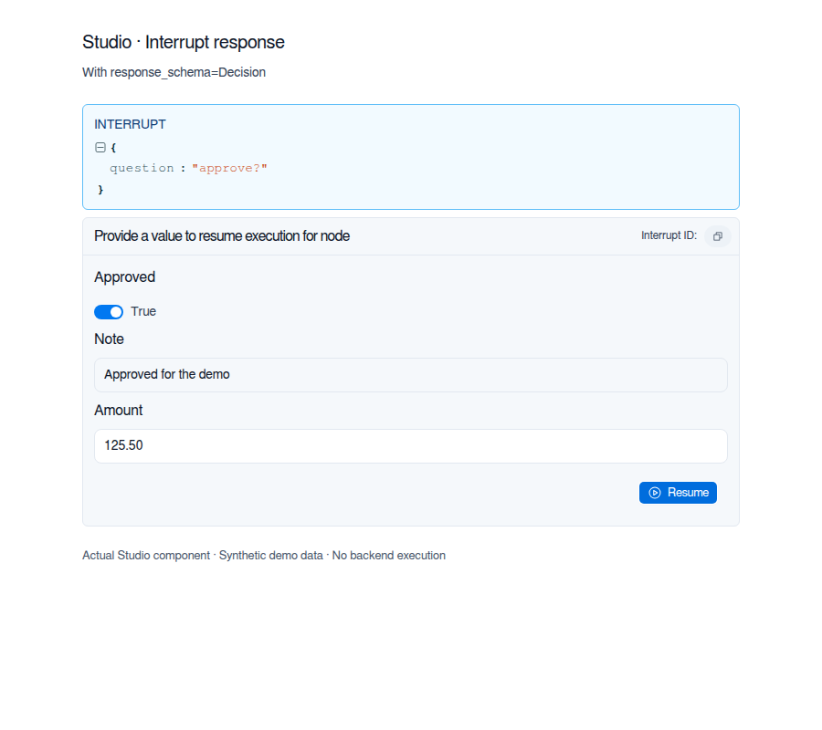
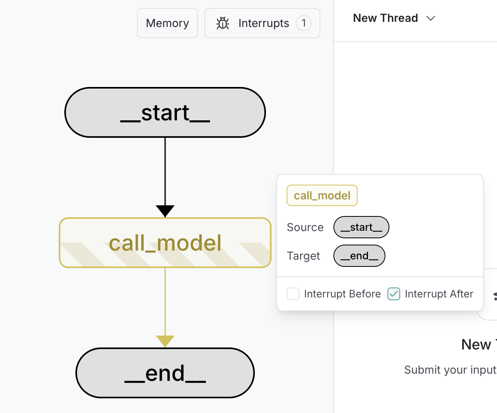

import LanggraphInterruptsResumeV2Py from '/snippets/code-samples/langgraph-interrupts-resume-v2-py.mdx';
import LanggraphInterruptsMultiplePy from '/snippets/code-samples/langgraph-interrupts-multiple-py.mdx';
import LanggraphInterruptsHitlStreamPy from '/snippets/code-samples/langgraph-interrupts-hitl-stream-py.mdx';
import LanggraphInterruptsHitlStreamJs from '/snippets/code-samples/langgraph-interrupts-hitl-stream-js.mdx';
import LanggraphInterruptsApprovalPy from '/snippets/code-samples/langgraph-interrupts-approval-py.mdx';
import LanggraphInterruptsReviewPy from '/snippets/code-samples/langgraph-interrupts-review-py.mdx';
import LanggraphInterruptsValidatePy from '/snippets/code-samples/langgraph-interrupts-validate-py.mdx';
import LanggraphInterruptsValidateConditionalEdgePatternPy from '/snippets/code-samples/langgraph-interrupts-validate-conditional-edge-pattern-py.mdx';
import LanggraphInterruptsValidateConditionalEdgePatternJs from '/snippets/code-samples/langgraph-interrupts-validate-conditional-edge-pattern-js.mdx';
import LanggraphInterruptsValidateConditionalEdgeJs from '/snippets/code-samples/langgraph-interrupts-validate-conditional-edge-js.mdx';
import LanggraphInterruptsValidateConditionalEdgePy from '/snippets/code-samples/langgraph-interrupts-validate-conditional-edge-py.mdx';

Interrupts 让你可以在特定位置暂停图执行，等待外部输入后再继续。它支持需要外部输入才能继续的人机协同模式。触发 interrupt 时，LangGraph 会用[持久化](/oss/langgraph/persistence)层保存图状态，并无限期等待，直到你恢复执行。

Interrupts 的工作方式是在图节点的任意位置调用 `interrupt()` 函数。该函数接受任意可 JSON 序列化的值，并将其呈现给调用方。当你准备好继续时，通过 `Command` 重新调用图来恢复执行，该值随后会成为节点内部 `interrupt()` 调用的返回值。

与静态断点（在特定节点之前或之后暂停）不同，interrupt 是**动态**的：可以放在代码中的任何位置，也可以根据应用逻辑有条件地触发。

:::python
- **Checkpointing 会记录你的位置：** checkpointer 会写入精确的图状态，因此即使处于错误状态，你之后也能恢复。
- **`thread_id` 是你的指针：** 设置 `config={"configurable": {"thread_id": ...}}`，告诉 checkpointer 要加载哪个状态。
- **Interrupt payload 通过 `stream.interrupts` 呈现：** 使用[事件流式传输](/oss/langgraph/event-streaming)（`graph.stream_events(..., version="v3")`）时，传给 `interrupt()` 的值会出现在 `stream.interrupts` 上；当运行因等待输入而暂停时，`stream.interrupted` 为 `True`。
:::
:::js
- **Checkpointing 会记录你的位置：** checkpointer 会写入精确的图状态，因此即使处于错误状态，你之后也能恢复。
- **`thread_id` 是你的指针：** 将 `{ configurable: { thread_id: ... } }` 作为 `invoke` 方法的 options 传入，告诉 checkpointer 要加载哪个状态。
- **Interrupt payload 以 `__interrupt__` 呈现：** 传给 `interrupt()` 的值会通过 `__interrupt__` 字段返回给调用方，让你知道图在等待什么。
:::

你选择的 `thread_id` 实际上就是持久游标。复用它恢复同一个 checkpoint；使用新值会启动一个状态为空的全新 thread。

<a id="pause-using-interrupt"></a>

## 使用 `interrupt` 暂停

@[`interrupt`] 函数暂停图执行，并向调用方返回一个值。当你在节点内调用 @[`interrupt`] 时，LangGraph 保存当前图状态，并等待你带着输入恢复执行。

要使用 @[`interrupt`]，你需要：
1. 一个 **checkpointer** 来持久化图状态（生产环境请使用持久化 checkpointer）
2. 配置中的一个 **thread ID**，让运行时知道从哪个状态恢复
3. 在需要暂停的位置调用 `interrupt()`（payload 必须可 JSON 序列化）

:::python
```python
from langgraph.types import interrupt

def approval_node(state: State):
    # Pause and ask for approval
    approved = interrupt("Do you approve this action?")

    # When you resume, Command(resume=...) returns that value here
    return {"approved": approved}
```
:::

:::js
```typescript
import { interrupt } from "@langchain/langgraph";

async function approvalNode(state: State) {
    // Pause and ask for approval
    const approved = interrupt("Do you approve this action?");

    // Command({ resume: ... }) provides the value returned into this variable
    return { approved };
}
```
:::

调用 @[`interrupt`] 时，会发生以下情况：

1. **图执行被挂起**，位置正是调用 @[`interrupt`] 的地方
2. **状态被保存**，使用 checkpointer 以便之后恢复执行。生产环境中应使用持久化 checkpointer（例如由数据库支持）
:::python
3. **值被返回**给调用方：使用[事件流式传输](/oss/langgraph/event-streaming)（`graph.stream_events(..., version="v3")`）时出现在 `stream.interrupts` 上，使用默认 `invoke()` API 时出现在 `__interrupt__` 下；它可以是任意可 JSON 序列化的值（字符串、对象、数组等）
:::
:::js
3. **值被返回**给调用方并出现在 `__interrupt__` 下；它可以是任意可 JSON 序列化的值（字符串、对象、数组等）
:::
4. **图无限期等待**，直到你带着响应恢复执行
5. **响应在恢复时被传回**节点，成为 `interrupt()` 调用的返回值

<a id="resuming-interrupts"></a>

## 恢复 interrupts

interrupt 暂停执行后，你可以传入包含 resume 值的 `Command` 再次调用图来恢复。resume 值会传回 `interrupt` 调用，让节点可以带着外部输入继续执行。

:::python
驱动可能 interrupt 的图，推荐使用[事件流式传输](/oss/langgraph/event-streaming)：它通过 `stream.interrupts` 和 `stream.interrupted` 呈现 interrupt，并通过 `stream.output` 暴露最终状态。

<LanggraphInterruptsResumeV2Py />

<Note>
默认的 `graph.invoke(...)` API 仍然可用，interrupt 会出现在 `result["__interrupt__"]` 下。不需要流式投影时可以使用它；否则优先使用 `graph.stream_events(..., version="v3")`。
</Note>

**关于恢复的要点：**

- 恢复时必须使用 interrupt 发生时所用的**同一个 thread ID**
- 传给 `Command(resume=...)` 的值会成为 @[`interrupt`] 调用的返回值
- 恢复时，节点会从调用 @[`interrupt`] 的节点开头重新开始，因此 @[`interrupt`] 之前的代码会再次运行
- resume 值可以是任意可 JSON 序列化的值；当你指定类型化的 `response_schema` 时，该值需要接受校验

<Warning>

`Command(resume=...)` 是**唯一**被设计为 `invoke()`/`stream()`/`stream_events()` 输入的 `Command` 用法。其他 `Command` 参数（`update`、`goto`、`graph`）用于[从节点函数返回](/oss/langgraph/graph-api#command)。不要传入 `Command(update=...)` 来继续多轮对话，而应传入普通输入字典。

</Warning>

:::

:::js
```typescript
import { Command } from "@langchain/langgraph";

// Initial run - hits the interrupt and pauses
// thread_id is the durable pointer back to the saved checkpoint
const config = { configurable: { thread_id: "thread-1" } };
const result = await graph.invoke({ input: "data" }, config);

// Check what was interrupted
// __interrupt__ mirrors every payload you passed to interrupt()
console.log(result.__interrupt__);
// [{ value: 'Do you approve this action?', ... }]

// Resume with the human's response
// Command({ resume }) returns that value from interrupt() in the node
await graph.invoke(new Command({ resume: true }), config);
```

**关于恢复的要点：**

- 恢复时必须使用 interrupt 发生时所用的**同一个 thread ID**
- 传给 `new Command({ resume: ... })` 的值会成为 @[`interrupt`] 调用的返回值
- 恢复时，节点会从调用 @[`interrupt`] 的节点开头重新开始，因此 @[`interrupt`] 之前的代码会再次运行
- resume 值可以是任意可 JSON 序列化的值；当你指定 Zod 的 `responseSchema` 时，该值需要接受校验

<Warning>

`new Command({ resume: ... })` 是**唯一**被设计为 `invoke()`/`stream()`/`stream_events()` 输入的 `Command` 用法。其他 `Command` 参数（`update`、`goto`、`graph`）用于[从节点函数返回](/oss/langgraph/graph-api#command)。不要传入 `new Command({ update: ... })` 来继续多轮对话，而应传入普通输入对象。

</Warning>

:::

<a id="define-an-interrupt-response-schema"></a>

## 定义 interrupt 响应模式

:::python
@[`interrupt`] 的 `response_schema` 参数描述恢复图时预期的输入。客户端可以用该模式渲染类型化的输入表单。

<Note>
Interrupt 响应模式需要 `langgraph>=1.2.12`。
</Note>

传入 Pydantic 模型类、`typing_extensions` 中的 `TypedDict` 或 dataclass，用于校验 resume 值。LangGraph 会把该类型转换为 JSON Schema，并放在 `Interrupt.response_schema` 中，与 interrupt 的 `value` payload 分开。返回给调用方的 interrupt 以及 checkpoint 任务 interrupt 中都包含该模式。

以下示例使用 LangGraph interrupt 测试中的审批模式：

```python
from typing import Any

from pydantic import BaseModel
from typing_extensions import TypedDict

from langgraph.checkpoint.memory import InMemorySaver
from langgraph.graph import START, StateGraph
from langgraph.types import Command, interrupt


class Decision(BaseModel):
    approved: bool
    note: str | None = None


class State(TypedDict):
    answer: Any


def node(state: State) -> State:
    answer = interrupt({"question": "approve?"}, response_schema=Decision)
    return {"answer": answer}


graph = (
    StateGraph(State)
    .add_node("node", node)
    .add_edge(START, "node")
    .compile(checkpointer=InMemorySaver())
)
config = {"configurable": {"thread_id": "1"}}

result = graph.invoke({"answer": None}, config)
pending = result["__interrupt__"][0]
assert pending.response_schema == Decision.model_json_schema()

result = graph.invoke(Command(resume={"approved": True}), config)
assert result["answer"] == Decision(approved=True)
```

使用类型化模式时，`interrupt()` 返回校验后的对象：Pydantic 模型实例、`TypedDict` 对应的字典或 dataclass 实例。Pydantic 的校验与类型转换规则同样适用。无效输入会抛出 `pydantic.ValidationError`；你可以用相同的 thread ID，通过修正后的 `Command(resume=...)` 重试。

你也可以传入 JSON Schema 字典作为 `response_schema`。LangGraph 会原样暴露该字典，但**不会**根据它校验 resume 值。省略 `response_schema` 时，其值为 `None`，resume 值会直接通过，不做模式校验。
:::

:::js
@[`interrupt`] 的 `responseSchema` 选项描述恢复图时预期的输入。客户端可以用该模式渲染类型化的输入表单。

<Note>
Interrupt 响应模式需要 `@langchain/langgraph` 1.4.16 或更高版本。
</Note>

传入 Zod 模式来校验 resume 值。LangGraph 会把它转换为 JSON Schema，并放在 `Interrupt.response_schema` 中，与 interrupt 的 `value` payload 分开。返回给调用方的 interrupt 以及 checkpoint 任务 interrupt 中都包含该模式。

以下示例使用 LangGraph interrupt 测试中的审批模式：

```typescript
import {
  Annotation,
  Command,
  MemorySaver,
  START,
  StateGraph,
  interrupt,
} from "@langchain/langgraph";
import { z } from "zod/v4";

const Decision = z.object({
  approved: z.boolean(),
  note: z.string().default(""),
});

const State = Annotation.Root({
  answer: Annotation<unknown>(),
});

const graph = new StateGraph(State)
  .addNode("node", () => ({
    answer: interrupt({ question: "approve?" }, { responseSchema: Decision }),
  }))
  .addEdge(START, "node")
  .compile({ checkpointer: new MemorySaver() });

const config = { configurable: { thread_id: "1" } };

const result = await graph.invoke({ answer: null }, config);
console.log(result.__interrupt__?.[0].response_schema);

const resumed = await graph.invoke(
  new Command({ resume: { approved: true } }),
  config
);
console.log(resumed.answer);
```

使用 Zod 模式时，`interrupt()` 返回解析后的值。在本示例中，结果是 `{ approved: true, note: "" }`，包含默认的 `note`。无效输入会抛出 `ZodError`；你可以用相同的 thread ID，通过修正后的 `new Command({ resume: ... })` 重试。

你也可以传入 JSON Schema 对象作为 `responseSchema`。LangGraph 会原样暴露该对象，但**不会**根据它校验 resume 值。省略 `responseSchema` 时，interrupt 没有 `response_schema` 字段，resume 值会直接通过，不做模式校验。
:::

Studio 会把 interrupt 响应模式渲染为类型化输入字段，而不是 JSON 编辑器。下面这个 Studio 组件预览使用包含审批、备注和数字金额字段的示例数据。



<a id="common-patterns"></a>

## 常见模式

interrupt 带来的核心能力是暂停执行并等待外部输入。它适用于多种场景，包括：

- <Icon icon="circle-check" /> [审批工作流](#approve-or-reject)：在执行关键操作前暂停（API 调用、数据库变更、金融交易）
- <Icon icon="link" /> [处理多个 interrupts](#handling-multiple-interrupts)：在一次调用中恢复多个 interrupt 时，将 interrupt ID 与 resume 值配对
- <Icon icon="pencil" /> [审阅并编辑](#review-and-edit-state)：让人类在继续前审阅并修改 LLM 输出或工具调用
- <Icon icon="tool" /> [中断工具调用](#interrupts-in-tools)：在执行工具调用前暂停，先审阅并编辑工具调用
- <Icon icon="shield-check" /> [校验人工输入](#validating-human-input)：在进入下一步前暂停，校验人工输入

<a id="stream-with-human-in-the-loop-hitl-interrupts"></a>

### 使用人机协同（HITL）interrupt 进行流式传输

构建带人机协同工作流的交互式智能体时，你可以使用[事件流式传输](/oss/langgraph/event-streaming)，在处理 interrupt 的同时消费消息片段和状态快照。

在循环中使用 `graph.stream_events(..., version="v3")` 返回的类型化投影，直到运行结束：
- 通过 `stream.messages` 逐 token 流式获取 AI 响应
- 通过 `stream.values` 观察每一步的状态快照
- 通过 `stream.interrupted` 检测 interrupt，并从 `stream.interrupts` 读取其 payload
- 再次调用 `stream_events` 并传入 `Command(resume=...)` 来恢复执行，重复此过程直到 `stream.interrupted` 为 false

:::python
<LanggraphInterruptsHitlStreamPy />

- **`stream.messages`**：以 content block 形式呈现 chat model 输出；遍历每个 `message.text` 获取 token 增量。对于嵌套子图，从 `stream.subgraphs[*].messages` 读取消息片段。
- **`stream.values`**：每一步后的完整状态快照
- **`stream.interrupted` / `stream.interrupts`**：每次运行后检查图是否暂停；从 `stream.interrupts` 读取 payload
- **`Command(resume=...)`**：作为下一次 `stream_events` 的输入传入以恢复；循环直到运行完成且不再 interrupt
:::

:::js
<LanggraphInterruptsHitlStreamJs />

- **`stream.messages`**：以 content block 形式呈现 chat model 输出；遍历 `message.text` 获取 token 增量。对于嵌套子图，从 `stream.subgraphs[*].messages` 读取消息片段。
- **`stream.values`**：每一步后的完整状态快照
- **`stream.interrupted` / `stream.interrupts`**：每次运行后检查图是否暂停；从 `stream.interrupts` 读取 payload
- **`Command(resume=...)`**：作为下一次 `streamEvents` 的输入传入以恢复；循环直到运行完成且不再 interrupt
:::

<a id="handling-multiple-interrupts"></a>

### 处理多个 interrupts

当并行分支同时触发 interrupt（例如 fan-out 到多个节点，每个节点都调用 `interrupt()`）时，你可能需要在一次调用中恢复多个 interrupt。
在一次调用中恢复多个 interrupt 时，将每个 interrupt ID 映射到其 resume 值。
这样可以确保每个响应在运行时与正确的 interrupt 配对。

:::python

<LanggraphInterruptsMultiplePy />

:::

:::js
```typescript
import {
  Annotation,
  Command,
  END,
  INTERRUPT,
  MemorySaver,
  START,
  StateGraph,
  interrupt,
  isInterrupted,
} from "@langchain/langgraph";

const State = Annotation.Root({
  vals: Annotation<string[]>({
    reducer: (left, right) =>
      left.concat(Array.isArray(right) ? right : [right]),
    default: () => [],
  }),
});

function nodeA(_state: typeof State.State) {
  const answer = interrupt("question_a") as string;
  return { vals: [`a:${answer}`] };
}

function nodeB(_state: typeof State.State) {
  const answer = interrupt("question_b") as string;
  return { vals: [`b:${answer}`] };
}

const graph = new StateGraph(State)
  .addNode("a", nodeA)
  .addNode("b", nodeB)
  .addEdge(START, "a")
  .addEdge(START, "b")
  .addEdge("a", END)
  .addEdge("b", END)
  .compile({ checkpointer: new MemorySaver() });

const config = { configurable: { thread_id: "1" } };

async function main() {
  // Step 1: invoke - both parallel nodes hit interrupt() and pause
  const interruptedResult = await graph.invoke({ vals: [] }, config);
  console.log(interruptedResult);
  /*
  {
    vals: [],
    __interrupt__: [
      { id: '...', value: 'question_a' },
      { id: '...', value: 'question_b' }
    ]
  }
  */

  // Step 2: resume all pending interrupts at once
  const resumeMap: Record<string, string> = {};
  if (isInterrupted(interruptedResult)) {
    for (const i of interruptedResult[INTERRUPT]) {
      if (i.id != null) {
        resumeMap[i.id] = `answer for ${i.value}`;
      }
    }
  }
  const result = await graph.invoke(new Command({ resume: resumeMap }), config);

  console.log("Final state:", result);
  //> Final state: { vals: ['a:answer for question_a', 'b:answer for question_b'] }
}

main().catch(console.error);
```
:::

<a id="approve-or-reject"></a>

### 审批或拒绝

interrupt 最常见的用途之一是在关键操作前暂停并请求批准。例如，你可能需要让人来批准一次 API 调用、一次数据库变更或其他重要决策。

:::python
```python
from typing import Literal
from langgraph.types import interrupt, Command

def approval_node(state: State) -> Command[Literal["proceed", "cancel"]]:
    # Pause execution; payload shows up on stream.interrupts (with stream_events) or result["__interrupt__"] (with invoke)
    is_approved = interrupt({
        "question": "Do you want to proceed with this action?",
        "details": state["action_details"]
    })

    # Route based on the response
    if is_approved:
        return Command(goto="proceed")  # Runs after the resume payload is provided
    else:
        return Command(goto="cancel")
```
:::

:::js
```typescript
import { interrupt, Command } from "@langchain/langgraph";

const approvalNode: typeof State.Node = (state) => {
  // Pause execution; payload surfaces in result.__interrupt__
  const isApproved = interrupt({
    question: "Do you want to proceed?",
    details: state.actionDetails
  });

  // Route based on the response
  if (isApproved) {
    return new Command({ goto: "proceed" }); // Runs after the resume payload is provided
  } else {
    return new Command({ goto: "cancel" });
  }
}
```
:::

:::python
恢复图时，传入 `True` 表示批准，传入 `False` 表示拒绝：
```python
# To approve
graph.stream_events(Command(resume=True), config=config, version="v3").output

# To reject
graph.stream_events(Command(resume=False), config=config, version="v3").output
```
:::

:::js
恢复图时，传入 `true` 表示批准，传入 `false` 表示拒绝：
```typescript
// To approve
await graph.invoke(new Command({ resume: true }), config);

// To reject
await graph.invoke(new Command({ resume: false }), config);
```
:::

<Accordion title="Full example">
    :::python

    <LanggraphInterruptsApprovalPy />

    :::

    :::js

    ```typescript
    import {
      Command,
      MemorySaver,
      START,
      END,
      StateGraph,
      StateSchema,
      interrupt,
    } from "@langchain/langgraph";
    import * as z from "zod";

    const State = new StateSchema({
      actionDetails: z.string(),
      status: z.enum(["pending", "approved", "rejected"]).nullable(),
    });

    const graphBuilder = new StateGraph(State)
      .addNode("approval", async (state) => {
        // Expose details so the caller can render them in a UI
        const decision = interrupt({
          question: "Approve this action?",
          details: state.actionDetails,
        });
        return new Command({ goto: decision ? "proceed" : "cancel" });
      }, { ends: ['proceed', 'cancel'] })
      .addNode("proceed", () => ({ status: "approved" }))
      .addNode("cancel", () => ({ status: "rejected" }))
      .addEdge(START, "approval")
      .addEdge("proceed", END)
      .addEdge("cancel", END);

    // Use a more durable checkpointer in production
    const checkpointer = new MemorySaver();
    const graph = graphBuilder.compile({ checkpointer });

    const config = { configurable: { thread_id: "approval-123" } };
    const initial = await graph.invoke(
      { actionDetails: "Transfer $500", status: "pending" },
      config,
    );
    console.log(initial.__interrupt__);
    // [{ value: { question: ..., details: ... } }]

    // Resume with the decision; true routes to proceed, false to cancel
    const resumed = await graph.invoke(new Command({ resume: true }), config);
    console.log(resumed.status); // -> "approved"
    ```
    :::

</Accordion>

<a id="review-and-edit-state"></a>

### 审阅并编辑状态

有时你需要让人在继续前审阅并编辑图状态的一部分。这适用于纠正 LLM 输出、补充缺失信息或做出调整。

:::python
```python
from langgraph.types import interrupt

def review_node(state: State):
    # Pause and show the current content for review (payload surfaces on stream.interrupts)
    edited_content = interrupt({
        "instruction": "Review and edit this content",
        "content": state["generated_text"]
    })

    # Update the state with the edited version
    return {"generated_text": edited_content}
```
:::

:::js
```typescript
import { interrupt } from "@langchain/langgraph";

const reviewNode: typeof State.Node = (state) => {
  // Pause and show the current content for review (surfaces in result.__interrupt__)
  const editedContent = interrupt({
    instruction: "Review and edit this content",
    content: state.generatedText
  });

  // Update the state with the edited version
  return { generatedText: editedContent };
}
```
:::

恢复时，提供编辑后的内容：

:::python
```python
graph.stream_events(
    Command(resume="The edited and improved text"),  # Value becomes the return from interrupt()
    config=config,
    version="v3",
).output
```
:::

:::js
```typescript
await graph.invoke(
  new Command({ resume: "The edited and improved text" }), // Value becomes the return from interrupt()
  config
);
```
:::

<Accordion title="Full example">
    :::python

    <LanggraphInterruptsReviewPy />

    :::

    :::js

    ```typescript
    import {
      Command,
      MemorySaver,
      START,
      END,
      StateGraph,
      StateSchema,
      interrupt,
    } from "@langchain/langgraph";
    import * as z from "zod";

    const State = new StateSchema({
      generatedText: z.string(),
    });

    const builder = new StateGraph(State)
      .addNode("review", async (state) => {
        // Ask a reviewer to edit the generated content
        const updated = interrupt({
          instruction: "Review and edit this content",
          content: state.generatedText,
        });
        return { generatedText: updated };
      })
      .addEdge(START, "review")
      .addEdge("review", END);

    const checkpointer = new MemorySaver();
    const graph = builder.compile({ checkpointer });

    const config = { configurable: { thread_id: "review-42" } };
    const initial = await graph.invoke({ generatedText: "Initial draft" }, config);
    console.log(initial.__interrupt__);
    // [{ value: { instruction: ..., content: ... } }]

    // Resume with the edited text from the reviewer
    const finalState = await graph.invoke(
      new Command({ resume: "Improved draft after review" }),
      config,
    );
    console.log(finalState.generatedText); // -> "Improved draft after review"
    ```
    :::

</Accordion>

<a id="interrupts-in-tools"></a>

### 在工具中使用 interrupts

你也可以把 interrupt 直接放在工具函数内部。这样工具在每次被调用时都会暂停等待批准，并允许人在工具调用执行前审阅和编辑它。

首先，定义一个使用 @[`interrupt`] 的工具：

:::python
```python
from langchain.tools import tool
from langgraph.types import interrupt

@tool
def send_email(to: str, subject: str, body: str):
    """Send an email to a recipient."""

    # Pause before sending; payload surfaces on stream.interrupts when using event streaming
    response = interrupt({
        "action": "send_email",
        "to": to,
        "subject": subject,
        "body": body,
        "message": "Approve sending this email?"
    })

    if response.get("action") == "approve":
        # Resume value can override inputs before executing
        final_to = response.get("to", to)
        final_subject = response.get("subject", subject)
        final_body = response.get("body", body)
        return f"Email sent to {final_to} with subject '{final_subject}'"
    return "Email cancelled by user"
```
:::

:::js
```typescript
import { tool } from "@langchain/core/tools";
import { interrupt } from "@langchain/langgraph";
import * as z from "zod";

const sendEmailTool = tool(
  async ({ to, subject, body }) => {
    // Pause before sending; payload surfaces in result.__interrupt__
    const response = interrupt({
      action: "send_email",
      to,
      subject,
      body,
      message: "Approve sending this email?",
    });

    if (response?.action === "approve") {
      // Resume value can override inputs before executing
      const finalTo = response.to ?? to;
      const finalSubject = response.subject ?? subject;
      const finalBody = response.body ?? body;
      return `Email sent to ${finalTo} with subject '${finalSubject}'`;
    }
    return "Email cancelled by user";
  },
  {
    name: "send_email",
    description: "Send an email to a recipient",
    schema: z.object({
      to: z.string(),
      subject: z.string(),
      body: z.string(),
    }),
  },
);
```
:::

当你希望审批逻辑与工具本身放在一起时，这种方式很有用，它让工具可以在图的多个部分复用。LLM 可以自然地调用该工具，interrupt 会在工具被调用时暂停执行，让你批准、编辑或取消该操作。

<Accordion title="Full example">
    :::python

    ```python
    import sqlite3
    import operator
    from typing import TypedDict, Annotated, Literal
    from langchain.tools import tool
    from langchain_anthropic import ChatAnthropic
    from langgraph.checkpoint.sqlite import SqliteSaver
    from langgraph.graph import StateGraph, START, END
    from langgraph.types import Command, interrupt
    from langchain.messages import AnyMessage, SystemMessage, ToolMessage


    class AgentState(TypedDict):
        messages: Annotated[list[AnyMessage], operator.add]


    @tool
    def send_email(to: str, subject: str, body: str):
        """Send an email to a recipient."""

        # Pause before sending; payload surfaces on stream.interrupts when using event streaming
        response = interrupt({
            "action": "send_email",
            "to": to,
            "subject": subject,
            "body": body,
            "message": "Approve sending this email?",
        })

        if response.get("action") == "approve":
            final_to = response.get("to", to)
            final_subject = response.get("subject", subject)
            final_body = response.get("body", body)

            # Actually send the email (your implementation here)
            print(f"[send_email] to={final_to} subject={final_subject} body={final_body}")
            return f"Email sent to {final_to}"

        return "Email cancelled by user"


    model = ChatAnthropic(model="claude-sonnet-4-6").bind_tools([send_email])
    tools_by_name = {"send_email": send_email}


    def agent_node(state: AgentState):
        # LLM may decide to call the tool; interrupt pauses before sending
        result = model.invoke(state["messages"])
        return {"messages": [result]}

    def tool_node(state: AgentState):
        """Performs the tool call"""
        result = []
        for tool_call in state["messages"][-1].tool_calls:
            tool = tools_by_name[tool_call["name"]]
            observation = tool.invoke(tool_call["args"])
            result.append(ToolMessage(content=observation, tool_call_id=tool_call["id"]))
        return {"messages": result}

    def should_continue(state: AgentState) -> Literal["tool_node", END]:
        """Decide if we should continue the loop or stop based upon whether the LLM made a tool call"""
        messages = state["messages"]
        last_message = messages[-1]

        if last_message.tool_calls:
            return "tool_node"
        return END

    builder = StateGraph(AgentState)
    builder.add_node("agent", agent_node)
    builder.add_node("tool_node", tool_node)

    builder.add_edge(START, "agent")
    builder.add_conditional_edges("agent", should_continue, ["tool_node", END])  # Routes to "tools" or END
    builder.add_edge("tool_node", "agent")  # Loop back after tools

    checkpointer = SqliteSaver(
        sqlite3.connect("tool-approval.db", check_same_thread=False)
    )
    graph = builder.compile(checkpointer=checkpointer)

    config = {"configurable": {"thread_id": "email-workflow"}}
    initial = graph.stream_events(
        {
            "messages": [
                {"role": "user", "content": "Send an email to alice@example.com about the meeting"}
            ]
        },
        config=config,
        version="v3",
    )
    initial.output  # drive the stream to completion
    print(initial.interrupts)  # -> (Interrupt(value={'action': 'send_email', ...}),)

    # Resume with approval and optionally edited arguments
    resumed = graph.stream_events(
        Command(resume={"action": "approve", "subject": "Updated subject"}),
        config=config,
        version="v3",
    )
    print(resumed.output["messages"][-1])  # -> Tool result returned by send_email
    ```
    :::

    :::js

    ```typescript
    import { tool } from "@langchain/core/tools";
    import { ChatAnthropic } from "@langchain/anthropic";
    import {
      Command,
      MemorySaver,
      START,
      END,
      StateGraph,
      StateSchema,
      MessagesValue,
      interrupt,
    } from "@langchain/langgraph";
    import { ToolNode } from "@langchain/langgraph/prebuilt";
    import { AIMessage } from "@langchain/core/messages";
    import * as z from "zod";

    const sendEmailTool = tool(
      async ({ to, subject, body }) => {
        // Pause before sending; payload surfaces in result.__interrupt__
        const response = interrupt({
          action: "send_email",
          to,
          subject,
          body,
          message: "Approve sending this email?",
        });

        if (response?.action === "approve") {
          const finalTo = response.to ?? to;
          const finalSubject = response.subject ?? subject;
          const finalBody = response.body ?? body;
          console.log("[sendEmailTool]", finalTo, finalSubject, finalBody);
          return `Email sent to ${finalTo}`;
        }
        return "Email cancelled by user";
      },
      {
        name: "send_email",
        description: "Send an email to a recipient",
        schema: z.object({
          to: z.string(),
          subject: z.string(),
          body: z.string(),
        }),
      },
    );

    const model = new ChatAnthropic({ model: "claude-sonnet-4-6" }).bindTools([sendEmailTool]);
    const toolNode = new ToolNode([sendEmailTool]);

    const State = new StateSchema({
      messages: MessagesValue,
    });

    const agent: typeof State.Node = async (state) => {
      // LLM may decide to call the tool; interrupt pauses before sending
      const response = await model.invoke(state.messages);
      return { messages: [response] };
    };

    const shouldContinue = (state: typeof State.State) => {
      // Route to the tools node if the LLM made a tool call
      const lastMessage = state.messages.at(-1);
      if (AIMessage.isInstance(lastMessage) && lastMessage.tool_calls?.length) {
        return "tools";
      }
      return END;
    };

    const graphBuilder = new StateGraph(State)
      .addNode("agent", agent)
      .addNode("tools", toolNode)
      .addEdge(START, "agent")
      .addConditionalEdges("agent", shouldContinue, ["tools", END])
      .addEdge("tools", "agent"); // Loop back after tools

    const checkpointer = new MemorySaver();
    const graph = graphBuilder.compile({ checkpointer });

    const config = { configurable: { thread_id: "email-workflow" } };
    const initial = await graph.invoke(
      {
        messages: [
          { role: "user", content: "Send an email to alice@example.com about the meeting" },
        ],
      },
      config,
    );
    console.log(initial.__interrupt__); // -> [{ value: { action: 'send_email', ... } }]

    // Resume with approval and optionally edited arguments
    const resumed = await graph.invoke(
      new Command({
        resume: { action: "approve", subject: "Updated subject" },
      }),
      config,
    );
    console.log(resumed.messages.at(-1)); // -> Tool result returned by send_email
    ```
    :::

</Accordion>

<a id="validating-human-input"></a>

### 校验人工输入

有时你需要校验人工输入，并在值无效时重新提示。推荐做法是**每次节点调用只调用一次 `interrupt()`**，从节点返回时把错误信息存入状态，并用**条件边**回到该节点，直到获得有效值。

<Warning>

**避免在单个节点内使用 `while True` + `interrupt()` 循环。** 因为节点在每次恢复时都会从头重新运行（参见 [Interrupt 规则](#rules-of-interrupts)），调用 `interrupt()` 多次的循环会让每次恢复都重放之前的所有迭代：第一次恢复重放 1 次迭代，第二次重放 2 次，依此类推。

</Warning>

:::python
正确的模式：

1. 把用于重新提示的问题存入状态（例如 `pending_question`）。
2. 在节点中**只调用一次** `interrupt()`，传入状态中的当前问题。
3. 如果答案无效，返回更新后的 `pending_question`，让下一次调用重新提示。
4. 使用 `add_conditional_edges` 路由回该节点，直到收集到有效值。

<LanggraphInterruptsValidateConditionalEdgePatternPy />

在本示例中，无效答案会让节点返回更新后的问题。在同一次图运行中，条件边会再次调用该节点，这次新的调用会在 `interrupt()` 处暂停。之后的恢复中，节点仍会从头开始，因此 `interrupt()` 之前的代码会再次运行。参见 [Interrupt 规则](#rules-of-interrupts)。

:::

:::js
正确的模式：

1. 把用于重新提示的问题存入状态（例如 `pendingQuestion`）。
2. 在节点中**只调用一次** `interrupt()`，传入状态中的当前问题。
3. 如果答案无效，返回更新后的 `pendingQuestion`，让下一次调用重新提示。
4. 使用 `addConditionalEdges` 路由回该节点，直到收集到有效值。

<LanggraphInterruptsValidateConditionalEdgePatternJs />

在本示例中，无效答案会让节点返回更新后的问题。在同一次图运行中，条件边会再次调用该节点，这次新的调用会在 `interrupt()` 处暂停。之后的恢复中，节点仍会从头开始，因此 `interrupt()` 之前的代码会再次运行。参见 [Interrupt 规则](#rules-of-interrupts)。

:::

<Accordion title="Full example">
    :::python

    <LanggraphInterruptsValidateConditionalEdgePy />

    :::

    :::js

    ```typescript
    import {
      Command,
      MemorySaver,
      START,
      END,
      StateGraph,
      StateSchema,
      interrupt,
    } from "@langchain/langgraph";
    import * as z from "zod";

    const State = new StateSchema({
      age: z.number().nullable(),
      pendingQuestion: z.string().nullable(),
    });

    const builder = new StateGraph(State)
      .addNode("collectAge", (state) => {
        const question = state.pendingQuestion ?? "What is your age?";
        const answer = interrupt(question); // called exactly once per invocation

        if (typeof answer === "number" && answer > 0) {
          return { age: answer, pendingQuestion: null };
        }
        return { pendingQuestion: `'${answer}' is not a valid age. Please enter a positive number.` };
      })
      .addEdge(START, "collectAge")
      .addConditionalEdges("collectAge", (state) =>
        state.age !== null ? END : "collectAge"
      );

    const checkpointer = new MemorySaver();
    const graph = builder.compile({ checkpointer });

    const config = { configurable: { thread_id: "form-1" } };
    const first = await graph.invoke({ age: null, pendingQuestion: null }, config);
    console.log(first.__interrupt__); // -> [{ value: "What is your age?", ... }]

    // Provide invalid data; the node re-prompts via the conditional edge
    const retry = await graph.invoke(new Command({ resume: "thirty" }), config);
    console.log(retry.__interrupt__); // -> [{ value: "'thirty' is not a valid age...", ... }]

    // Provide valid data; route returns END and the graph finishes
    const final = await graph.invoke(new Command({ resume: 30 }), config);
    console.log(final.age); // -> 30
    ```
    :::

</Accordion>

<a id="rules-of-interrupts"></a>

## Interrupt 规则

在节点内调用 @[`interrupt`] 时，LangGraph 会抛出异常来挂起执行，通知运行时暂停。该异常会沿调用栈向上传播并被运行时捕获，运行时随后通知图保存当前状态并等待外部输入。

执行恢复时（在你提供请求的输入之后），运行时会从头重新启动整个节点，而不会从调用 @[`interrupt`] 的那一行继续。这意味着 @[`interrupt`] 之前运行过的代码会再次执行。因此，使用 interrupt 时需要遵循几条重要规则，以确保其行为符合预期。

:::python
<a id="do-not-wrap-interrupt-calls-in-tryexcept"></a>

### 不要用 try/except 包裹 `interrupt` 调用

@[`interrupt`] 在调用点暂停执行的方式是抛出一个特殊异常。如果你用 try/except 块包裹 @[`interrupt`] 调用，就会捕获该异常，interrupt 将无法传回图。

* ✅ 将 @[`interrupt`] 调用与容易出错的代码分开
* ✅ 在 try/except 块中使用具体的异常类型

<CodeGroup>
```python Separating logic
def node_a(state: State):
    # ✅ Good: interrupting first, then handling
    # error conditions separately
    interrupt("What's your name?")
    try:
        fetch_data()  # This can fail
    except Exception as e:
        print(e)
    return state
```
```python Explicit exception handling
def node_a(state: State):
    # ✅ Good: catching specific exception types
    # will not catch the interrupt exception
    try:
        name = interrupt("What's your name?")
        fetch_data()  # This can fail
    except NetworkException as e:
        print(e)
    return state
```
</CodeGroup>

* 🔴 不要用裸 try/except 块包裹 @[`interrupt`] 调用

```python
def node_a(state: State):
    # ❌ Bad: wrapping interrupt in bare try/except
    # will catch the interrupt exception
    try:
        interrupt("What's your name?")
    except Exception as e:
        print(e)
    return state
```
:::

:::js
<a id="do-not-wrap-interrupt-calls-in-trycatch"></a>

### 不要用 try/catch 包裹 `interrupt` 调用

@[`interrupt`] 在调用点暂停执行的方式是抛出一个特殊异常。如果你用 try/catch 块包裹 @[`interrupt`] 调用，就会捕获该异常，interrupt 将无法传回图。

* ✅ 将 @[`interrupt`] 调用与容易出错的代码分开
* ✅ 根据需要有条件地捕获错误

<CodeGroup>
```typescript Separating logic
const nodeA: GraphNode<typeof State> = async (state) => {
  // ✅ Good: interrupting first, then handling error conditions separately
  const name = interrupt("What's your name?");
  try {
    await fetchData(); // This can fail
  } catch (err) {
    console.error(error);
  }
  return state;
}
```
```typescript Conditionally handling errors
const nodeA: GraphNode<typeof State> = async (state) => {
  // ✅ Good: re-throwing the exception will
  // allow the interrupt to be passed back to
  // the graph
  try {
    const name = interrupt("What's your name?");
    await fetchData(); // This can fail
  } catch (err) {
    if (error instanceof NetworkError) {
      console.error(error);
    }
    throw error;
  }
  return state;
}
```
</CodeGroup>

* 🔴 不要用裸 try/catch 块包裹 @[`interrupt`] 调用

```typescript
async function nodeA(state: State) {
    // ❌ Bad: wrapping interrupt in bare try/catch will catch the interrupt exception
    try {
        const name = interrupt("What's your name?");
    } catch (err) {
        console.error(error);
    }
    return state;
}
```
:::

<a id="do-not-reorder-interrupt-calls-within-a-node"></a>

### 不要在节点内重排 `interrupt` 调用的顺序

在单个节点中使用多个 interrupt 很常见，但如果处理不当，可能导致意外行为。

当节点包含多个 interrupt 调用时，LangGraph 会为执行该节点的任务维护一个专用 resume 值列表。每次恢复执行时，都从节点开头开始。对于遇到的每个 interrupt，LangGraph 会检查任务的 resume 列表中是否存在匹配的值。匹配**严格基于索引**，因此节点内 interrupt 调用的顺序很重要。

* ✅ 让 @[`interrupt`] 调用在节点的每次执行中保持一致

:::python
```python
def node_a(state: State):
    # ✅ Good: interrupt calls happen in the same order every time
    name = interrupt("What's your name?")
    age = interrupt("What's your age?")
    city = interrupt("What's your city?")

    return {
        "name": name,
        "age": age,
        "city": city
    }
```
:::
:::js
```typescript
async function nodeA(state: State) {
    // ✅ Good: interrupt calls happen in the same order every time
    const name = interrupt("What's your name?");
    const age = interrupt("What's your age?");
    const city = interrupt("What's your city?");

    return {
        name,
        age,
        city
    };
}
```
:::

* 🔴 不要在节点内有条件地跳过 @[`interrupt`] 调用
* 🔴 不要用跨执行不确定的逻辑循环 @[`interrupt`] 调用，包括 `while True` 校验循环。请改用条件边（参见[校验人工输入](#validating-human-input)）

:::python
<CodeGroup>
```python Skipping interrupts
def node_a(state: State):
    # ❌ Bad: conditionally skipping interrupts changes the order
    name = interrupt("What's your name?")

    # On first run, this might skip the interrupt
    # On resume, it might not skip it - causing index mismatch
    if state.get("needs_age"):
        age = interrupt("What's your age?")

    city = interrupt("What's your city?")

    return {"name": name, "city": city}
```
```python Looping interrupts
def node_a(state: State):
    # ❌ Bad: looping based on non-deterministic data
    # The number of interrupts changes between executions
    results = []
    for item in state.get("dynamic_list", []):  # List might change between runs
        result = interrupt(f"Approve {item}?")
        results.append(result)

    return {"results": results}
```
</CodeGroup>
:::
:::js
<CodeGroup>
```typescript Skipping interrupts
const nodeA: GraphNode<typeof State> = async (state) => {
  // ❌ Bad: conditionally skipping interrupts changes the order
  const name = interrupt("What's your name?");

  // On first run, this might skip the interrupt
  // On resume, it might not skip it - causing index mismatch
  if (state.needsAge) {
    const age = interrupt("What's your age?");
  }

  const city = interrupt("What's your city?");

  return { name, city };
}
```
```typescript Looping interrupts
const nodeA: GraphNode<typeof State> = async (state) => {
  // ❌ Bad: looping based on non-deterministic data
  // The number of interrupts changes between executions
  const results = [];
  for (const item of state.dynamicList || []) {  // List might change between runs
    const result = interrupt(`Approve ${item}?`);
    results.push(result);
  }

  return { results };
}
```
</CodeGroup>
:::

<a id="do-not-return-complex-values-in-interrupt-calls"></a>

### 不要在 `interrupt` 调用中返回复杂值

取决于所用的 checkpointer，复杂值可能无法序列化（例如函数无法序列化）。为了让图能适配任何部署环境，最佳实践是只使用可以合理序列化的值。

* ✅ 向 @[`interrupt`] 传入简单、可 JSON 序列化的类型
* ✅ 传入包含简单值的字典/对象

:::python
<CodeGroup>
```python Simple values
def node_a(state: State):
    # ✅ Good: passing simple types that are serializable
    name = interrupt("What's your name?")
    count = interrupt(42)
    approved = interrupt(True)

    return {"name": name, "count": count, "approved": approved}
```
```python Structured data
def node_a(state: State):
    # ✅ Good: passing dictionaries with simple values
    response = interrupt({
        "question": "Enter user details",
        "fields": ["name", "email", "age"],
        "current_values": state.get("user", {})
    })

    return {"user": response}
```
</CodeGroup>
:::

:::js
<CodeGroup>
```typescript Simple values
const nodeA: GraphNode<typeof State> = async (state) => {
  // ✅ Good: passing simple types that are serializable
  const name = interrupt("What's your name?");
  const count = interrupt(42);
  const approved = interrupt(true);

  return { name, count, approved };
}
```
```typescript Structured data
const nodeA: GraphNode<typeof State> = async (state) => {
  // ✅ Good: passing objects with simple values
  const response = interrupt({
    question: "Enter user details",
    fields: ["name", "email", "age"],
    currentValues: state.user || {}
  });

  return { user: response };
}
```
</CodeGroup>
:::

* 🔴 不要向 @[`interrupt`] 传入函数、类实例或其他复杂对象

:::python
<CodeGroup>
```python Functions
def validate_input(value):
    return len(value) > 0

def node_a(state: State):
    # ❌ Bad: passing a function to interrupt
    # The function cannot be serialized
    response = interrupt({
        "question": "What's your name?",
        "validator": validate_input  # This will fail
    })
    return {"name": response}
```
```python Class instances
class DataProcessor:
    def __init__(self, config):
        self.config = config

def node_a(state: State):
    processor = DataProcessor({"mode": "strict"})

    # ❌ Bad: passing a class instance to interrupt
    # The instance cannot be serialized
    response = interrupt({
        "question": "Enter data to process",
        "processor": processor  # This will fail
    })
    return {"result": response}
```
</CodeGroup>
:::

:::js
<CodeGroup>
```typescript Functions
function validateInput(value: string): boolean {
    return value.length > 0;
}

const nodeA: GraphNode<typeof State> = async (state) => {
  // ❌ Bad: passing a function to interrupt
  // The function cannot be serialized
  const response = interrupt({
    question: "What's your name?",
    validator: validateInput  // This will fail
  });
  return { name: response };
}
```
```typescript Class instances
class DataProcessor {
    constructor(private config: any) {}
}

const nodeA: GraphNode<typeof State> = async (state) => {
  const processor = new DataProcessor({ mode: "strict" });

  // ❌ Bad: passing a class instance to interrupt
  // The instance cannot be serialized
  const response = interrupt({
    question: "Enter data to process",
    processor: processor  // This will fail
  });
  return { result: response };
}
```
</CodeGroup>
:::

<a id="side-effects-called-before-interrupt-must-be-idempotent"></a>

### `interrupt` 之前调用的副作用必须具备幂等性

由于 interrupt 通过重新运行调用它的节点来工作，@[`interrupt`] 之前调用的副作用（理想情况下）应具备幂等性。幂等是指同一操作可以执行多次，而不会在首次执行之后改变结果。

例如，节点内可能有一次更新记录的 API 调用。如果在该调用之后才调用 @[`interrupt`]，节点恢复时它会再次运行多次，可能覆盖最初的更新或创建重复记录。

* ✅ 在 @[`interrupt`] 之前使用幂等操作
* ✅ 将副作用放在 @[`interrupt`] 调用之后
* ✅ 尽可能把副作用拆分到单独的节点

在下面的批准后示例中，只有批准成功时才会运行副作用。如果节点在提交副作用之后、完成之前失败，重试该节点可能重复该副作用。请使用幂等操作，或在外部系统中对写入去重。

:::python
<CodeGroup>
```python Idempotent operations
def node_a(state: State):
    # ✅ Good: using upsert operation which is idempotent
    # Running this multiple times will have the same result
    db.upsert_user(
        user_id=state["user_id"],
        status="pending_approval"
    )

    approved = interrupt("Approve this change?")

    return {"approved": approved}
```
```python Side effects after interrupt
def node_a(state: State):
    # ✅ Good: placing side effect after the interrupt
    # Approval gates this side effect; retries still need idempotency
    approved = interrupt("Approve this change?")

    if approved:
        db.create_audit_log(
            user_id=state["user_id"],
            action="approved"
        )

    return {"approved": approved}
```
```python Separating into different nodes
def approval_node(state: State):
    # ✅ Good: only handling the interrupt in this node
    approved = interrupt("Approve this change?")

    return {"approved": approved}

def notification_node(state: State):
    # ✅ Good: side effect happens in a separate node
    # Approval gates this side effect; retries still need idempotency
    if (state.approved):
        send_notification(
            user_id=state["user_id"],
            status="approved"
        )

    return state
```
</CodeGroup>
:::

:::js
<CodeGroup>
```typescript Idempotent operations
const nodeA: GraphNode<typeof State> = async (state) => {
  // ✅ Good: using upsert operation which is idempotent
  // Running this multiple times will have the same result
  await db.upsertUser({
    userId: state.userId,
    status: "pending_approval"
  });

  const approved = interrupt("Approve this change?");

  return { approved };
}
```
```typescript Side effects after interrupt
const nodeA: GraphNode<typeof State> = async (state) => {
  // ✅ Good: placing side effect after the interrupt
  // Approval gates this side effect; retries still need idempotency
  const approved = interrupt("Approve this change?");

  if (approved) {
    await db.createAuditLog({
      userId: state.userId,
      action: "approved"
    });
  }

  return { approved };
}
```
```typescript Separating into different nodes
const approvalNode: GraphNode<typeof State> = async (state) => {
  // ✅ Good: only handling the interrupt in this node
  const approved = interrupt("Approve this change?");

  return { approved };
}

const notificationNode: GraphNode<typeof State> = async (state) => {
  // ✅ Good: side effect happens in a separate node
  // Approval gates this side effect; retries still need idempotency
  if (state.approved) {
    await sendNotification({
      userId: state.userId,
      status: "approved",
    });
  }

  return state;
}
```
</CodeGroup>
:::

* 🔴 不要在 @[`interrupt`] 之前执行非幂等操作
* 🔴 不要在未检查记录是否存在的情况下创建新记录

:::python
<CodeGroup>
```python Creating records
def node_a(state: State):
    # ❌ Bad: creating a new record before interrupt
    # This will create duplicate records on each resume
    audit_id = db.create_audit_log({
        "user_id": state["user_id"],
        "action": "pending_approval",
        "timestamp": datetime.now()
    })

    approved = interrupt("Approve this change?")

    return {"approved": approved, "audit_id": audit_id}
```
```python Appending to lists
def node_a(state: State):
    # ❌ Bad: appending to a list before interrupt
    # This will add duplicate entries on each resume
    db.append_to_history(state["user_id"], "approval_requested")

    approved = interrupt("Approve this change?")

    return {"approved": approved}
```
</CodeGroup>
:::

:::js
<CodeGroup>
```typescript Creating records
const nodeA: GraphNode<typeof State> = async (state) => {
  // ❌ Bad: creating a new record before interrupt
  // This will create duplicate records on each resume
  const auditId = await db.createAuditLog({
    userId: state.userId,
    action: "pending_approval",
    timestamp: new Date()
  });

  const approved = interrupt("Approve this change?");

  return { approved, auditId };
}
```
```typescript Appending to arrays
const nodeA: GraphNode<typeof State> = async (state) => {
  // ❌ Bad: appending to an array before interrupt
  // This will add duplicate entries on each resume
  await db.appendToHistory(state.userId, "approval_requested");

  const approved = interrupt("Approve this change?");

  return { approved };
}
```
</CodeGroup>
:::

<a id="using-with-subgraphs-called-as-functions"></a>

## 与作为函数调用的子图一起使用

在节点内调用子图时，父图会从调用子图并触发 @[`interrupt`] 的**节点开头**恢复执行。同样，**子图**也会从调用 @[`interrupt`] 的节点开头恢复。

:::python
```python
def node_in_parent_graph(state: State):
    some_code()  # <-- This will re-execute when resumed
    # Invoke a subgraph as a function.
    # The subgraph contains an `interrupt` call.
    subgraph_result = subgraph.invoke(some_input)
    # ...

def node_in_subgraph(state: State):
    some_other_code()  # <-- This will also re-execute when resumed
    result = interrupt("What's your name?")
    # ...
```
:::
:::js
```typescript
async function nodeInParentGraph(state: State) {
    someCode(); // <-- This will re-execute when resumed
    // Invoke a subgraph as a function.
    // The subgraph contains an `interrupt` call.
    const subgraphResult = await subgraph.invoke(someInput);
    // ...
}

async function nodeInSubgraph(state: State) {
    someOtherCode(); // <-- This will also re-execute when resumed
    const result = interrupt("What's your name?");
    // ...
}
```
:::

<a id="debugging-with-interrupts"></a>

## 使用 interrupts 调试

:::python
要调试和测试图，你可以把静态 interrupt 用作断点，一次一个节点地步进图执行。静态 interrupt 在节点执行之前或之后的指定位置触发。编译图时指定 `interrupt_before` 和 `interrupt_after` 即可设置。
:::
:::js
要调试和测试图，你可以把静态 interrupt 用作断点，一次一个节点地步进图执行。静态 interrupt 在节点执行之前或之后的指定位置触发。编译图时指定 `interruptBefore` 和 `interruptAfter` 即可设置。
:::

<Note>
    人机协同工作流**不**推荐使用静态 interrupt。请改用 @[`interrupt`] 函数。
</Note>

<Tabs>
    <Tab title="At compile time">
        :::python
        ```python
        graph = builder.compile(
            interrupt_before=["node_a"],  # [!code highlight]
            interrupt_after=["node_b", "node_c"],  # [!code highlight]
            checkpointer=checkpointer,
        )

        # Pass a thread ID to the graph
        config = {
            "configurable": {
                "thread_id": "some_thread"
            }
        }

        # Run the graph until the breakpoint
        graph.invoke(inputs, config=config)  # [!code highlight]

        # Resume the graph
        graph.invoke(None, config=config)  # [!code highlight]
        ```

        1. 断点在 `compile` 时设置。
        2. `interrupt_before` 指定在执行节点之前应暂停的节点。
        3. `interrupt_after` 指定在执行节点之后应暂停的节点。
        4. 启用断点需要 checkpointer。
        5. 图会运行到第一个断点。
        6. 传入 `None` 作为输入即可恢复图，图会继续运行到下一个断点。
        :::
        :::js
        ```typescript
        const graph = builder.compile({
            interruptBefore: ["node_a"],  // [!code highlight]
            interruptAfter: ["node_b", "node_c"],  // [!code highlight]
            checkpointer,
        });

        // Pass a thread ID to the graph
        const config = {
            configurable: {
                thread_id: "some_thread"
            }
        };

        // Run the graph until the breakpoint
        await graph.invoke(inputs, config);# [!code highlight]

        await graph.invoke(null, config);  # [!code highlight]
        ```

        1. 断点在 `compile` 时设置。
        2. `interruptBefore` 指定在执行节点之前应暂停的节点。
        3. `interruptAfter` 指定在执行节点之后应暂停的节点。
        4. 启用断点需要 checkpointer。
        5. 图会运行到第一个断点。
        6. 传入 `null` 作为输入即可恢复图，图会继续运行到下一个断点。
        :::
    </Tab>
    <Tab title="At run time">
        :::python
        ```python
        config = {
            "configurable": {
                "thread_id": "some_thread"
            }
        }

        # Run the graph until the breakpoint
        graph.invoke(
            inputs,
            interrupt_before=["node_a"],  # [!code highlight]
            interrupt_after=["node_b", "node_c"],  # [!code highlight]
            config=config,
        )

        # Resume the graph
        graph.invoke(None, config=config)  # [!code highlight]
        ```

        1. 调用 `graph.invoke` 时传入 `interrupt_before` 和 `interrupt_after` 参数。这是运行时配置，可以在每次调用时更改。
        2. `interrupt_before` 指定在执行节点之前应暂停的节点。
        3. `interrupt_after` 指定在执行节点之后应暂停的节点。
        4. 图会运行到第一个断点。
        5. 传入 `None` 作为输入即可恢复图，图会继续运行到下一个断点。
        :::
        :::js
        ```typescript
        // Run the graph until the breakpoint
        graph.invoke(inputs, {
            interruptBefore: ["node_a"],  // [!code highlight]
            interruptAfter: ["node_b", "node_c"],  // [!code highlight]
            configurable: {
                thread_id: "some_thread"
            }
        });

        // Resume the graph
        await graph.invoke(null, config);  // [!code highlight]
        ```

        1. 调用 `graph.invoke` 时传入 `interruptBefore` 和 `interruptAfter` 参数。这是运行时配置，可以在每次调用时更改。
        2. `interruptBefore` 指定在执行节点之前应暂停的节点。
        3. `interruptAfter` 指定在执行节点之后应暂停的节点。
        4. 图会运行到第一个断点。
        5. 传入 `null` 作为输入即可恢复图，图会继续运行到下一个断点。
        :::
    </Tab>
</Tabs>

<Tip>
要调试 interrupt，请使用 [LangSmith](/langsmith/observability)。
</Tip>

<a id="using-langsmith-studio"></a>

### 使用 LangSmith Studio

你可以在运行图之前，通过 UI 在 [LangSmith Studio](/langsmith/studio) 中为图设置静态 interrupt。也可以用该 UI 在执行过程中的任意时刻检查图状态。


