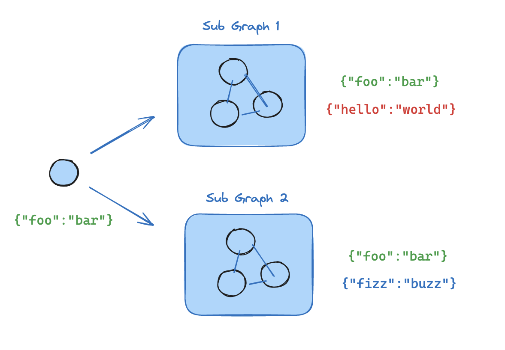

import LanggraphSubgraphsInterruptV2Py from '/snippets/code-samples/langgraph-subgraphs-interrupt-v2-py.mdx';

本指南解释如何使用子图。子图是一个在另一个图中被当作 [node](/oss/langgraph/graph-api#nodes) 使用的 [graph](/oss/langgraph/graph-api#graphs)。

子图适用于：
- 构建 [multi-agent systems](/oss/langchain/multi-agent)
- 在多个图中复用一组 nodes
- 分工开发：当你希望不同团队独立负责图的不同部分时，可以把每个部分定义为子图，只要子图接口（输入和输出 schema）保持一致，父图就不需要了解子图的任何细节

## 设置

:::python
<CodeGroup>
```bash pip
pip install -U langgraph
```

```bash uv
uv add langgraph
```
</CodeGroup>
:::

:::js
```bash
npm install @langchain/langgraph
```
:::

<Tip>
**为 LangGraph 开发设置 LangSmith**
注册 [LangSmith](https://smith.langchain.com) 可以快速发现问题并提升 LangGraph 项目的性能。LangSmith 允许你使用 trace 数据来调试、测试和监控用 LangGraph 构建的 LLM 应用 - 了解更多 [如何开始使用 LangSmith](https://docs.langchain.com/langsmith/observability)。
</Tip>


## 定义子图通信

添加子图时，你需要定义父图和子图如何通信：

| 模式 | 适用场景 | State schemas |
|---------|------------|--------------|
| [在 node 内调用子图](#call-a-subgraph-inside-a-node) | 父图和子图有**不同的 state schema**（没有共享 key），或者你需要在它们之间转换 state | 你需要写一个包装函数，把父 state 映射为子图输入，再把子图输出映射回父 state |
| [把子图作为 node 添加](#add-a-subgraph-as-a-node) | 父图和子图**共享 state key** - 子图读写的 channel 与父图相同 | 你直接把编译后的子图传给 `add_node` - 不需要包装函数 |

<a id="invoke-a-graph-from-a-node"></a>
### 在 node 内调用子图

当父图和子图有**不同的 state schema**（没有共享 key）时，可以在 node 函数内部调用子图。这在 [multi-agent](/oss/langchain/multi-agent) 系统里很常见，因为你可能希望为每个 agent 保留私有的消息历史。

node 函数会先把父 state 转换成子图 state，然后调用子图，最后在返回前把结果转换回父 state。

:::python
```python
from typing_extensions import TypedDict
from langgraph.graph.state import StateGraph, START

class SubgraphState(TypedDict):
    bar: str

# 子图

def subgraph_node_1(state: SubgraphState):
    return {"bar": "hi! " + state["bar"]}

subgraph_builder = StateGraph(SubgraphState)
subgraph_builder.add_node(subgraph_node_1)
subgraph_builder.add_edge(START, "subgraph_node_1")
subgraph = subgraph_builder.compile()

# 父图

class State(TypedDict):
    foo: str

def call_subgraph(state: State):
    # 将 state 转换为子图 state
    subgraph_output = subgraph.invoke({"bar": state["foo"]})  # [!code highlight]
    # 将响应转换回父 state
    return {"foo": subgraph_output["bar"]}

builder = StateGraph(State)
builder.add_node("node_1", call_subgraph)
builder.add_edge(START, "node_1")
graph = builder.compile()
```
:::

:::js
```typescript
import { StateGraph, StateSchema, START } from "@langchain/langgraph";
import * as z from "zod";

const SubgraphState = new StateSchema({
  bar: z.string(),
});

// 子图
const subgraphBuilder = new StateGraph(SubgraphState)
  .addNode("subgraphNode1", (state) => {
    return { bar: "hi! " + state.bar };
  })
  .addEdge(START, "subgraphNode1");

const subgraph = subgraphBuilder.compile();

// 父图
const State = new StateSchema({
  foo: z.string(),
});

// 将 state 转换为子图 state 再转回
const builder = new StateGraph(State)
  .addNode("node1", async (state) => {
    const subgraphOutput = await subgraph.invoke({ bar: state.foo });
    return { foo: subgraphOutput.bar };
  })
  .addEdge(START, "node1");

const graph = builder.compile();
```
:::

<Accordion title="完整示例：不同的 state schema">
  :::python
  ```python
  from typing_extensions import TypedDict
  from langgraph.graph.state import StateGraph, START
  from langgraph.stream import UpdatesTransformer

  # Define subgraph
  class SubgraphState(TypedDict):
      # note that none of these keys are shared with the parent graph state
      bar: str
      baz: str

  def subgraph_node_1(state: SubgraphState):
      return {"baz": "baz"}

  def subgraph_node_2(state: SubgraphState):
      return {"bar": state["bar"] + state["baz"]}

  subgraph_builder = StateGraph(SubgraphState)
  subgraph_builder.add_node(subgraph_node_1)
  subgraph_builder.add_node(subgraph_node_2)
  subgraph_builder.add_edge(START, "subgraph_node_1")
  subgraph_builder.add_edge("subgraph_node_1", "subgraph_node_2")
  subgraph = subgraph_builder.compile()

  # Define parent graph
  class ParentState(TypedDict):
      foo: str

  def node_1(state: ParentState):
      return {"foo": "hi! " + state["foo"]}

  def node_2(state: ParentState):
      # Transform the state to the subgraph state
      response = subgraph.invoke({"bar": state["foo"]})
      # Transform response back to the parent state
      return {"foo": response["bar"]}


  builder = StateGraph(ParentState)
  builder.add_node("node_1", node_1)
  builder.add_node("node_2", node_2)
  builder.add_edge(START, "node_1")
  builder.add_edge("node_1", "node_2")
  graph = builder.compile()

  stream = graph.stream_events({"foo": "foo"}, version="v3", transformers=[UpdatesTransformer])
  for event in stream:
      if event["method"] == "updates":
          print(event["params"]["namespace"], event["params"]["data"])
  ```

  ```
  [] {'node_1': {'foo': 'hi! foo'}}
  ['node_2:577b710b-64ae-31fb-9455-6a4d4cc2b0b9'] {'subgraph_node_1': {'baz': 'baz'}}
  ['node_2:577b710b-64ae-31fb-9455-6a4d4cc2b0b9'] {'subgraph_node_2': {'bar': 'hi! foobaz'}}
  [] {'node_2': {'foo': 'hi! foobaz'}}
  ```
  :::

  :::js
  ```typescript
  import { StateGraph, StateSchema, START } from "@langchain/langgraph";
  import * as z from "zod";

  // Define subgraph
  const SubgraphState = new StateSchema({
    // note that none of these keys are shared with the parent graph state
    bar: z.string(),
    baz: z.string(),
  });

  const subgraphBuilder = new StateGraph(SubgraphState)
    .addNode("subgraphNode1", (state) => {
      return { baz: "baz" };
    })
    .addNode("subgraphNode2", (state) => {
      return { bar: state.bar + state.baz };
    })
    .addEdge(START, "subgraphNode1")
    .addEdge("subgraphNode1", "subgraphNode2");

  const subgraph = subgraphBuilder.compile();

  // Define parent graph
  const ParentState = new StateSchema({
    foo: z.string(),
  });

  const builder = new StateGraph(ParentState)
    .addNode("node1", (state) => {
      return { foo: "hi! " + state.foo };
    })
    .addNode("node2", async (state) => {
      const response = await subgraph.invoke({ bar: state.foo });   // [!code highlight]
      return { foo: response.bar };   // [!code highlight]
    })
    .addEdge(START, "node1")
    .addEdge("node1", "node2");

  const graph = builder.compile();

  const stream = await graph.streamEvents(
    { foo: "foo" },
    { subgraphs: true, version: "v3" }
  );
  for await (const message of stream.messages) {
    for await (const token of message.text) {
      process.stdout.write(token);
    }
  }
  ```

  1. 将 state 转换为子图 state
  2. 将响应转换回父 state

  ```
  [[], { node1: { foo: 'hi! foo' } }]
  [['node2:9c36dd0f-151a-cb42-cbad-fa2f851f9ab7'], { subgraphNode1: { baz: 'baz' } }]
  [['node2:9c36dd0f-151a-cb42-cbad-fa2f851f9ab7'], { subgraphNode2: { bar: 'hi! foobaz' } }]
  [[], { node2: { foo: 'hi! foobaz' } }]
  ```
  :::
</Accordion>

<Accordion title="完整示例：不同的 state schema（两级子图）">
  这是一个两级子图的示例：parent -> child -> grandchild。

  :::python
  ```python
  # Grandchild graph
  from typing_extensions import TypedDict
  from langgraph.graph.state import StateGraph, START, END
  from langgraph.stream import UpdatesTransformer

  class GrandChildState(TypedDict):
      my_grandchild_key: str

  def grandchild_1(state: GrandChildState) -> GrandChildState:
      # NOTE: child or parent keys will not be accessible here
      return {"my_grandchild_key": state["my_grandchild_key"] + ", how are you"}


  grandchild = StateGraph(GrandChildState)
  grandchild.add_node("grandchild_1", grandchild_1)

  grandchild.add_edge(START, "grandchild_1")
  grandchild.add_edge("grandchild_1", END)

  grandchild_graph = grandchild.compile()

  # Child graph
  class ChildState(TypedDict):
      my_child_key: str

  def call_grandchild_graph(state: ChildState) -> ChildState:
      # NOTE: parent or grandchild keys won't be accessible here
      grandchild_graph_input = {"my_grandchild_key": state["my_child_key"]}
      grandchild_graph_output = grandchild_graph.invoke(grandchild_graph_input)
      return {"my_child_key": grandchild_graph_output["my_grandchild_key"] + " today?"}

  child = StateGraph(ChildState)
  # We're passing a function here instead of just compiled graph (`grandchild_graph`)
  child.add_node("child_1", call_grandchild_graph)
  child.add_edge(START, "child_1")
  child.add_edge("child_1", END)
  child_graph = child.compile()

  # Parent graph
  class ParentState(TypedDict):
      my_key: str

  def parent_1(state: ParentState) -> ParentState:
      # NOTE: child or grandchild keys won't be accessible here
      return {"my_key": "hi " + state["my_key"]}

  def parent_2(state: ParentState) -> ParentState:
      return {"my_key": state["my_key"] + " bye!"}

  def call_child_graph(state: ParentState) -> ParentState:
      child_graph_input = {"my_child_key": state["my_key"]}
      child_graph_output = child_graph.invoke(child_graph_input)
      return {"my_key": child_graph_output["my_child_key"]}

  parent = StateGraph(ParentState)
  parent.add_node("parent_1", parent_1)
  # We're passing a function here instead of just a compiled graph (`child_graph`)
  parent.add_node("child", call_child_graph)
  parent.add_node("parent_2", parent_2)

  parent.add_edge(START, "parent_1")
  parent.add_edge("parent_1", "child")
  parent.add_edge("child", "parent_2")
  parent.add_edge("parent_2", END)

  parent_graph = parent.compile()

  stream = parent_graph.stream_events({"my_key": "Bob"}, version="v3", transformers=[UpdatesTransformer])
  for event in stream:
      if event["method"] == "updates":
          print(event["params"]["namespace"], event["params"]["data"])
  ```

  ```
  [] {'parent_1': {'my_key': 'hi Bob'}}
  ['child:2e26e9ce-602f-862c-aa66-1ea5a4655e3b', 'child_1:781bb3b1-3971-84ce-810b-acf819a03f9c'] {'grandchild_1': {'my_grandchild_key': 'hi Bob, how are you'}}
  ['child:2e26e9ce-602f-862c-aa66-1ea5a4655e3b'] {'child_1': {'my_child_key': 'hi Bob, how are you today?'}}
  [] {'child': {'my_key': 'hi Bob, how are you today?'}}
  [] {'parent_2': {'my_key': 'hi Bob, how are you today? bye!'}}
  ```
  :::

  :::js
  ```typescript
  import { StateGraph, StateSchema, START, END } from "@langchain/langgraph";
  import * as z from "zod";

  // Grandchild graph
  const GrandChildState = new StateSchema({
    myGrandchildKey: z.string(),
  });

  const grandchild = new StateGraph(GrandChildState)
    .addNode("grandchild1", (state) => {
      // NOTE: child or parent keys will not be accessible here
      return { myGrandchildKey: state.myGrandchildKey + ", how are you" };
    })
    .addEdge(START, "grandchild1")
    .addEdge("grandchild1", END);

  const grandchildGraph = grandchild.compile();

  // Child graph
  const ChildState = new StateSchema({
    myChildKey: z.string(),
  });

  const child = new StateGraph(ChildState)
    .addNode("child1", async (state) => {
      // NOTE: parent or grandchild keys won't be accessible here
      const grandchildGraphInput = { myGrandchildKey: state.myChildKey };   // [!code highlight]
      const grandchildGraphOutput = await grandchildGraph.invoke(grandchildGraphInput);
      return { myChildKey: grandchildGraphOutput.myGrandchildKey + " today?" };   // [!code highlight]
    })   // [!code highlight]
    .addEdge(START, "child1")
    .addEdge("child1", END);

  const childGraph = child.compile();

  // Parent graph
  const ParentState = new StateSchema({
    myKey: z.string(),
  });

  const parent = new StateGraph(ParentState)
    .addNode("parent1", (state) => {
      // NOTE: child or grandchild keys won't be accessible here
      return { myKey: "hi " + state.myKey };
    })
    .addNode("child", async (state) => {
      const childGraphInput = { myChildKey: state.myKey };   // [!code highlight]
      const childGraphOutput = await childGraph.invoke(childGraphInput);
      return { myKey: childGraphOutput.myChildKey };   // [!code highlight]
    })   // [!code highlight]
    .addNode("parent2", (state) => {
      return { myKey: state.myKey + " bye!" };
    })
    .addEdge(START, "parent1")
    .addEdge("parent1", "child")
    .addEdge("child", "parent2")
    .addEdge("parent2", END);

  const parentGraph = parent.compile();

  const stream = await parentGraph.streamEvents(
    { myKey: "Bob" },
    { subgraphs: true, version: "v3" }
  );
  for await (const message of stream.messages) {
    for await (const token of message.text) {
      process.stdout.write(token);
    }
  }
  ```

  1. 我们将 state 从子图 state 的 channel（`myChildKey`）转换为孙图 state 的 channel（`myGrandchildKey`）
  2. 我们将 state 从孙图 state 的 channel（`myGrandchildKey`）转换回子图 state 的 channel（`myChildKey`）
  3. 这里我们传入的是一个函数，而不是直接传入编译后的图（`grandchildGraph`）
  4. 我们将 state 从父图 state 的 channel（`myKey`）转换为子图 state 的 channel（`myChildKey`）
  5. 我们将 state 从子图 state 的 channel（`myChildKey`）转换回父图 state 的 channel（`myKey`）
  6. 这里我们传入的是一个函数，而不是直接传入编译后的图（`childGraph`）

  ```
  [[], { parent1: { myKey: 'hi Bob' } }]
  [['child:2e26e9ce-602f-862c-aa66-1ea5a4655e3b', 'child1:781bb3b1-3971-84ce-810b-acf819a03f9c'], { grandchild1: { myGrandchildKey: 'hi Bob, how are you' } }]
  [['child:2e26e9ce-602f-862c-aa66-1ea5a4655e3b'], { child1: { myChildKey: 'hi Bob, how are you today?' } }]
  [[], { child: { myKey: 'hi Bob, how are you today?' } }]
  [[], { parent2: { myKey: 'hi Bob, how are you today? bye!' } }]
  ```
  :::
</Accordion>

<a id="add-a-graph-as-a-node"></a>
### 把子图作为 node 添加

当父图和子图**共享 state key** 时，你可以直接把编译后的子图传给 `add_node`。不需要包装函数——子图会自动读写父图的 state channel。例如在 [multi-agent](/oss/langchain/multi-agent) 系统中，各个 agent 通常通过共享的 [messages](/oss/langgraph/graph-api#why-use-messages) key 通信。



如果你的子图与父图共享 state key，可以按以下步骤把它添加到你的图中：

:::python
1. 定义子图工作流（下例中的 `subgraph_builder`）并编译它
2. 在定义父图工作流时，把编译后的子图传给 @[`add_node`] 方法

```python
from typing_extensions import TypedDict
from langgraph.graph.state import StateGraph, START

class State(TypedDict):
    foo: str

# Subgraph

def subgraph_node_1(state: State):
    return {"foo": "hi! " + state["foo"]}

subgraph_builder = StateGraph(State)
subgraph_builder.add_node(subgraph_node_1)
subgraph_builder.add_edge(START, "subgraph_node_1")
subgraph = subgraph_builder.compile()

# Parent graph

builder = StateGraph(State)
builder.add_node("node_1", subgraph)  # [!code highlight]
builder.add_edge(START, "node_1")
graph = builder.compile()
```
:::

:::js
1. 定义子图工作流（下例中的 `subgraphBuilder`）并编译它
2. 在定义父图工作流时，把编译后的子图传给 `.addNode` 方法

```typescript
import { StateGraph, StateSchema, START } from "@langchain/langgraph";
import * as z from "zod";

const State = new StateSchema({
  foo: z.string(),
});

// Subgraph
const subgraphBuilder = new StateGraph(State)
  .addNode("subgraphNode1", (state) => {
    return { foo: "hi! " + state.foo };
  })
  .addEdge(START, "subgraphNode1");

const subgraph = subgraphBuilder.compile();

// Parent graph
const builder = new StateGraph(State)
  .addNode("node1", subgraph)
  .addEdge(START, "node1");

const graph = builder.compile();
```
:::

<Accordion title="完整示例：共享 state schema">
  :::python
  ```python
  from typing_extensions import TypedDict
  from langgraph.graph.state import StateGraph, START
  from langgraph.stream import UpdatesTransformer

  # Define subgraph
  class SubgraphState(TypedDict):
      foo: str  # shared with parent graph state
      bar: str  # private to SubgraphState

  def subgraph_node_1(state: SubgraphState):
      return {"bar": "bar"}

  def subgraph_node_2(state: SubgraphState):
      # note that this node is using a state key ('bar') that is only available in the subgraph
      # and is sending update on the shared state key ('foo')
      return {"foo": state["foo"] + state["bar"]}

  subgraph_builder = StateGraph(SubgraphState)
  subgraph_builder.add_node(subgraph_node_1)
  subgraph_builder.add_node(subgraph_node_2)
  subgraph_builder.add_edge(START, "subgraph_node_1")
  subgraph_builder.add_edge("subgraph_node_1", "subgraph_node_2")
  subgraph = subgraph_builder.compile()

  # Define parent graph
  class ParentState(TypedDict):
      foo: str

  def node_1(state: ParentState):
      return {"foo": "hi! " + state["foo"]}

  builder = StateGraph(ParentState)
  builder.add_node("node_1", node_1)
  builder.add_node("node_2", subgraph)
  builder.add_edge(START, "node_1")
  builder.add_edge("node_1", "node_2")
  graph = builder.compile()

  stream = graph.stream_events({"foo": "foo"}, version="v3", transformers=[UpdatesTransformer])
  for event in stream:
      if event["method"] == "updates" and not event["params"]["namespace"]:
          print(event["params"]["data"])
  ```

  ```
  {'node_1': {'foo': 'hi! foo'}}
  {'node_2': {'foo': 'hi! foobar'}}
  ```
  :::

  :::js
  ```typescript
  import { StateGraph, StateSchema, START } from "@langchain/langgraph";
  import * as z from "zod";

  // Define subgraph
  const SubgraphState = new StateSchema({
    foo: z.string(),    // [!code highlight]
    bar: z.string(),    // [!code highlight]
  });

  const subgraphBuilder = new StateGraph(SubgraphState)
    .addNode("subgraphNode1", (state) => {
      return { bar: "bar" };
    })
    .addNode("subgraphNode2", (state) => {
      // note that this node is using a state key ('bar') that is only available in the subgraph
      // and is sending update on the shared state key ('foo')
      return { foo: state.foo + state.bar };
    })
    .addEdge(START, "subgraphNode1")
    .addEdge("subgraphNode1", "subgraphNode2");

  const subgraph = subgraphBuilder.compile();

  // Define parent graph
  const ParentState = new StateSchema({
    foo: z.string(),
  });

  const builder = new StateGraph(ParentState)
    .addNode("node1", (state) => {
      return { foo: "hi! " + state.foo };
    })
    .addNode("node2", subgraph)
    .addEdge(START, "node1")
    .addEdge("node1", "node2");

  const graph = builder.compile();

  const stream = await graph.streamEvents({ foo: "foo" }, { version: "v3" });
  for await (const message of stream.messages) {
    for await (const token of message.text) {
      process.stdout.write(token);
    }
  }
  ```

  1. 这个 key 与父图 state 共享
  2. 这个 key 是 `SubgraphState` 私有的，父图看不到

  ```
  { node1: { foo: 'hi! foo' } }
  { node2: { foo: 'hi! foobar' } }
  ```
  :::
</Accordion>

## 子图持久化

当你使用子图时，需要决定它在不同调用之间如何处理内部数据。比如一个客户支持 bot 把任务交给专门的 subagent：这个“账单专家” subagent 应该记住客户之前的问题，还是每次调用都重新开始？

`.compile()` 上的 `checkpointer` 参数控制子图持久化：

| 模式 | `checkpointer=` | 行为 |
|------|-----------------|------|
| [Per-invocation](#per-invocation-default) | `None`（默认） | 每次调用都从新状态开始，并继承父图的 checkpointer，以支持单次调用内的 [interrupts](/oss/langgraph/interrupts) 和 [durable execution](/oss/langgraph/persistence)。 |
| [Per-thread](#per-thread) | `True` | 状态会跨同一线程的多次调用累积。每次调用都会从上一次停下的地方继续。 |
| [Stateless](#stateless) | `False` | 完全不做 checkpointing - 就像普通函数调用一样运行。没有 interrupts，也没有 durable execution。 |

对于大多数应用，包括 [multi-agent](/oss/langchain/multi-agent) 系统，per-invocation 是更合适的选择，因为 subagent 处理的是相互独立的请求。只有在 subagent 需要多轮对话记忆时，才使用 per-thread，比如一个会在多次交互中积累上下文的研究助手。

<Note>
父图必须使用 checkpointer 编译，子图持久化相关功能（interrupts、state inspection、per-thread memory）才能正常工作。请参阅 [persistence](/oss/langgraph/persistence)。
</Note>

<Info>
下面的示例使用 LangChain 的 @[`create_agent`]，这是构建 agent 的常见方式。`create_agent` 底层会生成一个 [LangGraph graph](/oss/langgraph/graph-api)，因此所有子图持久化概念都可以直接应用。如果你使用的是原生 LangGraph `StateGraph`，同样的模式和配置项也适用 - 详见 [Graph API](/oss/langgraph/graph-api)。
</Info>

### Stateful

有状态子图会继承父图的 checkpointer，从而启用 [interrupts](/oss/langgraph/interrupts)、[persistence](/oss/langgraph/persistence) 和 state inspection。两种有状态模式的区别在于 state 保留多长时间。

#### Per-invocation（默认）

<Tip>
这是大多数应用的推荐模式，包括作为 tool 被调用的 [multi-agent](/oss/langchain/multi-agent) 系统。它支持 [interrupts](/oss/langgraph/interrupts)、[persistence](/oss/langgraph/persistence) 和并行调用，同时保持每次调用相互隔离。
</Tip>

当子图的每次调用彼此独立，且 subagent 不需要记住之前调用的内容时，就使用 per-invocation 持久化。这是最常见的模式，尤其适合 [multi-agent](/oss/langchain/multi-agent) 系统中处理一次性请求的 subagent，比如“查一下这个客户的订单”或“总结这份文档”。

省略 `checkpointer`，或者把它设为 `None`。每次调用都会从新状态开始，但在单次调用内，子图会继承父图的 checkpointer，并且可以使用 `interrupt()` 暂停并恢复。

下面的示例使用两个 subagent（水果专家、蔬菜专家）作为外层 agent 的 tool：

:::python

```python
from langchain.agents import create_agent
from langchain.tools import tool
from langgraph.checkpoint.memory import MemorySaver
from langgraph.types import Command, interrupt

@tool
def fruit_info(fruit_name: str) -> str:
    """查找水果信息。"""
    return f"Info about {fruit_name}"

@tool
def veggie_info(veggie_name: str) -> str:
    """查找蔬菜信息。"""
    return f"Info about {veggie_name}"

# Subagents - 不设置 checkpointer（继承父图）
fruit_agent = create_agent(
    model="gpt-5.4-mini",
    tools=[fruit_info],
    system_prompt="You are a fruit expert. Use the fruit_info tool. Respond in one sentence.",
)

veggie_agent = create_agent(
    model="gpt-5.4-mini",
    tools=[veggie_info],
    system_prompt="You are a veggie expert. Use the veggie_info tool. Respond in one sentence.",
)

# 把 subagent 封装为外层 agent 的 tool
@tool
def ask_fruit_expert(question: str) -> str:
    """询问水果专家。用于所有水果问题。"""
    response = fruit_agent.invoke(
        {"messages": [{"role": "user", "content": question}]},
    )
    return response["messages"][-1].content

@tool
def ask_veggie_expert(question: str) -> str:
    """询问蔬菜专家。用于所有蔬菜问题。"""
    response = veggie_agent.invoke(
        {"messages": [{"role": "user", "content": question}]},
    )
    return response["messages"][-1].content

# 带 checkpointer 的外层 agent
agent = create_agent(
    model="gpt-5.4-mini",
    tools=[ask_fruit_expert, ask_veggie_expert],
    system_prompt=(
        "You have two experts: ask_fruit_expert and ask_veggie_expert. "
        "ALWAYS delegate questions to the appropriate expert."
    ),
    checkpointer=MemorySaver(),
)
```

<Tabs>
  <Tab title="Interrupts">
  每次调用都可以使用 `interrupt()` 暂停并恢复。在 tool 函数里加入 `interrupt()`，即可在继续执行前要求用户批准：

  ```python
  @tool
  def fruit_info(fruit_name: str) -> str:
      """查找水果信息。"""
      interrupt("continue?")  # [!code highlight]
      return f"Info about {fruit_name}"
  ```

  <LanggraphSubgraphsInterruptV2Py />
  </Tab>
  <Tab title="Multi-turn">
  每次调用都会从一个新的 subagent state 开始。subagent 不会记住上一次调用：

  ```python
  config = {"configurable": {"thread_id": "1"}}

  # 第一次调用
  response = agent.invoke(
      {"messages": [{"role": "user", "content": "Tell me about apples"}]},
      config=config,
  )
  # Subagent message count: 4

  # 第二次调用 - subagent 从新状态开始，不记得 apples
  response = agent.invoke(
      {"messages": [{"role": "user", "content": "Now tell me about bananas"}]},
      config=config,
  )
  # Subagent message count: 4 (still fresh!)
  ```
  </Tab>
  <Tab title="Multiple subgraph calls">
  对同一个 subgraph 的多次调用不会冲突，因为每次调用都会获得自己的 checkpoint 命名空间：

  ```python
  config = {"configurable": {"thread_id": "1"}}

  # LLM 对 apples 和 bananas 都调用 ask_fruit_expert
  response = agent.invoke(
      {"messages": [{"role": "user", "content": "Tell me about apples and bananas"}]},
      config=config,
  )
  # Subagent message count: 4 (apples - fresh)
  # Subagent message count: 4 (bananas - fresh)
  ```
  </Tab>
</Tabs>
:::

:::js

```typescript
import { createAgent, tool } from "langchain";
import { MemorySaver, Command, interrupt } from "@langchain/langgraph";
import * as z from "zod";

const fruitInfo = tool(
  (input) => `Info about ${input.fruitName}`,
  {
    name: "fruit_info",
    description: "Look up fruit info.",
    schema: z.object({ fruitName: z.string() }),
  }
);

const veggieInfo = tool(
  (input) => `Info about ${input.veggieName}`,
  {
    name: "veggie_info",
    description: "Look up veggie info.",
    schema: z.object({ veggieName: z.string() }),
  }
);

// Subagents - 不设置 checkpointer（继承父图）
const fruitAgent = createAgent({
  model: "gpt-5.4-mini",
  tools: [fruitInfo],
  systemPrompt: "You are a fruit expert. Use the fruit_info tool. Respond in one sentence.",
});

const veggieAgent = createAgent({
  model: "gpt-5.4-mini",
  tools: [veggieInfo],
  systemPrompt: "You are a veggie expert. Use the veggie_info tool. Respond in one sentence.",
});

// 把 subagent 封装为外层 agent 的 tool
const askFruitExpert = tool(
  async (input) => {
    const response = await fruitAgent.invoke({
      messages: [{ role: "user", content: input.question }],
    });
    return response.messages[response.messages.length - 1].content;
  },
  {
    name: "ask_fruit_expert",
    description: "Ask the fruit expert. Use for ALL fruit questions.",
    schema: z.object({ question: z.string() }),
  }
);

const askVeggieExpert = tool(
  async (input) => {
    const response = await veggieAgent.invoke({
      messages: [{ role: "user", content: input.question }],
    });
    return response.messages[response.messages.length - 1].content;
  },
  {
    name: "ask_veggie_expert",
    description: "Ask the veggie expert. Use for ALL veggie questions.",
    schema: z.object({ question: z.string() }),
  }
);

// 带 checkpointer 的外层 agent
const agent = createAgent({
  model: "gpt-5.4-mini",
  tools: [askFruitExpert, askVeggieExpert],
  systemPrompt:
    "You have two experts: ask_fruit_expert and ask_veggie_expert. " +
    "ALWAYS delegate questions to the appropriate expert.",
  checkpointer: new MemorySaver(),
});
```

<Tabs>
  <Tab title="Interrupts">
  每次调用都可以使用 `interrupt()` 暂停并恢复。在 tool 函数里加入 `interrupt()`，即可在继续执行前要求用户批准：

  ```typescript
  const fruitInfo = tool(
    (input) => {
      interrupt("continue?");  // [!code highlight]
      return `Info about ${input.fruitName}`;
    },
    {
      name: "fruit_info",
      description: "Look up fruit info.",
      schema: z.object({ fruitName: z.string() }),
    }
  );
  ```

  ```typescript
  const config = { configurable: { thread_id: "1" } };

  // Invoke - the subagent's tool calls interrupt()
  let response = await agent.invoke(
    { messages: [{ role: "user", content: "Tell me about apples" }] },
    config,
  );
  // response contains __interrupt__

  // Resume - approve the interrupt
  response = await agent.invoke(new Command({ resume: true }), config);  // [!code highlight]
  // Subagent message count: 4
  ```
  </Tab>
  <Tab title="Multi-turn">
  每次调用都会从一个新的 subagent state 开始。subagent 不会记住上一次调用：

  ```typescript
  const config = { configurable: { thread_id: "1" } };

  // First call
  let response = await agent.invoke(
    { messages: [{ role: "user", content: "Tell me about apples" }] },
    config,
  );
  // Subagent message count: 4

  // Second call - subagent starts fresh, no memory of apples
  response = await agent.invoke(
    { messages: [{ role: "user", content: "Now tell me about bananas" }] },
    config,
  );
  // Subagent message count: 4 (still fresh!)
  ```
  </Tab>
  <Tab title="Multiple subgraph calls">
  对同一个子图的多次调用可以正常工作，不会冲突，因为每次调用都会获得自己的 checkpoint 命名空间：

  ```typescript
  const config = { configurable: { thread_id: "1" } };

  // LLM calls ask_fruit_expert for both apples and bananas
  const response = await agent.invoke(
    { messages: [{ role: "user", content: "Tell me about apples and bananas" }] },
    config,
  );
  // Subagent message count: 4 (apples - fresh)
  // Subagent message count: 4 (bananas - fresh)
  ```
  </Tab>
</Tabs>
:::

#### Per-thread

当 subagent 需要记住之前的交互时，使用 per-thread 持久化。例如一个会在多次交互中逐步积累上下文的研究助手，或者一个会记录自己已经修改过哪些文件的编码助手。subagent 的对话历史和数据会在同一线程的多次调用之间累积。每次调用都会从上一次停下的地方继续。

使用 `checkpointer=True` 编译即可启用这种行为。

<Warning>
Per-thread 子图不支持并行 tool 调用。当 LLM 可以把一个 per-thread subagent 当作 tool 使用时，它可能会尝试并行调用这个 tool 多次（例如同时向水果专家询问 apples 和 bananas）。这会导致 checkpoint 冲突，因为两次调用都会写入同一个命名空间。

下面的示例使用 LangChain 的 `ToolCallLimitMiddleware` 来避免这一问题。如果你使用的是原生 LangGraph `StateGraph`，就需要自己防止并行 tool 调用——例如配置模型禁用并行 tool 调用，或者添加逻辑确保同一个子图不会被并行调用多次。
</Warning>

下面的示例使用一个以 `checkpointer=True` 编译的水果专家 subagent：

:::python

```python
from langchain.agents import create_agent
from langchain.agents.middleware import ToolCallLimitMiddleware
from langchain.tools import tool
from langgraph.checkpoint.memory import MemorySaver
from langgraph.types import Command, interrupt

@tool
def fruit_info(fruit_name: str) -> str:
    """Look up fruit info."""
    return f"Info about {fruit_name}"

# Subagent with checkpointer=True for persistent state
fruit_agent = create_agent(
    model="gpt-5.4-mini",
    tools=[fruit_info],
    system_prompt="You are a fruit expert. Use the fruit_info tool. Respond in one sentence.",
    checkpointer=True,  # [!code highlight]
)

# Wrap subagent as a tool for the outer agent
@tool
def ask_fruit_expert(question: str) -> str:
    """Ask the fruit expert. Use for ALL fruit questions."""
    response = fruit_agent.invoke(
        {"messages": [{"role": "user", "content": question}]},
    )
    return response["messages"][-1].content

# Outer agent with checkpointer
# Use ToolCallLimitMiddleware to prevent parallel calls to per-thread subagents,
# which would cause checkpoint conflicts.
agent = create_agent(
    model="gpt-5.4-mini",
    tools=[ask_fruit_expert],
    system_prompt="You have a fruit expert. ALWAYS delegate fruit questions to ask_fruit_expert.",
    middleware=[  # [!code highlight]
        ToolCallLimitMiddleware(tool_name="ask_fruit_expert", run_limit=1),  # [!code highlight]
    ],  # [!code highlight]
    checkpointer=MemorySaver(),
)
```

<Tabs>
  <Tab title="Interrupts">
  Per-thread subagent 和 per-invocation 一样支持 `interrupt()`。在 tool 函数里加入 `interrupt()`，即可要求用户批准：

  ```python
  @tool
  def fruit_info(fruit_name: str) -> str:
      """Look up fruit info."""
      interrupt("continue?")  # [!code highlight]
      return f"Info about {fruit_name}"
  ```

  <LanggraphSubgraphsInterruptV2Py />
  </Tab>
  <Tab title="Multi-turn">
  State 会在多次调用之间累积——subagent 会记住过去的对话：

  ```python
  config = {"configurable": {"thread_id": "1"}}

  # First call
  response = agent.invoke(
      {"messages": [{"role": "user", "content": "Tell me about apples"}]},
      config=config,
  )
  # Subagent message count: 4

  # Second call - subagent REMEMBERS apples conversation
  response = agent.invoke(
      {"messages": [{"role": "user", "content": "Now tell me about bananas"}]},
      config=config,
  )
  # Subagent message count: 8 (accumulated!)
  ```
  </Tab>
  <Tab title="Multiple subgraph calls">

  当你有多个**不同的** per-thread 子图（比如一个水果专家和一个蔬菜专家）时，它们各自都需要独立的存储空间，这样它们的 checkpoint 才不会互相覆盖。这称为 **namespace isolation**。

  如果你 [在 node 内调用子图](#call-a-subgraph-inside-a-node)，LangGraph 会根据调用顺序分配命名空间（第一次调用、第二次调用等）。这意味着调整调用顺序可能会搞混哪个子图加载哪份 state。为了避免这个问题，可以把每个 subagent 封装进自己的 `StateGraph`，并使用唯一的 node 名称——这样每个子图都会获得一个稳定且唯一的命名空间：

  ```python
  from langgraph.graph import MessagesState, StateGraph

  def create_sub_agent(model, *, name, **kwargs):
      """Wrap an agent with a unique node name for namespace isolation."""
      agent = create_agent(model=model, name=name, **kwargs)
      return (
          StateGraph(MessagesState)
          .add_node(name, agent)  # unique name → stable namespace  # [!code highlight]
          .add_edge("__start__", name)
          .compile()
      )

  fruit_agent = create_sub_agent(
      "gpt-5.4-mini", name="fruit_agent",
      tools=[fruit_info], system_prompt="...", checkpointer=True,
  )
  veggie_agent = create_sub_agent(
      "gpt-5.4-mini", name="veggie_agent",
      tools=[veggie_info], system_prompt="...", checkpointer=True,
  )

  config = {"configurable": {"thread_id": "1"}}

  # First call - LLM calls both fruit and veggie experts
  response = agent.invoke(
      {"messages": [{"role": "user", "content": "Tell me about cherries and broccoli"}]},
      config=config,
  )
  # Fruit subagent message count: 4
  # Veggie subagent message count: 4

  # Second call - both agents accumulate independently
  response = agent.invoke(
      {"messages": [{"role": "user", "content": "Now tell me about oranges and carrots"}]},
      config=config,
  )
  # Fruit subagent message count: 8 (remembers cherries!)
  # Veggie subagent message count: 8 (remembers broccoli!)
  ```

  通过 [作为 node 添加](#add-a-subgraph-as-a-node) 的子图已经会自动获得基于名称的命名空间，因此不需要这层包装。
  </Tab>
</Tabs>
:::

:::js

```typescript
import { createAgent, tool, toolCallLimitMiddleware } from "langchain";
import { MemorySaver, Command, interrupt } from "@langchain/langgraph";
import * as z from "zod";

const fruitInfo = tool(
  (input) => `Info about ${input.fruitName}`,
  {
    name: "fruit_info",
    description: "Look up fruit info.",
    schema: z.object({ fruitName: z.string() }),
  }
);

// Subagent with checkpointer=true for persistent state
const fruitAgent = createAgent({
  model: "gpt-5.4-mini",
  tools: [fruitInfo],
  systemPrompt: "You are a fruit expert. Use the fruit_info tool. Respond in one sentence.",
  checkpointer: true,  // [!code highlight]
});

// Wrap subagent as a tool for the outer agent
const askFruitExpert = tool(
  async (input) => {
    const response = await fruitAgent.invoke({
      messages: [{ role: "user", content: input.question }],
    });
    return response.messages[response.messages.length - 1].content;
  },
  {
    name: "ask_fruit_expert",
    description: "Ask the fruit expert. Use for ALL fruit questions.",
    schema: z.object({ question: z.string() }),
  }
);

// Outer agent with checkpointer
// Use toolCallLimitMiddleware to prevent parallel calls to per-thread subagents,
// which would cause checkpoint conflicts.
const agent = createAgent({
  model: "gpt-5.4-mini",
  tools: [askFruitExpert],
  systemPrompt: "You have a fruit expert. ALWAYS delegate fruit questions to ask_fruit_expert.",
  middleware: [  // [!code highlight]
    toolCallLimitMiddleware({ toolName: "ask_fruit_expert", runLimit: 1 }),  // [!code highlight]
  ],  // [!code highlight]
  checkpointer: new MemorySaver(),
});
```

<Tabs>
  <Tab title="Interrupts">
  Per-thread subagent 和 per-invocation 一样支持 `interrupt()`。在 tool 函数里加入 `interrupt()`，即可要求用户批准：

  ```typescript
  const fruitInfo = tool(
    (input) => {
      interrupt("continue?");  // [!code highlight]
      return `Info about ${input.fruitName}`;
    },
    {
      name: "fruit_info",
      description: "Look up fruit info.",
      schema: z.object({ fruitName: z.string() }),
    }
  );
  ```

  ```typescript
  const config = { configurable: { thread_id: "1" } };

  // Invoke - the subagent's tool calls interrupt()
  let response = await agent.invoke(
    { messages: [{ role: "user", content: "Tell me about apples" }] },
    config,
  );
  // response contains __interrupt__

  // Resume - approve the interrupt
  response = await agent.invoke(new Command({ resume: true }), config);  // [!code highlight]
  // Subagent message count: 4
  ```
  </Tab>
  <Tab title="Multi-turn">
  State 会在多次调用之间累积——subagent 会记住过去的对话：

  ```typescript
  const config = { configurable: { thread_id: "1" } };

  // First call
  let response = await agent.invoke(
    { messages: [{ role: "user", content: "Tell me about apples" }] },
    config,
  );
  // Subagent message count: 4

  // Second call - subagent REMEMBERS apples conversation
  response = await agent.invoke(
    { messages: [{ role: "user", content: "Now tell me about bananas" }] },
    config,
  );
  // Subagent message count: 8 (accumulated!)
  ```
  </Tab>
  <Tab title="Multiple subgraph calls">

  当你有多个**不同的** per-thread 子图（比如一个水果专家和一个蔬菜专家）时，它们各自都需要独立的存储空间，这样它们的 checkpoint 才不会互相覆盖。这称为 **namespace isolation**。

  如果你 [在 node 内调用子图](#call-a-subgraph-inside-a-node)，LangGraph 会根据调用顺序分配命名空间（第一次调用、第二次调用等）。这意味着调整调用顺序可能会搞混哪个子图加载哪份 state。为了避免这个问题，可以把每个 subagent 封装进自己的 `StateGraph`，并使用唯一的 node 名称——这样每个子图都会获得一个稳定且唯一的命名空间：

  ```typescript
  import { StateGraph, StateSchema, MessagesValue, START } from "@langchain/langgraph";

  function createSubAgent(model: string, { name, ...kwargs }: { name: string; [key: string]: any }) {
    const agent = createAgent({ model, name, ...kwargs });
    return new StateGraph(new StateSchema({ messages: MessagesValue }))
      .addNode(name, agent)  // unique name → stable namespace  // [!code highlight]
      .addEdge(START, name)
      .compile();
  }

  const fruitAgent = createSubAgent("gpt-5.4-mini", {
    name: "fruit_agent", tools: [fruitInfo], systemPrompt: "...", checkpointer: true,
  });
  const veggieAgent = createSubAgent("gpt-5.4-mini", {
    name: "veggie_agent", tools: [veggieInfo], systemPrompt: "...", checkpointer: true,
  });
  const config = { configurable: { thread_id: "1" } };

  // First call - LLM calls both fruit and veggie experts
  let response = await agent.invoke(
    { messages: [{ role: "user", content: "Tell me about cherries and broccoli" }] },
    config,
  );
  // Fruit subagent message count: 4
  // Veggie subagent message count: 4

  // Second call - both agents accumulate independently
  response = await agent.invoke(
    { messages: [{ role: "user", content: "Now tell me about oranges and carrots" }] },
    config,
  );
  // Fruit subagent message count: 8 (remembers cherries!)
  // Veggie subagent message count: 8 (remembers broccoli!)
  ```

  通过 [作为 node 添加](#add-a-subgraph-as-a-node) 的子图已经会自动获得基于名称的命名空间，因此不需要这层包装。
  </Tab>
</Tabs>
:::

### Stateless

如果你希望把 subagent 当作普通函数调用来运行，不要 checkpoint 开销，就用这个模式。子图不能暂停 / 恢复，也不会受益于 [durable execution](/oss/langgraph/persistence)。编译时把 `checkpointer` 设为 `False`。

<Warning>
没有 checkpointing，子图就没有 durable execution。如果进程在运行中崩溃，子图无法恢复，只能从头重跑。
</Warning>

:::python
```python
subgraph_builder = StateGraph(...)
subgraph = subgraph_builder.compile(checkpointer=False)  # [!code highlight]
```
:::

:::js
```typescript
const subgraphBuilder = new StateGraph(...);
const subgraph = subgraphBuilder.compile({ checkpointer: false });  // [!code highlight]
```
:::

### Checkpointer reference

使用 `.compile()` 上的 `checkpointer` 参数控制子图持久化：

:::python
```python
subgraph = builder.compile(checkpointer=False)  # or True / None
```
:::

:::js
```typescript
const subgraph = builder.compile({ checkpointer: false });  // or true, or null
```
:::

| 功能 | Per-invocation (default) | Per-thread | Stateless |
|---|---|---|---|
| `checkpointer=` | `None` | `True` | `False` |
| Interrupts (HITL) | ✅ | ✅ | ❌ |
| Multi-turn memory | ❌ | ✅ | ❌ |
| Multiple calls (different subgraphs) | ✅ | <Tooltip tip="Calls to multiple per-thread subgraphs in the same node can cause namespace conflicts. Workarounds are available.">⚠️</Tooltip> | ✅ |
| Multiple calls (same subgraph) | ✅ | ❌ | ✅ |
| State inspection | <Tooltip tip="State inspection with per-invocation persistence is available for the current invocation only (while interrupted). Each invocation starts fresh, so there is no accumulated state to inspect after the invocation completes.">⚠️</Tooltip> | ✅ | ❌ |

- **Interrupts (HITL)**：子图可以使用 [interrupt()](/oss/langgraph/interrupts) 暂停执行并等待用户输入，然后从暂停处继续。
- **Multi-turn memory**：子图会在同一个 [thread](/oss/langgraph/checkpointers#threads) 的多次调用之间保留状态。每次调用都会从上一次结束的地方继续，而不是重新开始。
- **Multiple calls (different subgraphs)**：同一个 node 中可以调用多个不同的 subgraph 实例，不会产生 checkpoint 命名空间冲突。
- **Multiple calls (same subgraph)**：同一个 subgraph 实例可以在同一个 node 中调用多次。对于有状态持久化，这些调用会写入同一个 checkpoint namespace 并产生冲突 - 应使用 per-invocation 持久化。
- **State inspection**：子图状态可以通过 `get_state(config, subgraphs=True)` 进行查看，用于调试和监控。

## 查看子图状态

启用 [persistence](/oss/langgraph/persistence) 后，你可以使用 subgraphs 选项查看子图状态。使用 [stateless](#stateless) checkpointing（`checkpointer=False`）时，不会保存任何子图 checkpoint，因此无法查看子图 state。

<Note>
查看子图 state 要求 LangGraph 能够**静态发现**这个子图 - 也就是说，它要么是 [作为 node 添加](#add-a-subgraph-as-a-node)，要么是 [在 node 内调用](#call-a-subgraph-inside-a-node)。如果子图是在一个 [tool](/oss/langchain/tools) 函数里调用的，或者通过其他间接方式调用（例如 [subagents](/oss/langchain/multi-agent/subagents) 模式），就不行。无论嵌套层级多深，interrupts 都会继续向上传播到顶层图。
</Note>

:::python
<Tabs>
  <Tab title="Per-invocation">
  返回**当前调用**的子图 state。每次调用都会从新开始。

  ```python
  from langgraph.graph import START, StateGraph
  from langgraph.checkpoint.memory import MemorySaver
  from langgraph.types import interrupt, Command
  from typing_extensions import TypedDict

  class State(TypedDict):
      foo: str

  # Subgraph
  def subgraph_node_1(state: State):
      value = interrupt("Provide value:")
      return {"foo": state["foo"] + value}

  subgraph_builder = StateGraph(State)
  subgraph_builder.add_node(subgraph_node_1)
  subgraph_builder.add_edge(START, "subgraph_node_1")
  subgraph = subgraph_builder.compile()  # inherits parent checkpointer

  # Parent graph
  builder = StateGraph(State)
  builder.add_node("node_1", subgraph)
  builder.add_edge(START, "node_1")

  checkpointer = MemorySaver()
  graph = builder.compile(checkpointer=checkpointer)

  config = {"configurable": {"thread_id": "1"}}

  graph.invoke({"foo": ""}, config)

  # 查看当前调用的 subgraph state
  subgraph_state = graph.get_state(config, subgraphs=True).tasks[0].state  # [!code highlight]

  # 恢复 subgraph
  graph.invoke(Command(resume="bar"), config)
  ```
  </Tab>
  <Tab title="Per-thread">
  返回该线程上所有调用的**累积** subgraph state。

  ```python
  from langgraph.graph import START, StateGraph, MessagesState
  from langgraph.checkpoint.memory import MemorySaver

  # Subgraph with its own persistent state
  subgraph_builder = StateGraph(MessagesState)
  # ... add nodes and edges
  subgraph = subgraph_builder.compile(checkpointer=True)  # [!code highlight]

  # Parent graph
  builder = StateGraph(MessagesState)
  builder.add_node("agent", subgraph)
  builder.add_edge(START, "agent")

  checkpointer = MemorySaver()
  graph = builder.compile(checkpointer=checkpointer)

  config = {"configurable": {"thread_id": "1"}}

  graph.invoke({"messages": [{"role": "user", "content": "hi"}]}, config)
  graph.invoke({"messages": [{"role": "user", "content": "what did I say?"}]}, config)

  # 查看累积的 subgraph state（包含两次调用的 messages）
  subgraph_state = graph.get_state(config, subgraphs=True).tasks[0].state  # [!code highlight]
  ```
  </Tab>
</Tabs>
:::

:::js
<Tabs>
  <Tab title="Per-invocation">
  返回**当前调用**的子图 state。每次调用都会从新开始。

  ```typescript
  import { StateGraph, StateSchema, START, MemorySaver, interrupt, Command } from "@langchain/langgraph";
  import * as z from "zod";

  const State = new StateSchema({
    foo: z.string(),
  });

  // Subgraph
  const subgraphBuilder = new StateGraph(State)
    .addNode("subgraphNode1", (state) => {
      const value = interrupt("Provide value:");
      return { foo: state.foo + value };
    })
    .addEdge(START, "subgraphNode1");

  const subgraph = subgraphBuilder.compile();  // inherits parent checkpointer

  // Parent graph
  const builder = new StateGraph(State)
    .addNode("node1", subgraph)
    .addEdge(START, "node1");

  const checkpointer = new MemorySaver();
  const graph = builder.compile({ checkpointer });

  const config = { configurable: { thread_id: "1" } };

  await graph.invoke({ foo: "" }, config);

  // 查看当前调用的 subgraph state
  const subgraphState = (await graph.getState(config, { subgraphs: true })).tasks[0].state;  // [!code highlight]

  // 恢复 subgraph
  await graph.invoke(new Command({ resume: "bar" }), config);
  ```
  </Tab>
  <Tab title="Per-thread">
  返回该线程上所有调用的**累积** subgraph state。

  ```typescript
  import { StateGraph, StateSchema, MessagesValue, START, MemorySaver } from "@langchain/langgraph";

  // Subgraph with its own persistent state
  const SubgraphState = new StateSchema({
    messages: MessagesValue,
  });

  const subgraphBuilder = new StateGraph(SubgraphState);
  // ... add nodes and edges
  const subgraph = subgraphBuilder.compile({ checkpointer: true });  // [!code highlight]

  // Parent graph
  const builder = new StateGraph(SubgraphState)
    .addNode("agent", subgraph)
    .addEdge(START, "agent");

  const checkpointer = new MemorySaver();
  const graph = builder.compile({ checkpointer });

  const config = { configurable: { thread_id: "1" } };

  await graph.invoke({ messages: [{ role: "user", content: "hi" }] }, config);
  await graph.invoke({ messages: [{ role: "user", content: "what did I say?" }] }, config);

  // 查看累积的 subgraph state（包含两次调用的 messages）
  const subgraphState = (await graph.getState(config, { subgraphs: true })).tasks[0].state;  // [!code highlight]
  ```
  </Tab>
</Tabs>
:::

## 流式输出子图

要在流式输出中包含子图的输出，请在父图的 `stream` 方法中设置 `subgraphs` 选项。这样会同时流式输出父图和所有子图的输出。

:::python
<Tabs>
    <Tab title="v2（LangGraph 1.1 或更高版本）">
    使用 `version="v2"` 时，子图事件使用相同的 `StreamPart` 格式。`ns` 字段用于标识来源图：

    ```python
    for chunk in graph.stream(
        {"foo": "foo"},
        subgraphs=True, # [!code highlight]
        stream_mode="updates",
        version="v2", # [!code highlight]
    ):
        print(chunk["type"])  # "updates"
        print(chunk["ns"])    # () for root, ("node_2:<task_id>",) for subgraph
        print(chunk["data"])  # {"node_name": {"key": "value"}}
    ```
    </Tab>
    <Tab title="v1（默认）">
    ```python
    for chunk in graph.stream(
        {"foo": "foo"},
        subgraphs=True, # [!code highlight]
        stream_mode="updates",
    ):
        print(chunk)
    ```
    </Tab>
</Tabs>
:::

:::js
```typescript
for await (const chunk of await graph.stream(
  { foo: "foo" },
  {
    subgraphs: true,   // [!code highlight]
    streamMode: "updates",
  }
)) {
  console.log(chunk);
}
```

1. 设置 `subgraphs: true` 以流式输出子图内容。
:::

<Accordion title="从子图流式输出">
  :::python
  ```python
  from typing_extensions import TypedDict
  from langgraph.graph.state import StateGraph, START
  from langgraph.stream import UpdatesTransformer

  # 定义子图
  class SubgraphState(TypedDict):
      foo: str
      bar: str

  def subgraph_node_1(state: SubgraphState):
      return {"bar": "bar"}

  def subgraph_node_2(state: SubgraphState):
      # 注意，这个 node 使用的是仅在子图中可用的 state key ('bar')
      # 并且它会把更新写到共享 state key ('foo') 上
      return {"foo": state["foo"] + state["bar"]}

  subgraph_builder = StateGraph(SubgraphState)
  subgraph_builder.add_node(subgraph_node_1)
  subgraph_builder.add_node(subgraph_node_2)
  subgraph_builder.add_edge(START, "subgraph_node_1")
  subgraph_builder.add_edge("subgraph_node_1", "subgraph_node_2")
  subgraph = subgraph_builder.compile()

  # 定义父图
  class ParentState(TypedDict):
      foo: str

  def node_1(state: ParentState):
      return {"foo": "hi! " + state["foo"]}

  builder = StateGraph(ParentState)
  builder.add_node("node_1", node_1)
  builder.add_node("node_2", subgraph)
  builder.add_edge(START, "node_1")
  builder.add_edge("node_1", "node_2")
  graph = builder.compile()

  stream = graph.stream_events({"foo": "foo"}, version="v3", transformers=[UpdatesTransformer])  # [!code highlight]
  for event in stream:
      if event["method"] == "updates":
          print(event["params"]["namespace"], event["params"]["data"])
  ```

  ```
  [] {'node_1': {'foo': 'hi! foo'}}
  ['node_2:e58e5673-a661-ebb0-70d4-e298a7fc28b7'] {'subgraph_node_1': {'bar': 'bar'}}
  ['node_2:e58e5673-a661-ebb0-70d4-e298a7fc28b7'] {'subgraph_node_2': {'foo': 'hi! foobar'}}
  [] {'node_2': {'foo': 'hi! foobar'}}
  ```
  :::

  :::js
  ```typescript
  import { StateGraph, StateSchema, START } from "@langchain/langgraph";
  import * as z from "zod";

  // 定义子图
  const SubgraphState = new StateSchema({
    foo: z.string(),
    bar: z.string(),
  });

  const subgraphBuilder = new StateGraph(SubgraphState)
    .addNode("subgraphNode1", (state) => {
      return { bar: "bar" };
    })
    .addNode("subgraphNode2", (state) => {
      // 注意，这个 node 使用的是仅在子图中可用的 state key ('bar')
      // 并且它会把更新写到共享 state key ('foo') 上
      return { foo: state.foo + state.bar };
    })
    .addEdge(START, "subgraphNode1")
    .addEdge("subgraphNode1", "subgraphNode2");

  const subgraph = subgraphBuilder.compile();

  // 定义父图
  const ParentState = new StateSchema({
    foo: z.string(),
  });

  const builder = new StateGraph(ParentState)
    .addNode("node1", (state) => {
      return { foo: "hi! " + state.foo };
    })
    .addNode("node2", subgraph)
    .addEdge(START, "node1")
    .addEdge("node1", "node2");

  const graph = builder.compile();

  const stream = await graph.streamEvents(
    { foo: "foo" },
    {
      subgraphs: true,   // [!code highlight]
      version: "v3",
    }
  );
  for await (const snapshot of stream.values) {
    console.log(snapshot);
  }
  ```

  1. 设置 `subgraphs: true` 以流式输出子图内容。

  ```
  [[], { node1: { foo: 'hi! foo' } }]
  [['node2:e58e5673-a661-ebb0-70d4-e298a7fc28b7'], { subgraphNode1: { bar: 'bar' } }]
  [['node2:e58e5673-a661-ebb0-70d4-e298a7fc28b7'], { subgraphNode2: { foo: 'hi! foobar' } }]
  [[], { node2: { foo: 'hi! foobar' } }]
  ```
  :::
</Accordion>
