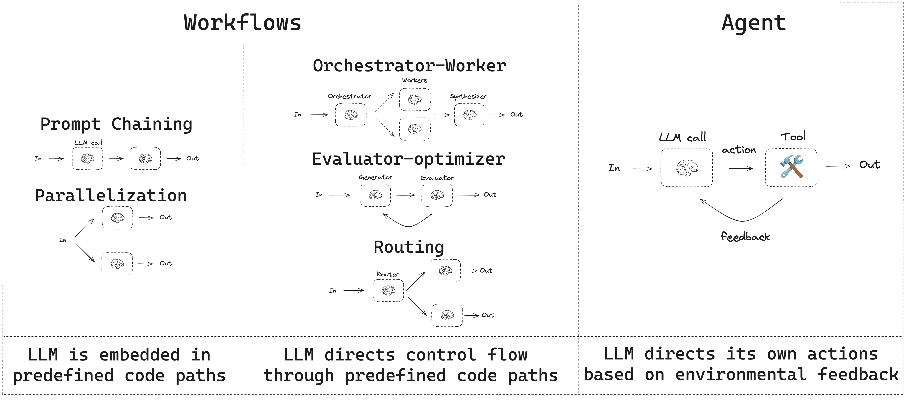
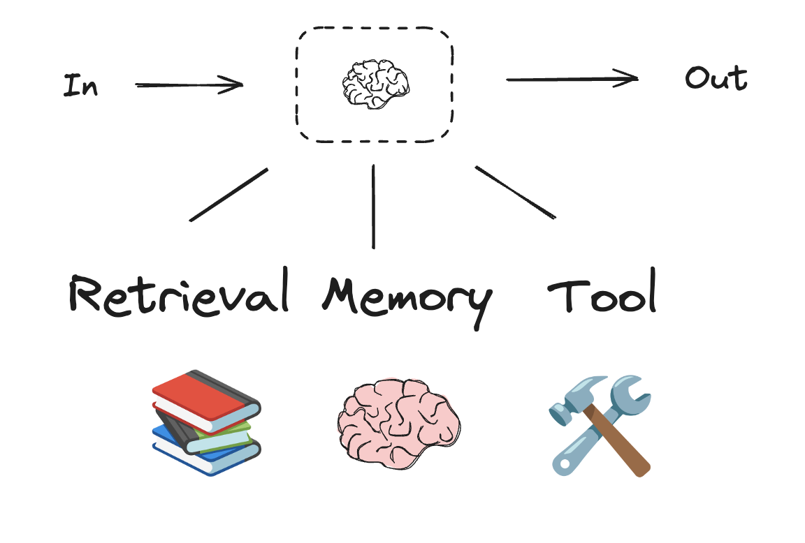
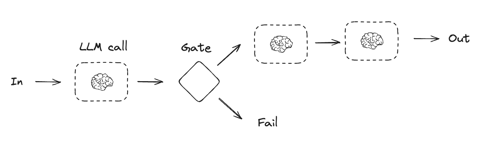
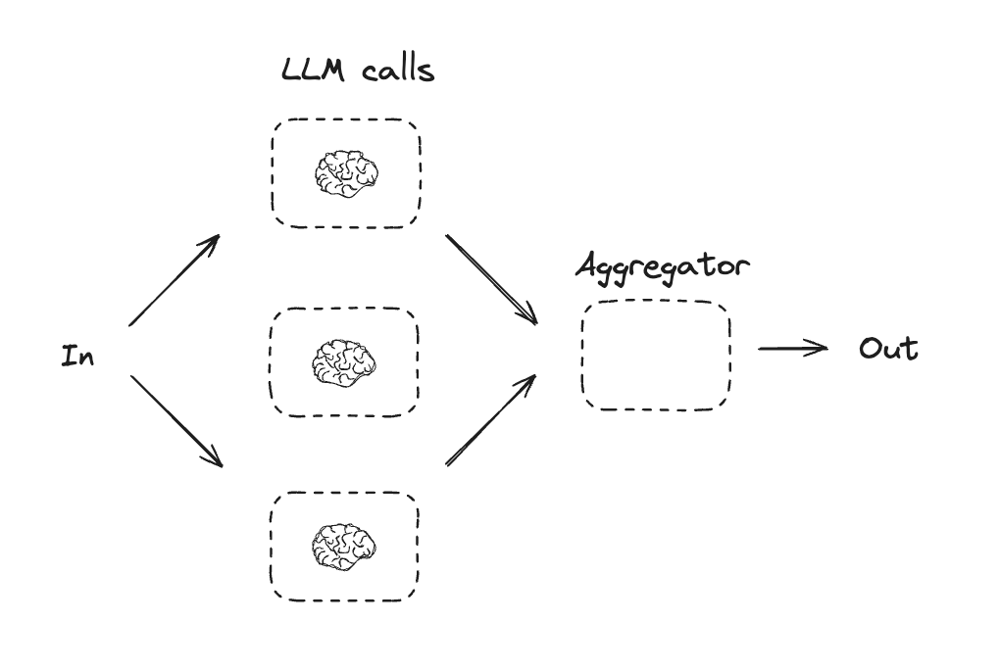
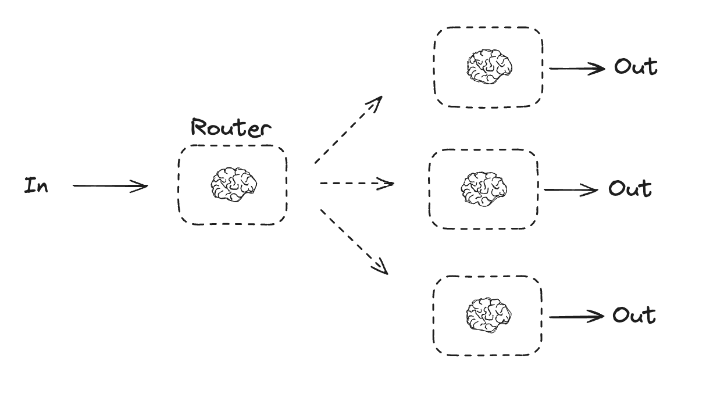
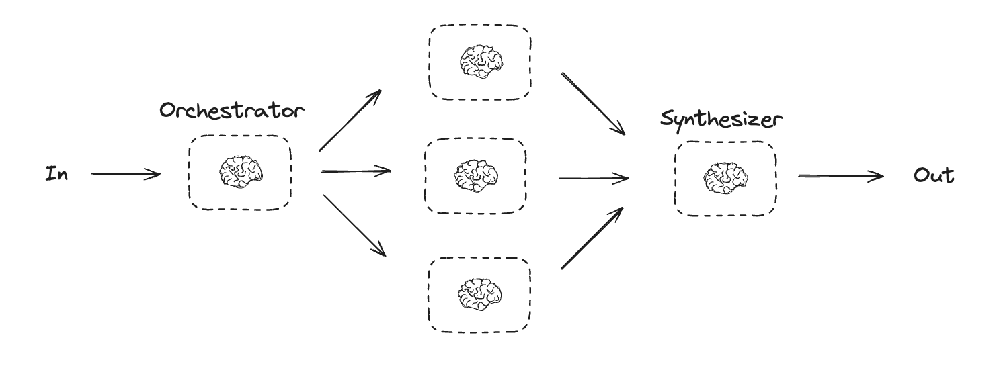
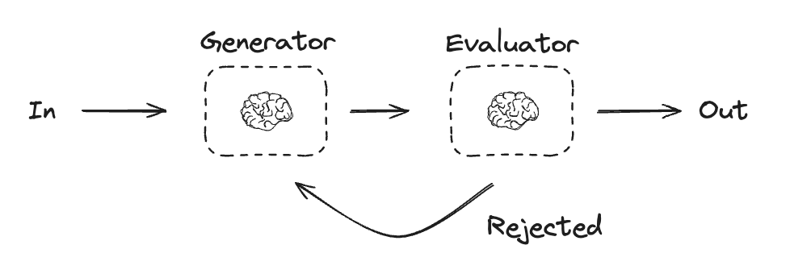
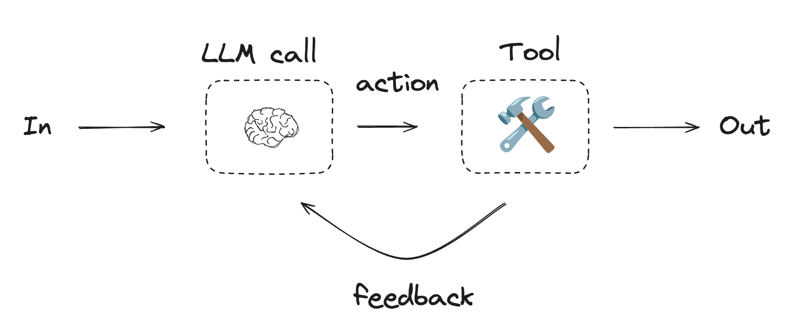

import WorkflowsAgentsToolRuntimeStateContextPy from '/snippets/code-samples/workflows-agents-tool-runtime-state-context-py.mdx';
import WorkflowsAgentsToolRuntimeStateContextJs from '/snippets/code-samples/workflows-agents-tool-runtime-state-context-js.mdx';

本指南介绍常见的工作流与智能体模式。

- 工作流具有预定的代码路径，并按特定顺序运行。
- 智能体是动态的，自行定义流程和工具使用方式。



在构建智能体和工作流时，LangGraph 提供多项优势，包括[持久化](/oss/langgraph/persistence)、[流式传输](/oss/langgraph/streaming)、调试支持以及[部署](/oss/langgraph/deploy)。

<Tip>
用 [LangSmith](https://smith.langchain.com) 追踪并比较这些工作流模式。按照[追踪快速入门](/langsmith/trace-with-langgraph)了解数据如何流经每个步骤。建议同时设置 [LangSmith Engine](/langsmith/engine)，它会监视你的追踪记录、检测问题并提出修复方案。
</Tip>

## 设置

要构建工作流或智能体，可以使用任何支持结构化输出和工具调用的[聊天模型](/oss/integrations/chat)。以下示例使用 Anthropic：

:::python
1. 安装依赖项：
```bash
pip install langchain_core langchain-anthropic langgraph
```

2. 初始化 LLM：

```python
import os
import getpass

from langchain_anthropic import ChatAnthropic

def _set_env(var: str):
    if not os.environ.get(var):
        os.environ[var] = getpass.getpass(f"{var}: ")


_set_env("ANTHROPIC_API_KEY")

llm = ChatAnthropic(model="claude-sonnet-4-6")
```
:::

:::js
1. 安装依赖项
<CodeGroup>
```bash npm
npm install @langchain/langgraph @langchain/core
```

```bash pnpm
pnpm add @langchain/langgraph @langchain/core
```

```bash yarn
yarn add @langchain/langgraph @langchain/core
```

```bash bun
bun add @langchain/langgraph @langchain/core
```
</CodeGroup>

2. 初始化 LLM：

```typescript
import { ChatAnthropic } from "@langchain/anthropic";

const llm = new ChatAnthropic({
  model: "claude-sonnet-4-6",
  apiKey: "<your_anthropic_key>"
});
```
:::

## LLM 与增强

工作流和智能体系统以 LLM 为基础，并依赖你为其添加的各种增强能力。[工具调用](/oss/langchain/tools)、[结构化输出](/oss/langchain/structured-output)和[短期记忆](/oss/langchain/short-term-memory)是几种按需定制 LLM 的方式。



:::python
```python
# Schema for structured output
from pydantic import BaseModel, Field


class SearchQuery(BaseModel):
    search_query: str | None = Field(
        default=None, description="Query that is optimized web search."
    )
    justification: str | None = Field(
        default=None, description="Why this query is relevant to the user's request."
    )


# Augment the LLM with schema for structured output
structured_llm = llm.with_structured_output(SearchQuery)

# Invoke the augmented LLM
output = structured_llm.invoke("How does Calcium CT score relate to high cholesterol?")
print(output)  # The model returns an instance of SearchQuery.

# Define a tool
def multiply(a: int, b: int) -> int:
    return a * b

# Augment the LLM with tools
llm_with_tools = llm.bind_tools([multiply])

# Invoke the LLM with input that triggers the tool call
msg = llm_with_tools.invoke("What is 2 times 3?")
print(msg.tool_calls)  # The model returns a request to call the tool.
```
:::
:::js
```typescript

import * as z from "zod";
import { tool } from "langchain";

// Schema for structured output
const SearchQuery = z.object({
  search_query: z.string().describe("Query that is optimized web search."),
  justification: z
    .string()
    .describe("Why this query is relevant to the user's request."),
});

// Augment the LLM with schema for structured output
const structuredLlm = llm.withStructuredOutput(SearchQuery);

// Invoke the augmented LLM
const output = await structuredLlm.invoke(
  "How does Calcium CT score relate to high cholesterol?"
);

// Define a tool
const multiply = tool(
  ({ a, b }) => {
    return a * b;
  },
  {
    name: "multiply",
    description: "Multiply two numbers",
    schema: z.object({
      a: z.number(),
      b: z.number(),
    }),
  }
);

// Augment the LLM with tools
const llmWithTools = llm.bindTools([multiply]);

// Invoke the LLM with input that triggers the tool call
const msg = await llmWithTools.invoke("What is 2 times 3?");

// Get the tool call
console.log(msg.tool_calls);
```
:::

## 提示链

提示链是指每个 LLM 调用都处理上一次调用的输出。它通常用于执行定义明确、可拆分为更小且可验证步骤的任务。常见示例包括：

- 将文档翻译成不同语言
- 验证生成内容的一致性



:::python
```python
from typing_extensions import TypedDict
from langgraph.graph import StateGraph, START, END
from IPython.display import Image, display


# Graph state
class State(TypedDict):
    topic: str
    joke: str
    improved_joke: str
    final_joke: str


# Nodes
def generate_joke(state: State):
    """First LLM call to generate initial joke"""

    msg = llm.invoke(f"Write a short joke about {state['topic']}")
    return {"joke": msg.content}


def check_punchline(state: State):
    """Gate function to check if the joke has a punchline"""

    # Simple check - does the joke contain "?" or "!"
    if "?" in state["joke"] or "!" in state["joke"]:
        return "Pass"
    return "Fail"


def improve_joke(state: State):
    """Second LLM call to improve the joke"""

    msg = llm.invoke(f"Make this joke funnier by adding wordplay: {state['joke']}")
    return {"improved_joke": msg.content}


def polish_joke(state: State):
    """Third LLM call for final polish"""
    msg = llm.invoke(f"Add a surprising twist to this joke: {state['improved_joke']}")
    return {"final_joke": msg.content}


# Build workflow
workflow = StateGraph(State)

# Add nodes
workflow.add_node("generate_joke", generate_joke)
workflow.add_node("improve_joke", improve_joke)
workflow.add_node("polish_joke", polish_joke)

# Add edges to connect nodes
workflow.add_edge(START, "generate_joke")
workflow.add_conditional_edges(
    "generate_joke", check_punchline, {"Fail": "improve_joke", "Pass": END}
)
workflow.add_edge("improve_joke", "polish_joke")
workflow.add_edge("polish_joke", END)

# Compile
chain = workflow.compile()

# Show workflow
display(Image(chain.get_graph().draw_mermaid_png()))

# Invoke
state = chain.invoke({"topic": "cats"})
print("Initial joke:")
print(state["joke"])
print("\n--- --- ---\n")
if "improved_joke" in state:
    print("Improved joke:")
    print(state["improved_joke"])
    print("\n--- --- ---\n")

    print("Final joke:")
    print(state["final_joke"])
else:
    print("Final joke:")
    print(state["joke"])
```
:::

:::js
```typescript
import { StateGraph, StateSchema, GraphNode, ConditionalEdgeRouter } from "@langchain/langgraph";
import { z } from "zod/v4";

// Graph state
const State = new StateSchema({
  topic: z.string(),
  joke: z.string(),
  improvedJoke: z.string(),
  finalJoke: z.string(),
});

// Define node functions

// First LLM call to generate initial joke
const generateJoke: GraphNode<typeof State> = async (state) => {
  const msg = await llm.invoke(`Write a short joke about ${state.topic}`);
  return { joke: msg.content };
};

// Gate function to check if the joke has a punchline
const checkPunchline: ConditionalEdgeRouter<{ InputSchema: typeof State; Nodes: "improveJoke" }> = (state) => {
  // Simple check - does the joke contain "?" or "!"
  if (state.joke?.includes("?") || state.joke?.includes("!")) {
    return "Pass";
  }
  return "Fail";
};

// Second LLM call to improve the joke
const improveJoke: GraphNode<typeof State> = async (state) => {
  const msg = await llm.invoke(
    `Make this joke funnier by adding wordplay: ${state.joke}`
  );
  return { improvedJoke: msg.content };
};

// Third LLM call for final polish
const polishJoke: GraphNode<typeof State> = async (state) => {
  const msg = await llm.invoke(
    `Add a surprising twist to this joke: ${state.improvedJoke}`
  );
  return { finalJoke: msg.content };
};

// Build workflow
const chain = new StateGraph(State)
  .addNode("generateJoke", generateJoke)
  .addNode("improveJoke", improveJoke)
  .addNode("polishJoke", polishJoke)
  .addEdge("__start__", "generateJoke")
  .addConditionalEdges("generateJoke", checkPunchline, {
    Pass: "improveJoke",
    Fail: "__end__"
  })
  .addEdge("improveJoke", "polishJoke")
  .addEdge("polishJoke", "__end__")
  .compile();

// Invoke
const state = await chain.invoke({ topic: "cats" });
console.log("Initial joke:");
console.log(state.joke);
console.log("\n--- --- ---\n");
if (state.improvedJoke !== undefined) {
  console.log("Improved joke:");
  console.log(state.improvedJoke);
  console.log("\n--- --- ---\n");

  console.log("Final joke:");
  console.log(state.finalJoke);
} else {
  console.log("Joke failed quality gate - no punchline detected!");
}
```
:::

## 并行化

通过并行化，多个 LLM 可以同时处理一项任务。既可以同时运行多个独立的子任务，也可以多次运行同一任务以检查不同的输出。并行化通常用于：

- 拆分并并行运行子任务，以提高速度
- 多次运行任务以检查不同输出，从而提高置信度

常见示例包括：

- 运行一个子任务处理文档中的关键词，再运行另一个子任务检查格式错误
- 多次运行同一任务，按不同标准为文档的准确性评分，例如引用数量、使用的来源数量以及来源质量



:::python
```python
# Graph state
class State(TypedDict):
    topic: str
    joke: str
    story: str
    poem: str
    combined_output: str


# Nodes
def call_llm_1(state: State):
    """First LLM call to generate initial joke"""

    msg = llm.invoke(f"Write a joke about {state['topic']}")
    return {"joke": msg.content}


def call_llm_2(state: State):
    """Second LLM call to generate story"""

    msg = llm.invoke(f"Write a story about {state['topic']}")
    return {"story": msg.content}


def call_llm_3(state: State):
    """Third LLM call to generate poem"""

    msg = llm.invoke(f"Write a poem about {state['topic']}")
    return {"poem": msg.content}


def aggregator(state: State):
    """Combine the joke, story and poem into a single output"""

    combined = f"Here's a story, joke, and poem about {state['topic']}!\n\n"
    combined += f"STORY:\n{state['story']}\n\n"
    combined += f"JOKE:\n{state['joke']}\n\n"
    combined += f"POEM:\n{state['poem']}"
    return {"combined_output": combined}


# Build workflow
parallel_builder = StateGraph(State)

# Add nodes
parallel_builder.add_node("call_llm_1", call_llm_1)
parallel_builder.add_node("call_llm_2", call_llm_2)
parallel_builder.add_node("call_llm_3", call_llm_3)
parallel_builder.add_node("aggregator", aggregator)

# Add edges to connect nodes
parallel_builder.add_edge(START, "call_llm_1")
parallel_builder.add_edge(START, "call_llm_2")
parallel_builder.add_edge(START, "call_llm_3")
parallel_builder.add_edge("call_llm_1", "aggregator")
parallel_builder.add_edge("call_llm_2", "aggregator")
parallel_builder.add_edge("call_llm_3", "aggregator")
parallel_builder.add_edge("aggregator", END)
parallel_workflow = parallel_builder.compile()

# Show workflow
display(Image(parallel_workflow.get_graph().draw_mermaid_png()))

# Invoke
state = parallel_workflow.invoke({"topic": "cats"})
print(state["combined_output"])
```
:::

:::js
```typescript
import { StateGraph, StateSchema, GraphNode } from "@langchain/langgraph";
import * as z from "zod";

// Graph state
const State = new StateSchema({
  topic: z.string(),
  joke: z.string(),
  story: z.string(),
  poem: z.string(),
  combinedOutput: z.string(),
});

// Nodes
// First LLM call to generate initial joke
const callLlm1: GraphNode<typeof State> = async (state) => {
  const msg = await llm.invoke(`Write a joke about ${state.topic}`);
  return { joke: msg.content };
};

// Second LLM call to generate story
const callLlm2: GraphNode<typeof State> = async (state) => {
  const msg = await llm.invoke(`Write a story about ${state.topic}`);
  return { story: msg.content };
};

// Third LLM call to generate poem
const callLlm3: GraphNode<typeof State> = async (state) => {
  const msg = await llm.invoke(`Write a poem about ${state.topic}`);
  return { poem: msg.content };
};

// Combine the joke, story and poem into a single output
const aggregator: GraphNode<typeof State> = async (state) => {
  const combined = `Here's a story, joke, and poem about ${state.topic}!\n\n` +
    `STORY:\n${state.story}\n\n` +
    `JOKE:\n${state.joke}\n\n` +
    `POEM:\n${state.poem}`;
  return { combinedOutput: combined };
};

// Build workflow
const parallelWorkflow = new StateGraph(State)
  .addNode("callLlm1", callLlm1)
  .addNode("callLlm2", callLlm2)
  .addNode("callLlm3", callLlm3)
  .addNode("aggregator", aggregator)
  .addEdge("__start__", "callLlm1")
  .addEdge("__start__", "callLlm2")
  .addEdge("__start__", "callLlm3")
  .addEdge("callLlm1", "aggregator")
  .addEdge("callLlm2", "aggregator")
  .addEdge("callLlm3", "aggregator")
  .addEdge("aggregator", "__end__")
  .compile();

// Invoke
const result = await parallelWorkflow.invoke({ topic: "cats" });
console.log(result.combinedOutput);
```
:::

## 路由

路由工作流先处理输入，再把输入分派到与上下文相关的特定任务。这样就可以为复杂任务定义专门的流程。例如，用于回答产品相关问题的工作流可以先判断问题类型，再把请求路由到定价、退款、退货等特定流程。



:::python
```python
from typing_extensions import Literal
from langchain.messages import HumanMessage, SystemMessage


# Schema for structured output to use as routing logic
class Route(BaseModel):
    step: Literal["poem", "story", "joke"] = Field(
        None, description="The next step in the routing process"
    )


# Augment the LLM with schema for structured output
router = llm.with_structured_output(Route)


# State
class State(TypedDict):
    input: str
    decision: str
    output: str


# Nodes
def llm_call_1(state: State):
    """Write a story"""

    result = llm.invoke(state["input"])
    return {"output": result.content}


def llm_call_2(state: State):
    """Write a joke"""

    result = llm.invoke(state["input"])
    return {"output": result.content}


def llm_call_3(state: State):
    """Write a poem"""

    result = llm.invoke(state["input"])
    return {"output": result.content}


def llm_call_router(state: State):
    """Route the input to the appropriate node"""

    # Run the augmented LLM with structured output to serve as routing logic
    decision = router.invoke(
        [
            SystemMessage(
                content="Route the input to story, joke, or poem based on the user's request."
            ),
            HumanMessage(content=state["input"]),
        ]
    )

    return {"decision": decision.step}


# Conditional edge function to route to the appropriate node
def route_decision(state: State):
    # Return the node name you want to visit next
    if state["decision"] == "story":
        return "llm_call_1"
    elif state["decision"] == "joke":
        return "llm_call_2"
    elif state["decision"] == "poem":
        return "llm_call_3"


# Build workflow
router_builder = StateGraph(State)

# Add nodes
router_builder.add_node("llm_call_1", llm_call_1)
router_builder.add_node("llm_call_2", llm_call_2)
router_builder.add_node("llm_call_3", llm_call_3)
router_builder.add_node("llm_call_router", llm_call_router)

# Add edges to connect nodes
router_builder.add_edge(START, "llm_call_router")
router_builder.add_conditional_edges(
    "llm_call_router",
    route_decision,
    {  # Name returned by route_decision : Name of next node to visit
        "llm_call_1": "llm_call_1",
        "llm_call_2": "llm_call_2",
        "llm_call_3": "llm_call_3",
    },
)
router_builder.add_edge("llm_call_1", END)
router_builder.add_edge("llm_call_2", END)
router_builder.add_edge("llm_call_3", END)

# Compile workflow
router_workflow = router_builder.compile()

# Show the workflow
display(Image(router_workflow.get_graph().draw_mermaid_png()))

# Invoke
state = router_workflow.invoke({"input": "Write me a joke about cats"})
print(state["output"])
```
:::

:::js
```typescript
import { StateGraph, StateSchema, GraphNode, ConditionalEdgeRouter } from "@langchain/langgraph";
import * as z from "zod";

// Schema for structured output to use as routing logic
const routeSchema = z.object({
  step: z.enum(["poem", "story", "joke"]).describe(
    "The next step in the routing process"
  ),
});

// Augment the LLM with schema for structured output
const router = llm.withStructuredOutput(routeSchema);

// Graph state
const State = new StateSchema({
  input: z.string(),
  decision: z.string(),
  output: z.string(),
});

// Nodes
// Write a story
const llmCall1: GraphNode<typeof State> = async (state) => {
  const result = await llm.invoke([{
    role: "system",
    content: "You are an expert storyteller.",
  }, {
    role: "user",
    content: state.input
  }]);
  return { output: result.content };
};

// Write a joke
const llmCall2: GraphNode<typeof State> = async (state) => {
  const result = await llm.invoke([{
    role: "system",
    content: "You are an expert comedian.",
  }, {
    role: "user",
    content: state.input
  }]);
  return { output: result.content };
};

// Write a poem
const llmCall3: GraphNode<typeof State> = async (state) => {
  const result = await llm.invoke([{
    role: "system",
    content: "You are an expert poet.",
  }, {
    role: "user",
    content: state.input
  }]);
  return { output: result.content };
};

const llmCallRouter: GraphNode<typeof State> = async (state) => {
  // Route the input to the appropriate node
  const decision = await router.invoke([
    {
      role: "system",
      content: "Route the input to story, joke, or poem based on the user's request."
    },
    {
      role: "user",
      content: state.input
    },
  ]);

  return { decision: decision.step };
};

// Conditional edge function to route to the appropriate node
const routeDecision: ConditionalEdgeRouter<{ InputSchema: typeof State; Nodes: "llmCall1" | "llmCall2" | "llmCall3" }> = (state) => {
  // Return the node name you want to visit next
  if (state.decision === "story") {
    return "llmCall1";
  } else if (state.decision === "joke") {
    return "llmCall2";
  } else {
    return "llmCall3";
  }
};

// Build workflow
const routerWorkflow = new StateGraph(State)
  .addNode("llmCall1", llmCall1)
  .addNode("llmCall2", llmCall2)
  .addNode("llmCall3", llmCall3)
  .addNode("llmCallRouter", llmCallRouter)
  .addEdge("__start__", "llmCallRouter")
  .addConditionalEdges(
    "llmCallRouter",
    routeDecision,
    ["llmCall1", "llmCall2", "llmCall3"],
  )
  .addEdge("llmCall1", "__end__")
  .addEdge("llmCall2", "__end__")
  .addEdge("llmCall3", "__end__")
  .compile();

// Invoke
const state = await routerWorkflow.invoke({
  input: "Write me a joke about cats"
});
console.log(state.output);
```
:::

## 编排器-工作者

在编排器-工作者配置中，编排器会：

- 将任务拆分为子任务
- 把子任务委派给工作者
- 将工作者的输出合成为最终结果



编排器-工作者工作流更灵活，常用于子任务无法像[并行化](#parallelization)那样预先定义的场景。这对于编写代码或需要跨多个文件更新内容的工作流很常见。例如，需要在数量未知的文档中更新多个 Python 库安装说明的工作流，可能会采用这种模式。

:::python
```python
from typing import Annotated, List
import operator


# Schema for structured output to use in planning
class Section(BaseModel):
    name: str = Field(
        description="Name for this section of the report.",
    )
    description: str = Field(
        description="Brief overview of the main topics and concepts to be covered in this section.",
    )


class Sections(BaseModel):
    sections: List[Section] = Field(
        description="Sections of the report.",
    )


# Augment the LLM with schema for structured output
planner = llm.with_structured_output(Sections)
```
:::

:::js
```typescript

type SectionSchema = {
    name: string;
    description: string;
}
type SectionsSchema = {
    sections: SectionSchema[];
}

// Augment the LLM with schema for structured output
const planner = llm.withStructuredOutput(sectionsSchema);
```
:::

### 在 LangGraph 中创建工作者

编排器-工作者工作流很常见，LangGraph 为其提供了内置支持。`Send` API 可以动态创建工作节点，并向它们发送特定输入。每个工作者都有自己的状态，所有工作者的输出都会写入编排器图可访问的共享状态键。这样编排器就能访问所有工作者的输出，并将它们合成为最终输出。下面的示例遍历章节列表，并使用 `Send` API 把每一章发送给一个工作者。


:::python
```python
from langgraph.types import Send


# Graph state
class State(TypedDict):
    topic: str  # Report topic
    sections: list[Section]  # List of report sections
    completed_sections: Annotated[
        list, operator.add
    ]  # All workers write to this key in parallel
    final_report: str  # Final report


# Worker state
class WorkerState(TypedDict):
    section: Section
    completed_sections: Annotated[list, operator.add]


# Nodes
def orchestrator(state: State):
    """Orchestrator that generates a plan for the report"""

    # Generate queries
    report_sections = planner.invoke(
        [
            SystemMessage(content="Generate a plan for the report."),
            HumanMessage(content=f"Here is the report topic: {state['topic']}"),
        ]
    )

    return {"sections": report_sections.sections}


def llm_call(state: WorkerState):
    """Worker writes a section of the report"""

    # Generate section
    section = llm.invoke(
        [
            SystemMessage(
                content="Write a report section following the provided name and description. Include no preamble for each section. Use markdown formatting."
            ),
            HumanMessage(
                content=f"Here is the section name: {state['section'].name} and description: {state['section'].description}"
            ),
        ]
    )

    # Write the updated section to completed sections
    return {"completed_sections": [section.content]}


def synthesizer(state: State):
    """Synthesize full report from sections"""

    # List of completed sections
    completed_sections = state["completed_sections"]

    # Format completed section to str to use as context for final sections
    completed_report_sections = "\n\n---\n\n".join(completed_sections)

    return {"final_report": completed_report_sections}


# Conditional edge function to create llm_call workers that each write a section of the report
def assign_workers(state: State):
    """Assign a worker to each section in the plan"""

    # Kick off section writing in parallel via Send() API
    return [Send("llm_call", {"section": s}) for s in state["sections"]]


# Build workflow
orchestrator_worker_builder = StateGraph(State)

# Add the nodes
orchestrator_worker_builder.add_node("orchestrator", orchestrator)
orchestrator_worker_builder.add_node("llm_call", llm_call)
orchestrator_worker_builder.add_node("synthesizer", synthesizer)

# Add edges to connect nodes
orchestrator_worker_builder.add_edge(START, "orchestrator")
orchestrator_worker_builder.add_conditional_edges(
    "orchestrator", assign_workers, ["llm_call"]
)
orchestrator_worker_builder.add_edge("llm_call", "synthesizer")
orchestrator_worker_builder.add_edge("synthesizer", END)

# Compile the workflow
orchestrator_worker = orchestrator_worker_builder.compile()

# Show the workflow
display(Image(orchestrator_worker.get_graph().draw_mermaid_png()))

# Invoke
state = orchestrator_worker.invoke({"topic": "Create a report on LLM scaling laws"})

from IPython.display import Markdown
Markdown(state["final_report"])
```
:::
:::js
```typescript
import { StateGraph, StateSchema, ReducedValue, GraphNode, Send } from "@langchain/langgraph";
import * as z from "zod";

// Graph state
const State = new StateSchema({
  topic: z.string(),
  sections: z.array(z.custom<SectionsSchema>()),
  completedSections: new ReducedValue(
    z.array(z.string()).default(() => []),
    { reducer: (a, b) => a.concat(b) }
  ),
  finalReport: z.string(),
});

// Worker state
const WorkerState = new StateSchema({
  section: z.custom<SectionsSchema>(),
  completedSections: new ReducedValue(
    z.array(z.string()).default(() => []),
    { reducer: (a, b) => a.concat(b) }
  ),
});

// Nodes
const orchestrator: GraphNode<typeof State> = async (state) => {
  // Generate queries
  const reportSections = await planner.invoke([
    { role: "system", content: "Generate a plan for the report." },
    { role: "user", content: `Here is the report topic: ${state.topic}` },
  ]);

  return { sections: reportSections.sections };
};

const llmCall: GraphNode<typeof WorkerState> = async (state) => {
  // Generate section
  const section = await llm.invoke([
    {
      role: "system",
      content: "Write a report section following the provided name and description. Include no preamble for each section. Use markdown formatting.",
    },
    {
      role: "user",
      content: `Here is the section name: ${state.section.name} and description: ${state.section.description}`,
    },
  ]);

  // Write the updated section to completed sections
  return { completedSections: [section.content] };
};

const synthesizer: GraphNode<typeof State> = async (state) => {
  // List of completed sections
  const completedSections = state.completedSections;

  // Format completed section to str to use as context for final sections
  const completedReportSections = completedSections.join("\n\n---\n\n");

  return { finalReport: completedReportSections };
};

// Conditional edge function to create llm_call workers that each write a section of the report
const assignWorkers: ConditionalEdgeRouter<{ InputSchema: typeof State; Nodes: "llmCall" }> = (state) => {
  // Kick off section writing in parallel via Send() API
  return state.sections.map((section) =>
    new Send("llmCall", { section })
  );
};

// Build workflow
const orchestratorWorker = new StateGraph(State)
  .addNode("orchestrator", orchestrator)
  .addNode("llmCall", llmCall)
  .addNode("synthesizer", synthesizer)
  .addEdge("__start__", "orchestrator")
  .addConditionalEdges(
    "orchestrator",
    assignWorkers,
    ["llmCall"]
  )
  .addEdge("llmCall", "synthesizer")
  .addEdge("synthesizer", "__end__")
  .compile();

// Invoke
const state = await orchestratorWorker.invoke({
  topic: "Create a report on LLM scaling laws"
});
console.log(state.finalReport);
```
:::

## 评估器-优化器

在评估器-优化器工作流中，一个 LLM 调用生成响应，另一个 LLM 调用评估该响应。如果评估器或 [human-in-the-loop](/oss/langgraph/interrupts) 判断响应需要改进，就会提供反馈并重新生成响应。这个循环会持续到生成可接受的响应为止。

当任务有特定的成功标准，但需要迭代才能满足该标准时，通常会使用评估器-优化器工作流。例如，在两种语言之间翻译文本并不总有完美对应，可能需要几轮迭代才能得到两种语言含义相同的译文。



:::python
```python
# Graph state
class State(TypedDict):
    joke: str
    topic: str
    feedback: str
    funny_or_not: str


# Schema for structured output to use in evaluation
class Feedback(BaseModel):
    grade: Literal["funny", "not funny"] = Field(
        description="Decide if the joke is funny or not.",
    )
    feedback: str = Field(
        description="If the joke is not funny, provide feedback on how to improve it.",
    )


# Augment the LLM with schema for structured output
evaluator = llm.with_structured_output(Feedback)


# Nodes
def llm_call_generator(state: State):
    """LLM generates a joke"""

    if state.get("feedback"):
        msg = llm.invoke(
            f"Write a joke about {state['topic']} but take into account the feedback: {state['feedback']}"
        )
    else:
        msg = llm.invoke(f"Write a joke about {state['topic']}")
    return {"joke": msg.content}


def llm_call_evaluator(state: State):
    """LLM evaluates the joke"""

    grade = evaluator.invoke(f"Grade the joke {state['joke']}")
    return {"funny_or_not": grade.grade, "feedback": grade.feedback}


# Conditional edge function to route back to joke generator or end based upon feedback from the evaluator
def route_joke(state: State):
    """Route back to joke generator or end based upon feedback from the evaluator"""

    if state["funny_or_not"] == "funny":
        return "Accepted"
    elif state["funny_or_not"] == "not funny":
        return "Rejected + Feedback"


# Build workflow
optimizer_builder = StateGraph(State)

# Add the nodes
optimizer_builder.add_node("llm_call_generator", llm_call_generator)
optimizer_builder.add_node("llm_call_evaluator", llm_call_evaluator)

# Add edges to connect nodes
optimizer_builder.add_edge(START, "llm_call_generator")
optimizer_builder.add_edge("llm_call_generator", "llm_call_evaluator")
optimizer_builder.add_conditional_edges(
    "llm_call_evaluator",
    route_joke,
    {  # Name returned by route_joke : Name of next node to visit
        "Accepted": END,
        "Rejected + Feedback": "llm_call_generator",
    },
)

# Compile the workflow
optimizer_workflow = optimizer_builder.compile()

# Show the workflow
display(Image(optimizer_workflow.get_graph().draw_mermaid_png()))

# Invoke
state = optimizer_workflow.invoke({"topic": "Cats"})
print(state["joke"])
```
:::

:::js
```typescript
import { StateGraph, StateSchema, GraphNode, ConditionalEdgeRouter } from "@langchain/langgraph";
import * as z from "zod";

// Graph state
const State = new StateSchema({
  joke: z.string(),
  topic: z.string(),
  feedback: z.string(),
  funnyOrNot: z.string(),
});

// Schema for structured output to use in evaluation
const feedbackSchema = z.object({
  grade: z.enum(["funny", "not funny"]).describe(
    "Decide if the joke is funny or not."
  ),
  feedback: z.string().describe(
    "If the joke is not funny, provide feedback on how to improve it."
  ),
});

// Augment the LLM with schema for structured output
const evaluator = llm.withStructuredOutput(feedbackSchema);

// Nodes
const llmCallGenerator: GraphNode<typeof State> = async (state) => {
  // LLM generates a joke
  let msg;
  if (state.feedback) {
    msg = await llm.invoke(
      `Write a joke about ${state.topic} but take into account the feedback: ${state.feedback}`
    );
  } else {
    msg = await llm.invoke(`Write a joke about ${state.topic}`);
  }
  return { joke: msg.content };
};

const llmCallEvaluator: GraphNode<typeof State> = async (state) => {
  // LLM evaluates the joke
  const grade = await evaluator.invoke(`Grade the joke ${state.joke}`);
  return { funnyOrNot: grade.grade, feedback: grade.feedback };
};

// Conditional edge function to route back to joke generator or end based upon feedback from the evaluator
const routeJoke: ConditionalEdgeRouter<{ InputSchema: typeof State; Nodes: "llmCallGenerator" }> = (state) => {
  // Route back to joke generator or end based upon feedback from the evaluator
  if (state.funnyOrNot === "funny") {
    return "Accepted";
  } else {
    return "Rejected + Feedback";
  }
};

// Build workflow
const optimizerWorkflow = new StateGraph(State)
  .addNode("llmCallGenerator", llmCallGenerator)
  .addNode("llmCallEvaluator", llmCallEvaluator)
  .addEdge("__start__", "llmCallGenerator")
  .addEdge("llmCallGenerator", "llmCallEvaluator")
  .addConditionalEdges(
    "llmCallEvaluator",
    routeJoke,
    {
      // Name returned by routeJoke : Name of next node to visit
      "Accepted": "__end__",
      "Rejected + Feedback": "llmCallGenerator",
    }
  )
  .compile();

// Invoke
const state = await optimizerWorkflow.invoke({ topic: "Cats" });
console.log(state.joke);
```
:::

## 智能体

智能体通常实现为使用[工具](/oss/langchain/tools)执行操作的 LLM。它们在持续的反馈循环中运行，适用于问题和解决方案都不可预测的场景。智能体比工作流拥有更多自主权，可以决定使用哪些工具以及如何解决问题。你仍然可以定义可用的工具集以及智能体的行为准则。



<Note>
要开始使用智能体，请参阅[快速入门](/oss/langchain/quickstart)，或阅读 LangChain 中关于[智能体工作原理](/oss/langchain/agents)的更多内容。
</Note>

:::python
```python Using tools
from langchain.tools import tool


# Define tools
@tool
def multiply(a: int, b: int) -> int:
    """Multiply `a` and `b`.

    Args:
        a: First int
        b: Second int
    """
    return a * b


@tool
def add(a: int, b: int) -> int:
    """Adds `a` and `b`.

    Args:
        a: First int
        b: Second int
    """
    return a + b


@tool
def divide(a: int, b: int) -> float:
    """Divide `a` and `b`.

    Args:
        a: First int
        b: Second int
    """
    return a / b


# Augment the LLM with tools
tools = [add, multiply, divide]
tools_by_name = {tool.name: tool for tool in tools}
llm_with_tools = llm.bind_tools(tools)
```

```python
from langgraph.graph import MessagesState
from langchain.messages import SystemMessage, HumanMessage, ToolMessage


# Nodes
def llm_call(state: MessagesState):
    """LLM decides whether to call a tool or not"""

    return {
        "messages": [
            llm_with_tools.invoke(
                [
                    SystemMessage(
                        content="You are a helpful assistant tasked with performing arithmetic on a set of inputs."
                    )
                ]
                + state["messages"]
            )
        ]
    }


def tool_node(state: MessagesState):
    """Performs the tool call"""

    result = []
    for tool_call in state["messages"][-1].tool_calls:
        tool = tools_by_name[tool_call["name"]]
        observation = tool.invoke(tool_call["args"])
        result.append(ToolMessage(content=observation, tool_call_id=tool_call["id"]))
    return {"messages": result}


# Conditional edge function to route to the tool node or end based upon whether the LLM made a tool call
def should_continue(state: MessagesState) -> Literal["tool_node", END]:
    """Decide if we should continue the loop or stop based upon whether the LLM made a tool call"""

    messages = state["messages"]
    last_message = messages[-1]

    # If the LLM makes a tool call, then perform an action
    if last_message.tool_calls:
        return "tool_node"

    # Otherwise, we stop (reply to the user)
    return END


# Build workflow
agent_builder = StateGraph(MessagesState)

# Add nodes
agent_builder.add_node("llm_call", llm_call)
agent_builder.add_node("tool_node", tool_node)

# Add edges to connect nodes
agent_builder.add_edge(START, "llm_call")
agent_builder.add_conditional_edges(
    "llm_call",
    should_continue,
    ["tool_node", END]
)
agent_builder.add_edge("tool_node", "llm_call")

# Compile the agent
agent = agent_builder.compile()

# Show the agent
display(Image(agent.get_graph(xray=True).draw_mermaid_png()))

# Invoke
messages = [HumanMessage(content="Add 3 and 4.")]
messages = agent.invoke({"messages": messages})
for m in messages["messages"]:
    m.pretty_print()
```
:::

:::js
```typescript Using tools
import { tool } from "@langchain/core/tools";
import * as z from "zod";

// Define tools
const multiply = tool(
  ({ a, b }) => {
    return a * b;
  },
  {
    name: "multiply",
    description: "Multiply two numbers together",
    schema: z.object({
      a: z.number().describe("first number"),
      b: z.number().describe("second number"),
    }),
  }
);

const add = tool(
  ({ a, b }) => {
    return a + b;
  },
  {
    name: "add",
    description: "Add two numbers together",
    schema: z.object({
      a: z.number().describe("first number"),
      b: z.number().describe("second number"),
    }),
  }
);

const divide = tool(
  ({ a, b }) => {
    return a / b;
  },
  {
    name: "divide",
    description: "Divide two numbers",
    schema: z.object({
      a: z.number().describe("first number"),
      b: z.number().describe("second number"),
    }),
  }
);

// Augment the LLM with tools
const tools = [add, multiply, divide];
const toolsByName = Object.fromEntries(tools.map((tool) => [tool.name, tool]));
const llmWithTools = llm.bindTools(tools);
```

```typescript
import { StateGraph, StateSchema, MessagesValue, GraphNode, ConditionalEdgeRouter } from "@langchain/langgraph";
import { ToolNode } from "@langchain/langgraph/prebuilt";
import {
  SystemMessage,
  ToolMessage
} from "@langchain/core/messages";

// Graph state
const State = new StateSchema({
  messages: MessagesValue,
});

// Nodes
const llmCall: GraphNode<typeof State> = async (state) => {
  // LLM decides whether to call a tool or not
  const result = await llmWithTools.invoke([
    {
      role: "system",
      content: "You are a helpful assistant tasked with performing arithmetic on a set of inputs."
    },
    ...state.messages
  ]);

  return {
    messages: [result]
  };
};

const toolNode = new ToolNode(tools);

// Conditional edge function to route to the tool node or end
const shouldContinue: ConditionalEdgeRouter<{ InputSchema: typeof State; Nodes: "toolNode" }> = (state) => {
  const messages = state.messages;
  const lastMessage = messages.at(-1);

  // If the LLM makes a tool call, then perform an action
  if (lastMessage?.tool_calls?.length) {
    return "toolNode";
  }
  // Otherwise, we stop (reply to the user)
  return "__end__";
};

// Build workflow
const agentBuilder = new StateGraph(State)
  .addNode("llmCall", llmCall)
  .addNode("toolNode", toolNode)
  // Add edges to connect nodes
  .addEdge("__start__", "llmCall")
  .addConditionalEdges(
    "llmCall",
    shouldContinue,
    ["toolNode", "__end__"]
  )
  .addEdge("toolNode", "llmCall")
  .compile();

// Invoke
const messages = [{
  role: "user",
  content: "Add 3 and 4."
}];
const result = await agentBuilder.invoke({ messages });
console.log(result.messages);
```
:::

### ToolNode

@[`ToolNode`] 是一个预构建节点，用于在 LangGraph 工作流中执行工具。它会自动处理并行工具执行、错误处理和状态注入。

当需要精细控制图的工具执行方式时，请使用 @[`ToolNode`]。它是许多 LangGraph 智能体模式中支撑工具执行的构建块。

:::python

```python
from langchain.tools import tool
from langgraph.prebuilt import ToolNode
from langgraph.graph import MessagesState, StateGraph

@tool
def search(query: str) -> str:
    """Search for information."""
    return f"Results for: {query}"

@tool
def calculator(expression: str) -> str:
    """Evaluate a math expression."""
    return str(eval(expression))

builder = StateGraph(MessagesState)
builder.add_node("tools", ToolNode([search, calculator]))
# ... add other nodes and edges
graph = builder.compile()
```

:::

:::js

```typescript
import { ToolNode } from "@langchain/langgraph/prebuilt";
import { tool } from "@langchain/core/tools";
import * as z from "zod";

const search = tool(
  ({ query }) => `Results for: ${query}`,
  {
    name: "search",
    description: "Search for information.",
    schema: z.object({ query: z.string() }),
  }
);

const calculator = tool(
  ({ expression }) => String(eval(expression)),
  {
    name: "calculator",
    description: "Evaluate a math expression.",
    schema: z.object({ expression: z.string() }),
  }
);

const toolNode = new ToolNode([search, calculator]);
```

:::

#### 从工具访问图状态和上下文

由 `ToolNode` 执行的工具会把模型生成的参数作为第一个参数接收。如需读取并非由模型生成的图侧数据，可使用以下方式之一：

- 在 Python 中，从注入的 @[`ToolRuntime`] 参数读取状态和运行范围内的上下文。
- 在 JavaScript 中，从工具的第二个参数读取状态和运行范围内的上下文，该参数的类型为 @[`ToolRuntime`]。

<Note>
工具只能访问传递给 `ToolNode` 的状态值。当 `ToolNode` 直接作为 `StateGraph` 节点添加时，该输入就是当前的图状态。如果从另一个节点手动调用 `ToolNode`，在工具需要自定义状态字段时要传入完整状态。例如，`tool_node.invoke(state)` 或 `toolNode.invoke(state, config)` 可访问完整状态，而只传 `{"messages": state["messages"]}` 或 `{ messages: state.messages }` 时只能访问 `messages`。
</Note>

:::python

<WorkflowsAgentsToolRuntimeStateContextPy />

:::

:::js

<WorkflowsAgentsToolRuntimeStateContextJs />

:::
