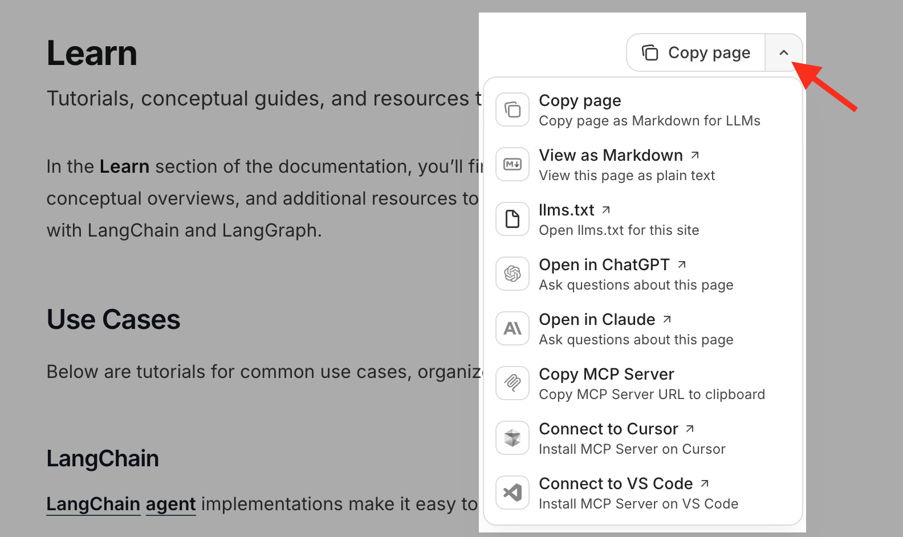
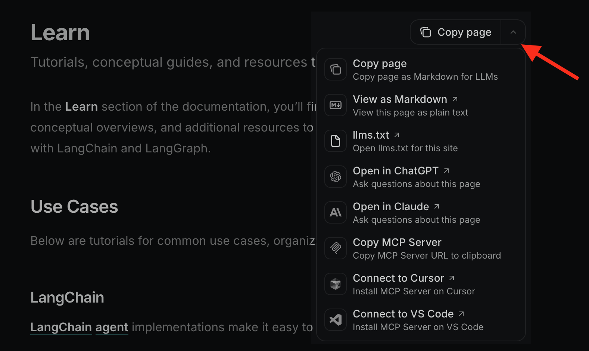

import ConnectDocsMcpPrompt from '/snippets/connect-docs-mcp-prompt.mdx';

LangChain 致力于让文档尽可能易于访问。你可以通过 AI 助手、代码编辑器以及 Model Context Protocol (MCP) 等直接集成方式，以编程方式使用这些文档。

## 快速访问选项

在文档的任意页面右上角，你都可以找到一个上下文菜单下拉框：





其中包含 `llms.txt`、MCP 服务器连接，以及 ChatGPT 和 Claude 等其他快速访问选项。

## 使用 MCP 服务器

<ConnectDocsMcpPrompt />

我们的文档提供两个互补的 **Model Context Protocol (MCP) 服务器**，让 AI 应用能够实时查询 LangChain 内容。为了获得最佳效果，我们建议同时连接这两个服务器：

| 服务器 | URL | 涵盖内容 |
|--------|-----|----------------|
| `docs-langchain` | `https://docs.langchain.com/mcp` | LangChain、LangGraph 和 LangSmith 的概念指南、操作指南、教程和产品文档 |
| `reference-langchain` | `https://reference.langchain.com/mcp` | API reference：所有 LangChain packages 的类、方法、参数和签名 |

同时添加两者，你的 coding agent 就能获得完整的信息：来自指南的**原因与方式**，以及来自 reference 文档的**精确 API 细节**。

### 连接到 Claude Code

如果你在使用 Claude Code，请在终端中运行以下命令，将两个服务器添加到当前项目：

```bash
claude mcp add --transport http docs-langchain https://docs.langchain.com/mcp
claude mcp add --transport http reference-langchain https://reference.langchain.com/mcp
```

<Note>
    **项目（本地）作用域**

    上面的命令只会将 MCP 服务器添加到当前项目或工作目录。若要全局添加 MCP 服务器并在所有项目中访问，请在命令中加入 `--scope user`：

    ```bash
    claude mcp add --transport http docs-langchain --scope user https://docs.langchain.com/mcp
    claude mcp add --transport http reference-langchain --scope user https://reference.langchain.com/mcp
    ```
</Note>

### 连接到 Claude Desktop

1. 打开 Claude Desktop
2. 前往 Settings > Connectors
3. 添加两个 MCP 服务器 URL：
   - `https://docs.langchain.com/mcp`
   - `https://reference.langchain.com/mcp`

### 连接到 Codex CLI

如果你在使用 OpenAI Codex CLI，请在终端中运行以下命令，全局添加这两个服务器：

```sh
codex mcp add langchain-docs --url https://docs.langchain.com/mcp
codex mcp add langchain-reference --url https://reference.langchain.com/mcp
```

### 连接到 Cursor

将以下内容添加到 MCP 设置配置文件中：

```json
{
  "mcpServers": {
    "docs-langchain": {
      "url": "https://docs.langchain.com/mcp"
    },
    "reference-langchain": {
      "url": "https://reference.langchain.com/mcp"
    }
  }
}
```

### 连接到 Deep Agents Code

将两个服务器添加到用户级 `~/.deepagents/.mcp.json` 文件，使其在每个 Deep Agents Code 项目中都可用；或者将它们添加到项目级 `.mcp.json` 文件，仅对当前项目生效：

```json
{
  "mcpServers": {
    "docs-langchain": {
      "type": "http",
      "url": "https://docs.langchain.com/mcp"
    },
    "reference-langchain": {
      "type": "http",
      "url": "https://reference.langchain.com/mcp"
    }
  }
}
```

启动或重启 `dcode` 以加载服务器。在交互式会话中，运行 `/mcp` 可查看服务器状态和已加载的工具。有关发现位置和优先级规则，请参阅 [MCP tools](/oss/deepagents/code/mcp-tools)。

### 连接到 VS Code

将以下内容添加到 MCP 设置配置文件中：

```json
{
  "servers": {
    "docs-langchain": {
      "url": "https://docs.langchain.com/mcp"
    },
    "reference-langchain": {
      "url": "https://reference.langchain.com/mcp"
    }
  }
}
```

### 连接到 Antigravity

将以下内容添加到 MCP 设置配置文件中：

```json
{
  "mcpServers": {
    "docs-langchain": {
      "serverUrl": "https://docs.langchain.com/mcp"
    },
    "reference-langchain": {
      "serverUrl": "https://reference.langchain.com/mcp"
    }
  }
}
```

## 了解更多

有关如何使用 Mintlify 的 MCP 服务器的更多信息，请参见 [Mintlify 官方文档](https://www.mintlify.com/docs/ai/model-context-protocol)。

如果你有问题或反馈，请前往我们的 [社区论坛](https://forum.langchain.com/)。
